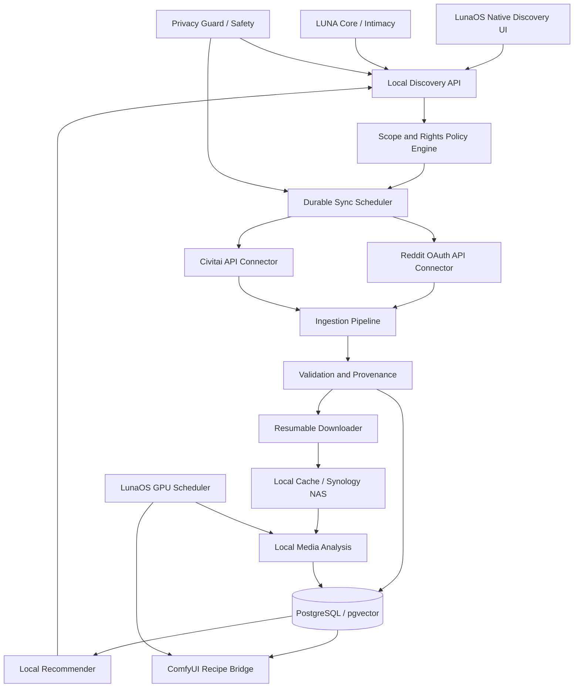

# LunaOS 1.0 — MONT BLANC | Codex Unified Master Specification

**Document:** `LUNAOS_MONT_BLANC_1_0_CODEX_UNIFIED_SPEC.md`  
**Revision:** `2026-10-23 / consolidated + iPhone Sync + Claude Code acceleration`  
**Status:** **APPROVED PRODUCT REQUIREMENTS / NOT IMPLEMENTED / NOT RELEASED**  
**Language:** English, implementation-oriented  
**Target:** x86_64 personal workstation (Ryzen 9 5950X, RTX 3080 Ti 12 GB, 32 GB RAM, NVMe, optional RTX 3070 and Synology NAS)  
**Build host:** MacBook Air M2 coordinating remote SSH builds on Linux  
**Shipping objective:** eight-week feature-complete target and twelve-week conditional stable release from October 26, 2026; no release without all privacy, hardware and acceptance gates.

> **Read this before the annexes.** Sections U0–U21 are the CURRENT authoritative decisions and implementation contract. Legacy source specifications are embedded in full after the annex divider for implementation detail, not equal-authority policy. In any inconsistency, the CURRENT sections override legacy annexes. Codex must add automated tests proving the latest behavior.

## U0. Product intent, boundaries and source of truth

LunaOS is an AI-native local-first Linux desktop; LUNA is its autonomous personal assistant. LUNA **is not the user's sexual partner**, and may discuss adult sexuality directly, curate legally accessible adult media, learn specifically authorized preferences, and create legal fictional adult media through ComfyUI. The user explicitly does not want a primarily voice-driven computer: preserve conventional keyboard/mouse/windows. Desktop is flat black, no wallpaper or desktop icons, slim lower text bar, subtle LUNA presence. Design visuals used previously are conceptual, not a mandate for a neon/photo background.

**Scope is complete in v1, including native iPhone USB-C sync (U20):** bootable/recoverable Linux distribution, graphical desktop, local LLM, model routing/cloud fallback controls, voice, user-context perception, memory, autonomous agents, system action broker, safety controller, GPU/VRAM broker, ComfyUI, storage/NAS, and the **entire** Intimacy Core: private preferences, memory, dialogue, adult discovery/indexing, multimodal tagging/search/recommender, adult creation, proactive recommendations, Private Identity Vault, Body Profile, face recognition, automatic/adaptive BLIND MODE, identity-scoped consent.

### Source-of-truth priority

1. This consolidated document **U0–U21**, specifically current visual learning/consent/BLIND rules and approved questions.
2. Validated safety/privacy principles, platform permissions, data-subject consent, applicable law.
3. Legacy master specification (embedded Annex A).
4. Legacy Discovery engineering specification (Annex B).
5. Legacy Series 25 BLIND learning specification (Annex C).
6. Historical earlier full spec for supplemental detail (Annex D).

Latest decisions supersede older text requiring BLIND to always preempt *even a deliberately authorized live body-scan session*: scoped, actively enabled `AUTHORIZED_CAPTURE_SESSION` may temporarily override **nudity-triggered auto-BLIND** for the **enrolled/consenting subject and authorized scopes** only. Explicit manual BLIND, revocation, an unknown person in an intimate frame, sensor uncertainty, and consent expiry still override collection. Outside this session, automatic genital-exposure detection enters BLIND immediately. A persistent consent grant **does not automatically activate every camera session**; there must be a visible active capture mode, physical device permissions, and an identifiable consented subject. In all cases, a BLIND transition stops image/acoustic/screen pipelines and prevents storage.

### Decisions traceability

- **Series 21:** 27 yes / 3 no. No universal confirmation requirement for destructive actions, no requested general undo history, no voice-first UI. Enforce independent least-privilege safety limits, system recovery, snapshot-before-update, and full technical audit regardless.
- **NSFWAI Discovery:** 29 yes / 1 no. **NO indiscriminate exploration of every Civitai NSFW category**. Allowlisted/configured tags, creators, categories, model families and sources only, with opt-in expansion.
- **Series 23:** adult personal preferences as user-declared *sensitive design inputs*, **NOT automatically injected into generic assistant memory or code/model training**. Explicit current instructions: assistant—not romantic partner; natural/direct/crude vocabulary acceptable; lingerie important, photorealism preferred, videos long, gradual novelty, local and discrete operation. Do not treat any user preference as proof of an offline action or consent to copy intimate imagery.
- **Series 25:** imports and authorized webcam capture; renewable explicit consent for others; statistically validated training stop; if no longer collecting for training, only continue captures under an explicit separate persistent ongoing-capture authorization; training data retained encrypted; face and intimate-scene detectors independent; simple progress status.
- **Latest approved:** create multi-person **LUNA Private Identity Vault** with separate per-person face, body, intimate-capture, storage and ML-training permissions; third party can grant **persistent** scope-specific consent via a dedicated popup click or by saying “OK, je valide,” with verified linkage to consenting person and with revocation. Disclosure **must explicitly mention nudity, genital areas and retention of intimate pictures**, not merely facial recognition. LUNA may analyze and quietly capture **consenting** subjects only, within granted scope. A quiet photo does not mean hidden camera operation or covert acquisition from nonconsenting bystanders.
- **Series 22 & 24:** questionnaire decisions **NOT submitted**; use safe documented defaults behind options, track pending ADRs. Do not invent user approvals.


## U20. Native LUNA iPhone Sync — USB-C auto-connect (P0)

**Status:** Approved product requirement, NOT implemented; applies to Mont Blanc 1.0. On insertion of a trusted iPhone via USB-C, LunaOS must automatically synchronize accessible photos/videos, create a verified encrypted local iPhone backup, extract contacts when technically supported, and optionally archive WhatsApp records that are verifiably available in an authorized backup. Sync to Synology encrypted storage is conditional on configured policy and connectivity. Never promise full access to iPhone application databases.

### U20.1. Scope and platform reality

- Use Linux `udev` -> `usbmuxd` -> `libimobiledevice` device discovery / trust pairing, and `ifuse` or an equivalent supported **read-only media/AFC** interface. Check upstream version compatibility and known ifuse regressions; test on actual iOS release. USB transport is not equivalent to unrestricted filesystem access.
- `idevicebackup2` or a verified compatible native tool provides local-device backup if supported by the connected iOS version; encryption enablement and backup operation may require iPhone unlock/passcode and existing backup password. Never bypass passcode, encryption, app sandbox, USB pairing, or Apple trust dialogs. Initial setup requires owner intervention.
- WhatsApp chat databases **are not available directly over ordinary AFC media access**. Availability through encrypted Finder/iTunes-style backup varies by app/iOS settings, device state, app backups and encryption. Treat `WHATSAPP_ARCHIVE` as capability-gated: extract only where lawful and technically confirmed with user-supplied authorization/backup password, otherwise mark `BLOCKED_BY_PLATFORM` or `NOT_PRESENT_IN_BACKUP`, not success. Offer official WhatsApp export as supported user-initiated fallback; never scrape devices or circumvent protections. Chats of other participants are private and not automatically fed to general memory or the Intimacy Core.
- Contacts may be recovered via a successful authorized full/local backup and a compatible local parser. Account-synced contacts and iCloud-managed data may be absent. Surface coverage and source; default to **read-only local archive**, not editing/replacing iPhone contacts.
- iCloud Photos optimized storage may exclude full-resolution files; iCloud Messages/photos not downloaded to the device may be absent from USB transfer. Report **actual manifest coverage** and missing sources without inventing completion.

### U20.2. Service decomposition

```text
udev/systemd device attach
  -> luna-device-broker (restricted USB identity, pairing, Trust states)
  -> luna-iphone-sync (per-device idempotent orchestration)
      |-- media-importer (DCIM, HEIC/JPEG/RAW, MOV/MP4, Live Photo pairing)
      |-- ios-backup-worker (encrypted local backup, incremental if supported)
      |-- contacts-extractor (authorized backup content; capability-gated)
      |-- whatsapp-archive-adapter (backup/export only; may be unavailable)
      |-- integrity-verifier (hashes, manifest, resumable copy, restore-readiness)
      |-- nas-replicator (encrypted and opt-in; queue when offline)
  -> notifications + native device panel
```

Connect from LUNA core through typed IPC; no LLM shell access to iOS device, pairing record, archive decryption key or USB transport. Manage jobs in existing durable scheduler and reserve IO/CPU so ComfyUI does not stall. Per-device mutual exclusion; job cancellation on unplug.

### U20.3. Required first-run user experience and connection policy

1. USB attach detects the iPhone and stable pseudonymous device identifier. Never dump UDID, pair records or personal metadata to analytics/logs.
2. If untrusted, show **"Unlock iPhone and Trust This Computer"**; pause safely pending handset confirmation. Prompt for any backup-encryption password through trusted secure input only; never place it in command-line arguments or logs.
3. On first successful pairing, display independently configurable scopes: `[photos/videos] [encrypted iPhone backup] [contacts local archive] [WhatsApp archive when available] [encrypted NAS replica]`; explain each source, limitations, retention and data locations. Persistent opt-in per-device; revoke or pause anytime. The user-requested default is automatic execution of approved scopes on subsequent USB-C connections.
4. On subsequent attaches, start new permitted work immediately after trust/unlock permits; show progress, last verified run, last failed stage, storage, integrity verification and per-source coverage.
5. On disconnect, stop reads, fsync completed chunks, update checkpoint, release mount, mark `PAUSED_DEVICE_UNPLUGGED`. On reconnect, resume idempotently; no partial file marked complete.
6. After every completed job, create a signed/hashed manifest indicating each dataset `COMPLETE_VERIFIED`, `PARTIAL`, `NOT_SUPPORTED`, `NOT_AVAILABLE`, or `BLOCKED_BY_PLATFORM`. One category's failure does not block verified media import.

### U20.4. Data architecture and privacy

Mandatory PostgreSQL entities (secrets stored separately):

```sql
CREATE TABLE ios_devices (
  id UUID PRIMARY KEY, pseudonymous_id TEXT UNIQUE NOT NULL,
  display_name TEXT, first_paired_at TIMESTAMPTZ, last_seen_at TIMESTAMPTZ,
  authorized_scopes JSONB NOT NULL DEFAULT '{}'::jsonb,
  revoked_at TIMESTAMPTZ
);
CREATE TABLE ios_sync_runs (
  id UUID PRIMARY KEY, device_id UUID NOT NULL REFERENCES ios_devices(id),
  started_at TIMESTAMPTZ NOT NULL, ended_at TIMESTAMPTZ,
  status TEXT NOT NULL, source_coverage JSONB NOT NULL DEFAULT '{}'::jsonb,
  failure_code TEXT, manifest_uri TEXT
);
CREATE TABLE ios_media_items (
  id UUID PRIMARY KEY, device_id UUID NOT NULL REFERENCES ios_devices(id),
  source_path_hash TEXT NOT NULL, logical_asset_id TEXT,
  sha256 TEXT NOT NULL, bytes BIGINT NOT NULL,
  captured_at TIMESTAMPTZ, content_type TEXT, archive_uri TEXT NOT NULL,
  verified_at TIMESTAMPTZ, UNIQUE(device_id, source_path_hash, sha256)
);
CREATE TABLE ios_backup_sets (
  id UUID PRIMARY KEY, device_id UUID NOT NULL REFERENCES ios_devices(id),
  created_at TIMESTAMPTZ NOT NULL, ios_version TEXT,
  encrypted BOOLEAN NOT NULL, backup_uri TEXT NOT NULL,
  verified_at TIMESTAMPTZ, coverage JSONB NOT NULL DEFAULT '{}'::jsonb
);
CREATE TABLE ios_sync_checkpoints (
  device_id UUID NOT NULL REFERENCES ios_devices(id),
  dataset TEXT NOT NULL, cursor_json JSONB NOT NULL DEFAULT '{}'::jsonb,
  updated_at TIMESTAMPTZ NOT NULL, PRIMARY KEY(device_id, dataset)
);
```

Stored media: `vault/iphone/<pseudonymous_device_id>/media/`, separate `backup/`, separate `contacts/` and `whatsapp_exports/`. Use encryption-at-rest for all backups and sensitive archives; store encryption keys in protected local secret manager; per-device or per-dataset key separation. Encrypt NAS replicas end-to-end prior to upload; avoid raw private photos on an unencrypted Synology share. Treat Live Photos as paired original components and preserve provenance/EXIF, creation time and edits where readable. Save EXIF securely; do not publish location metadata by default.

**Privacy boundary:** Importing an iPhone photo does NOT grant LUNA permission to classify intimate anatomy, enroll other people, create facial embeddings, learn preferences or reuse images for ComfyUI. iPhone archive is a private backup domain, not NSFWAI Discovery or LUNA Intimacy training. All cross-vault transfers require **explicit per-person, per-purpose grants** described in U1 and the specific media item rights. Thumbnails and backups must not trigger background face/body training. Delete/export according to independent retention controls.

### U20.5. Backups, integrity and failure policy

- Snapshot-like staging directory, incremental backup only after verifying prior manifest, checked free-space margin (minimum estimated payload + 20%), atomic rename on verified completion. Preserve last known-good backup; no automatic deletion on iPhone.
- Chunk-aware media copy with checksum (device read limitations may require size/metadata compare plus repeated local hash), write-to-temp then atomic commit; detect renamed/moved files and exact duplicates.
- Encrypted iOS backup policy must not silently downgrade to unencrypted when encryption is unsupported. Mark blocked and notify; do not claim comprehensive backup.
- Verify backup manifest parseability, encrypted state, file hashes/checksums and **periodic restore-readiness checks** using a non-destructive inspection method. Do not initiate a physical restore autonomously.
- Physical USB disconnect, iPhone lock, permission revoked, disk-full, NAS outage, damaged file, changed iOS API, wrong backup password -> resumable categorized failures, independently retryable stages, never mass-remove prior archive.
- Source data retention configurable; use encrypted local staging, strict umask, no plaintext swap or core dumps for backup credentials, secrets redacted from events.

### U20.6. Device UI and autonomy

Native desktop panel `LUNA iPhone Sync` with device name (user-local), pairing state, USB connection, data-type toggles, last backup timestamp, storage cost, NAS replica state, encryption indicator, per-dataset coverage and typed error messages. Optional quiet completion notification. No surprise sync into the intimate vault. Explain blocked WhatsApp data explicitly, without offering unlawful extraction/bypass.

### U20.7. Test & acceptance suite — release blocking

1. Device attach starts sync on approved trusted iPhone without extra desktop clicks; unknown device remains unauthorized.
2. First pairing requires Trust/unlock on actual iPhone; no fake-pairing path or passcode bypass.
3. Media import preserves HEIC, JPEG, video, RAW (where accessible), Live Photo pairs, EXIF and duplicate policy.
4. Second unchanged connection transfers no duplicate payload; modified/new media imported.
5. Unplug mid-transfer and mid-backup: clean stop, no corrupted committed files, successful resumable recovery.
6. iOS encrypted backup created and verified *on tested actual hardware/iOS combination*; unsupported versions clearly reported.
7. Wrong/missing backup password never logged or sent to model; no plaintext fallback.
8. Local contacts archive accurately reports partial/missing data and never alters phone contacts.
9. WhatsApp archive workflow passes only with real available authorized data; not available is visibly and accurately declared, not silently fabricated.
10. iCloud-only/optimized photos accurately reported as missing from local import.
11. Synology outage and storage exhaustion do not destroy locally verified backups; queued replica resumes.
12. iPhone photos do not flow into Intimacy/BLIND learning or face identity matching without required explicit grants.
13. Revocation cancels new sync; deletion/export scopes and old backups behave as documented.
14. Repeated plug/unplug, 24h soak, concurrent ComfyUI load, idempotence, and permission-boundary tests run on real target workstation.
15. Dashboard accurately marks unsupported OS-specific access as a limitation. Test CI fixtures cannot substitute for real iOS device runs.

### U20.8. Official capability references to verify during implementation

- libimobiledevice: https://libimobiledevice.org/ and https://cgit.sukimashita.com/libimobiledevice.git/tree/tools/idevicebackup2.c
- ifuse: https://github.com/libimobiledevice/ifuse (avoid known buggy release 1.2.0; validate patched release)
- Apple iOS backup content, device Trust/pairing and iCloud coverage: review current official Apple docs during implementation.
- WhatsApp export and backup inclusion: verify against current official WhatsApp/Apple support and actual encrypted backup contents; no undocumented guaranteed app-database access.

## U21. Claude Code 24/7 engineering execution contract (P0 delivery process)

**Primary autonomous coding engine:** Claude Code, operated continuously with supervised automation, parallel isolated worktrees, scheduled backlog dispatch and CI. Codex-oriented specs remain tool-agnostic; Claude Code is the intended executor, and both may consume this master file.

The system can run without a developer typing every command, but **"24/7" means persistent orchestration, not infallible independent engineering**. Tool sessions may end, costs/API quotas may exhaust, and hardware/authentication/consent tasks require a human. On failure, checkpoint and resume; never claim hours of actual code generation not backed by commits and tests.

### U21.1. Agent topology and dependency management

```text
ORCHESTRATOR (single backlog owner, task claims, credits and stop limits)
  +-- OS / installer / recovery agent
  +-- LUNA core / models / agents / UI agent
  +-- GPU / ComfyUI / media agent
  +-- Vault / consent / BLIND / body profile agent
  +-- Discovery / search / recommendations agent
  +-- iPhone USB sync / archive agent
  +-- CI / tests / integration agent
  +-- Security reviewer agent (independent read-only review)
```

- One task = one issue with acceptance criteria + verification command + changed-file ownership; agent holds an explicit claim/lease. Agent worktrees and feature branches are isolated; merge through a serialized integration queue after unit/contract/integration tests.
- Run parallel agents on independent modules, **not all heavyweight tests or training jobs in parallel on a 12GB GPU**. Per-host resource scheduler reserves GPU VRAM, storage bandwidth, CPU, free disk and physical USB device access.
- Continuous schedule: tasks claimed whenever a worker becomes free; bounded tokens/spend, concurrency cap, exponential backoff for API errors and context limits. Prefer recoverable agent invocations managed by systemd, queue and a transparent cost/status dashboard.
- Enforce explicit privileged command policy, dry-run on disks, no autonomous repartitioning or reboot of critical user machine, no silent app-account login, no unattended use of intimate data as development fixtures. Hardware-assisted installs and external approval may pause one lane while independent lanes progress.
- Each integration merge must produce source diff, relevant actual test output, observed runtime metrics and updated feature matrix with statuses `PASS`, `FAIL`, `BLOCKED_EXTERNAL`, `NOT_TESTED`. Do not confuse authored tests with passed tests.

### U21.2. Parallel development gates (fast path)

- **W1:** repository inventory, module contracts, runnable Linux UI boot prototype, queues, security/privacy baseline, USB/iPhone capability spike.
- **W2–W3:** independent functional vertical slices: OS boot/recovery; LUNA core; encrypted vault/privacy controller; GPU/ComfyUI; media Discovery; iPhone photos and pairing.
- **W4–W5:** integrate agents/model router/voice; consent and independent detectors; permitted body learning; NAS; encrypted iPhone backup and contacts; indexed recommendations and NSFW Core.
- **W6–W8:** full Mont Blanc P0 feature integration, non-mock E2E exercises, real iPhone and real camera hardware paths, legal/provider capabilities; feature-complete gate if tests pass.
- **W9–W12:** adversarial privacy tests, burn-in, hardware recovery drills, real backup-readability checks, iOS unplug/resume, GPU concurrency, API quotas and signed stable packaging, **if gate criteria pass**.

Target: **feature complete 8 weeks**, conditional **stable at 12 weeks** after kickoff. If P0 tests fail, continue iterations; no fake ready status or silent feature cuts. Unlike earlier year-plus estimates, this is an intentionally high-risk execution target enabled by maximum reuse and parallel always-on development; do not misrepresent it as statistically guaranteed.

### U21.3. Agent instruction starter

```text
You are a Claude Code implementation agent for LunaOS 1.0 Mont Blanc.
Read the UNIFIED master spec U0–U21 before coding; U0–U21 overrides legacy annexes.
Implement one claimed milestone slice with real code and tests. Use an isolated worktree.
Do not produce mocks or placeholders as shipping deliverables.
Record exact commands and evidence. No protected-device disk changes without human approval.
Never retain or replay real intimate video as test data; use consented synthetic fixtures.
If external service or iOS application data is inaccessible, report BLOCKED_EXTERNAL.
Submit changes for CI, integration and independent privacy review.
```

## U1. Non-negotiable safety/privacy invariants

1. **No persistent intimate capture or biometric enrollment of an unconsenting third party.** An owner's standing authorization cannot consent for a guest or bystander.
2. New persons default to `UNKNOWN_NO_CONSENT`. The system may detect a generic human/presence ephemerally to manage privacy but cannot infer their identity, sexual traits, age or willingness from appearance.
3. **No intimate capture/recognition/training on known or suspected minors**. Unknown or uncertain adulthood -> no capture, no intimate profile, suspend private-body analysis. The generic privacy trigger may blind without preserving why.
4. Consent is per-person, per-purpose, explicit, informed, revocable, and renewable. Grant expiry and withdrawal are effective immediately at the camera broker, job scheduler, vault and model registry. “Permanent” means **no repeated prompts while a valid grant remains active**, not irrevocable.
5. Clear separate scopes: `FACE_REFERENCE`, `FACE_RECOGNITION`, `BODY_PROFILE`, `INTIMATE_VIEW`, `INTIMATE_STILL_CAPTURE`, `INTIMATE_VIDEO_CAPTURE`, `INTIMATE_DATA_RETENTION`, `TRAINING_FACE`, `TRAINING_BODY`, `TRAINING_BLIND`, `ONGOING_AUTONOMOUS_CAPTURE`, `NAS_ENCRYPTED_BACKUP`, `GENERATION_REFERENCE`. No implicit scope escalation.
6. Consent popup shows what data, how acquired, local encryption/retention, AI learning, any NAS backup, revocation, and whether webcam may silently acquire shots while visible capture mode is on. Intimate scopes explicitly say **nudity, penis/genitals, buttocks** and storage of intimate images. Agreement to face recognition does not grant any intimate scope.
7. Clicking consent requires direct action by the actual person; voice “OK, je valide” is allowed only through the active on-screen challenge associated with that subject. **A voice phrase alone cannot prove identity**; use local supervised enrollment + randomly spoken challenge or equivalent anti-replay mechanism, and fall back to on-screen subject-controlled confirmation if certainty is insufficient. Denial/no response = no consent. No biometric enrollment solely to verify an unenrolled speaker.
8. User and other subjects can view, pause, revoke, export and delete own records. Implement per-subject key destruction, cascade deletion for derivatives/models, cache purges, NAS backup deletion ledger, bounded retention disclosures. Retain only minimum non-intimate compliance audit evidence needed to verify a grant/revocation, never intimate media in audit.
9. **BLIND wins over LUNA's desires, agents or generated code.** Once BLIND active: no camera, microphone, desktop/screen perception, memory intake, hidden screenshot, training capture, embeddings, remote egress or intimate event telemetry. It exits **only via direct explicit user action**, e.g. button **“Ouvrir les yeux 👀”** or verified accessible manual control. Do not allow LLM to bypass it.
10. No ordinary screenshots of entire screens while intimate media is open; separate virtual safe desktop zones, screen-share masking, and enforce screen capture permissions. No unexpected OS thumbnail caches.
11. All sensitive ML input/output including embeddings, thumbnails, derived body descriptors and weights must remain encrypted at rest and local by default; cloud upload denied, including debugging, analytics and tracing. Don't leak secrets into logs or backups.
12. BODY PROFILE is a description of consented visible anatomy, not an objective diagnosis or a precise measurement without a reference scale. No inference of personality, sexual desire, consent or health diagnosis from anatomy. Safety messaging for concerning changes remains uncertain and non-diagnostic.
13. Externally sourced adult content must be lawful, adult, permitted by provider terms, licensed for the requested use. Disallow minors, nonconsensual intimate imagery, deceptive real-person sexual impersonation and unauthorized redistribution.
14. Independent system safety controls and disaster recovery remain required even though user opted against universal destructive-action confirmations and general-purpose undo history.

## U2. Reference implementation architecture

```text
UEFI / bootloader / Linux kernel / systemd / recovery image
    |-- Wayland / Hyprland + luna-shell + luna-ui-engine
    |-- luna-core + local model router + planner + agents (sandboxed)
    |-- luna-action-broker (scoped root operations; Rust) + independent guardian
    |-- luna-voice + luna-perception (all mediated by sensor brokers)
    |-- luna-resource-broker (CPU, RTX 3080 Ti 12G, secondary GPU, VRAM, power)
    |-- luna-comfyui + workflow registry + model manager
    |-- luna-memory (general relational/vector store)
    |-- luna-intimacy-core (isolated sensitive domain)
    |     |-- luna-nsfwai-discovery (Reddit OAuth/Civitai API plugins)
    |     |-- adult local index + multimodal analysis + recommender
    |     |-- luna-private-identity-vault (encrypted subject compartments)
    |     |-- luna-body-profile (authorized stills/video-derived observations)
    |     |-- luna-face-recognition (opted-in, independently bounded)
    |     |-- luna-blind-detector (ephemeral local anatomy/scene detector)
    |     |-- luna-training-manager (offline training, validation and promotion)
    |     `-- luna-consent-service (subject-scoped consent lifecycle)
    |-- luna-camera-broker, luna-screen-broker, luna-audio-broker
    `-- luna-privacy-controller (higher priority than LLM, enforced IPC cut-off)
        |-- BLIND latching + hardware/devices/screencapture ACLs
        `-- “Ouvrir les yeux 👀” shell-only restore action
```

**Trust domains:** `system-root` only for broker/guardian; `luna-user` for shell/core; `luna-sensitive` for vault/intimacy; `luna-inference` for ML sandbox; `luna-external` for restricted network connectors; `luna-recovery` independent. Mandatory authenticated Unix socket calls, pinned schemas, peer credentials, per-operation capabilities, unit tests for IPC enforcement. LLM cannot call raw root or raw camera device APIs.

**Hardware caveats:** x86_64 host builds on Linux (not the M2 locally); NVIDIA proprietary/OSS driver decision by tested device compatibility, CUDA environment pinned per workload, ComfyUI isolation from OS dependencies; no hard promise of real-time large model inference concurrently with video generation on a 12 GB card. Cloud GPU fallback is **not approved** as a user decision (Series 22 unanswered); put behind disabled configurable setting.

## U3. The unified visual privacy state machine

Two **independent orthogonal dimensions**: `privacy_mode` and `visual_enrollment_state`. Never use a single boolean to stand for all permissions.

```text
privacy_mode:
    STARTUP_LOCKED
    NORMAL_EPHEMERAL_DETECTION
    AUTHORIZED_CAPTURE_SESSION
    BLIND_LATCHED
    SENSOR_UNAVAILABLE

visual_enrollment_state (per person / model):
    NOT_ENROLLED
    CONSENT_REQUIRED
    COLLECTION_AUTHORIZED
    TRAINING_QUEUED
    TRAINING
    VALIDATING
    NEEDS_MORE_AUTHORIZED_DATA
    READY
    REVALIDATION_SUGGESTED
    PAUSED
    CONSENT_REVOKED
```

### Priority ordering (highest priority first)

1. `MANUAL_BLIND`, subject revocation, detected third-party nonconsent for intimate scene, detected/suspected minor, permission broker failure, privacy controller crash -> **BLIND_LATCHED** or **SENSOR_UNAVAILABLE (no capture)** immediately.
2. If already `BLIND_LATCHED`, ignore all perception requests and model commands. Do not unlock because nudity is no longer visible; require user gesture.
3. During `NORMAL_EPHEMERAL_DETECTION`, local generic detector sees explicit genital exposure -> BLIND immediately. Ephemeral frames and detector results are purged; event log may record only `BLIND_ENTERED` without anatomical details or person ID.
4. An `AUTHORIZED_CAPTURE_SESSION` is an **explicit opt-in exception** to auto genital-triggered BLIND only for scopes/subjects validated at capture time. Camera-on and capture-on indicators remain visible; frames with people lacking matching grants cannot be saved or learned from; if ambiguous, pause and BLIND. Manual BLIND always works.
5. Session ends -> automatically return to `NORMAL_EPHEMERAL_DETECTION` (unless BLIND latched). Pause at OS lock, screen share, consent expiry, unexpected person appearance, uncertainty, crash, restart or sensor ownership change.
6. `READY` stops routine training collection. If `ONGOING_AUTONOMOUS_CAPTURE` is separately granted and active within an authorized session, LUNA may continue selective captures for the **specific informed purpose**, subject to retention and quota; it must never infer a new permission from readiness.
7. Degraded confidence / new light or camera -> suggest renewed learning; no unapproved collection.

### Capture semantics

- **Normal:** frame visible in protected volatile memory solely for local detector; no files, images, vector embeddings, anatomical descriptions, timestamps correlated with trigger, model gradients, crash snapshots or network transfer. Detect -> latch BLIND -> revoke acquisition capabilities.
- **Authorized session:** consent broker issues per-subject short-lived capture capability and per-purpose durable grant; persistent indicator “Caméra active · captures autorisées”. Actual still image stored only when consent for intimate still capture + retention is active. A body profile may be updated from legal authorized examples. When multiple people visible, require *every depicted identifiable person* whose sensitive information would be retained to have the relevant permission or discard frame entirely; do not assume cropping removes incidental sensitive content unless verified.
- **Quiet vs covert:** authorized capture can occur without interrupting the activity or one popup per image, **but no secret camera enablement**. The user/subject sees the existing persistent capture indicator.
- **Saving originals:** only explicitly permitted captured frames from the authorized session and intentional imports. Retain encrypted original, stripped EXIF, provenance, consent binding, annotated fields, expiry and subject-scoped audit. Avoid unbounded retention; default quotas apply until configured.

### Controller pseudocode (normative ordering, implementation-specific)

```python
async def handle_video_frame(frame: VolatileFrame, ctx: CameraContext):
    if controller.blind_latched or controller.mandatory_pause:
        frame.zeroize(); return
    if ctx.mode == "AUTHORIZED_CAPTURE_SESSION":
        if not consent_policy.all_present_subjects_authorized(ctx, frame):
            frame.zeroize(); controller.enter_blind("PRIVACY_FALLBACK"); return
        if consent_policy.permits_capture(ctx) and ctx.visible_capture_indicator:
            await learning_queue.submit_authorized_frame(frame, ctx.grant_id)
        frame.zeroize(); return
    if local_blind_detector.trigger(frame):
        frame.zeroize(); controller.enter_blind("INTIMATE_SCENE"); return
    frame.zeroize()  # no normal-scene training

async def exit_blind(auth):
    if auth.origin not in {"trusted_shell_click", "trusted_accessible_control"}:
        raise PermissionError("Cannot clear BLIND latch")
    await broker.reauthorize_sensors_after_checks(auth)
```

This pseudocode is explanatory, not proof of sound frame isolation, subject attribution or reliable genital recognition. Implement actual permissions and fail-closed state transitions in audited non-LLM code. **No universal webcam analysis can promise zero missed exposures; provide a manual BLIND hotkey and clear readiness/miss diagnostics.**

## U4. Multi-person Private Identity Vault

Design per-subject compartments and explicit roles; the operator's ownership of the PC does not grant permission to capture another person's intimate data.

### Subject entity

`subject_id (UUID)`, `is_self`, encrypted optional display name, adult-status declaration/proof workflow appropriate to sensitivity, consent state, last consent renewal, profile pointers, model versions, encrypted storage quota, retention preference, `deleted_at` tombstone. Never build latent identity maps for unknown bystanders.

### Permission popup flow

1. Previously unknown person appears -> optional **generic privacy overlay** indicating an unrecognized presence, *without enrolling biometrics or capturing intimate photos*; prompt may be surfaced without asserting identity.
2. Dedicated UI states `REQUESTED -> DISCLOSURE_READ -> SUBJECT_PRESENT_APPROVAL -> GRANTED|DECLINED|EXPIRED|REVOKED`. Page separates **face**, **body**, **intimate photography**, **intimate video**, **learning**, **ongoing unattended snapshots**, and **encrypted NAS backup** as distinct toggles (off by default).
3. In French, communicate plainly: “LUNA pourra analyser votre corps, y compris en cas de nudité, et conserver des images où les parties génitales sont visibles, selon les autorisations cochées.” Must specify which person is approving, purpose, recipients, duration, and revocation control. Refuse = no penalty and no retry spam.
4. Approval by **self-operated UI click** OR a scoped voice command **“OK, je valide”** while popup active, with anti-replay check, human-in-the-loop subject identification, accessible alternative, no passive listening once BLIND latched. Avoid pretending that voice recognition alone establishes legal consent; if unverifiable, do not finalize and invite direct click.
5. Emit signed/immutable-minimal `consent.granted` record (scope names and subject pseudonymous identifier, no photographs), and store signed human-readable disclosure version. Bind each media asset/model derivative to `consent_id`/subject.
6. Consent can be open-ended **only if lawfully permissible and clearly disclosed**, accompanied by periodic unobtrusive review and instant revoke button. Explicit renewal requested by user; implement policy-driven expiry even for permanent UI grants if required. Consent withdrawal starts immediate capture revocation followed by asynchronous verifiable deletion of assets, embeddings, training sets and person-specific model adapters.
7. Separate webcam stream access from image-storage permission. A granted `INTIMATE_VIEW` without `INTIMATE_STILL_CAPTURE` and `INTIMATE_DATA_RETENTION` is live-only/no saving. An identity grant never authorizes intimate media.
8. For multiple people in the same frame, deny persistence if one person lacks the required scoped permissions. No claim of reliable consent detection from faces alone.

### Example UI copy (French)

> **LUNA — Autorisation personnelle**  
> Vous pouvez autoriser séparément : reconnaissance du visage, analyse du corps, enregistrement de photos intimes (nudité et parties génitales incluses), enregistrement de vidéos intimes, apprentissage local, captures automatiques pendant les sessions signalées, sauvegarde chiffrée sur NAS.  
> Les images autorisées sont chiffrées sur cet ordinateur. Vous pouvez consulter et retirer votre accord à tout moment. Aucun enregistrement n'a lieu avant votre validation.  
> **[Refuser] [J'autorise les options sélectionnées]**  
> Commande vocale disponible sur cet écran : **« OK, je valide »**, avec contrôle de l'identité de la personne qui consent.

### Camera indicator and access

Provide three permanently visible statuses in normal desktop shell: `CAMERA_OFF`, `CAMERA_ON_EPHEMERAL`, `CAMERA_ON_AUTHORIZED_CAPTURE`. `BLIND_LATCHED` is unmistakable, with only **“Ouvrir les yeux 👀”** (resume after checks) and a keyboard-only escape accessible. Shell must not allow a window overlay to hide an active capture indicator. Both hardware sensor indicator (if present) and OS indicator remain on when camera is in use. No standalone hidden background access from plugins.

## U5. Full Body Profile (consent-scoped, local)

LUNA Body Profile may extract detailed anatomical descriptors from expressly authorized **adult** self-images/consenting-adult examples, e.g. body proportions, torso, body hair, tattoos, scars, moles, penis appearance (flaccid/erect/retracted foreskin when visible), buttocks and longitudinal change. The user requested very detailed anatomical knowledge; implement **fields as optional observations with provenance**, rather than hallucinating a complete body map.

- `body_observation(subject_id, region, feature_label, value_ciphertext, capture_id, confidence, model_version, observed_at, measured_method, explicitness_level)`.
- Allow user-corrected factual attributes and separate estimates from measured facts. Length/size from uncontrolled photos is **estimated/unknown** absent calibration reference; do not invent precision.
- Use segmentation/cropping **only inside authorized capture session**, with minimum necessary raw image access. Do not treat adult body features as a signal of sexual desire or consent.
- Compare authorized assets to track visible change with explicit uncertainty; no medical diagnosis or automatic health conclusions. Sensitive health inference off by default.
- Body profiles are excluded from generic RAG, NSFWAI Discovery, recommender or ComfyUI reference prompts unless a separate per-purpose `GENERATION_REFERENCE` scope exists. No automatic real-person sexualized generation from a vault identity.
- Images at rest: subject-specific envelope encryption, originals and derived metadata and model artifacts all encrypted, keys unlocked locally on explicit vault access; auto-login never means unrestricted vault decryption.
- Vault browsing and analysis must be separated from NORMAL webcam perception: opening the vault does not silently activate a camera.

## U6. Learning / model-quality automation

**Goal:** LUNA determines when it has sufficient representative authorized training data, stops requesting/capturing for ordinary training, and resumes further learning only with the correct renewed scope. Never optimize a false 'perfect recognition' claim.

- Separate generic `luna-blind-detector` (intimate scene/no owner identification) and `luna-face-recognition` (consented people only); body-profile model is a third bounded analyzer.
- Dataset split **by session / subject / camera** to prevent adjacent-frame leakage; evaluate recall/specificity, calibration, fairness across lighting/angles, FPR/FNR, latency and memory on target GPU/CPU.
- Initial R&D gate (subject to empirical calibration): holdout intimate trigger **recall ≥98%**, FPR **≤2%** on representative approved negative dataset, median inference **≤250 ms** on actual target hardware. These are **aspirational measurable gates**, not claims of achieved performance; prioritize no sensitive captures over maximizing detection accuracy. Must separately test unlabeled edge cases and abstention.
- `READY` requires sufficient diversity, nontrivial separated holdout, measured confidence intervals and no critical subgroup failure. Store aggregate metrics, not sensitive trigger frames.
- `READY` => routine training dataset acquisition stops. `ONGOING_AUTONOMOUS_CAPTURE` may still allow **separately scoped** user/subject-authorized quiet capture while a visually indicated session runs. Don't reclassify a private detection event into training data.
- Low-quality or changed conditions => `REVALIDATION_SUGGESTED`; new capture only after the appropriate active/renewed grant.
- Model registry: immutable version IDs, signed weights, comparison report, staged promotion, bounded rollback to previous local model; separate model rollback from user-requested general system undo.
- Simple UI states: `Non configuré`, `Consentement requis`, `Apprentissage`, `Validation`, `Prêt`, `Mise à jour proposée`, `Suspendu`, `Yeux fermés`.

## U7. Encrypted vault and sensitive data lifecycle

- Recommended: per-subject envelope keys sealed by local OS keyring/TPM where available, master key unlock separate from graphical autologin, libsodium XChaCha20-Poly1305 or equivalent AEAD, unique per-object nonces, authenticated associated data (subject/purpose/consent version), key rotation.
- **Always encrypt** originals, live-capture stills stored, thumbnails, crops, segmentation outputs, text descriptions, embeddings, LoRA/fine-tunes, training datasets, identifiers and metadata at rest. Filesystems and database must not store identifying cleartext columns beyond operational opaque IDs.
- Per-person vault directories inaccessible to ordinary LunaOS plugin/model processes. Use dedicated permissioned IPC for decrypted views, secure temp avoidance and scrub caches. Restrict backups, snapshots and crash dumps.
- Anti-dup: encrypted object references, chunk hashes inside vault only; dedupe across different subjects must **not** leak whether another subject's image exists.
- Retention policy: encrypted images persist by user/subject request until deletion, subject to documented opt-in limits and applicable law. Deletion should produce tombstones and key destruction; purge indexes and generated artifacts; eventually expire managed backup keys. State backup retention honestly.
- Logs: never store subject-specific nudity event timeline; non-sensitive anonymous service status permitted. `BLIND_ENTERED` with coarse reason only, ephemeral if trigger-related.
- No online API, telemetry, crash reporting or cloud model for private biometric/intimate processing. NAS backup off for biometric/intimate by default unless per-subject scope granted; encrypted before crossing network.

## U8. Data model and migrations — required tables

This SQL is the canonical **minimum** logical schema (implementation may split encrypted payload to vault, create normalized constraints, and add approved fields; generate migrations with tests). Do not store user-readable sensitive content unencrypted in JSONB.

```sql
CREATE TYPE luna_subject_kind AS ENUM ('SELF','OTHER');
CREATE TYPE luna_privacy_mode AS ENUM (
  'STARTUP_LOCKED','NORMAL_EPHEMERAL_DETECTION',
  'AUTHORIZED_CAPTURE_SESSION','BLIND_LATCHED','SENSOR_UNAVAILABLE');
CREATE TYPE luna_enrollment_state AS ENUM (
  'NOT_ENROLLED','CONSENT_REQUIRED','COLLECTION_AUTHORIZED',
  'TRAINING_QUEUED','TRAINING','VALIDATING',
  'NEEDS_MORE_AUTHORIZED_DATA','READY',
  'REVALIDATION_SUGGESTED','PAUSED','CONSENT_REVOKED');
CREATE TABLE luna_private_subjects (
  id UUID PRIMARY KEY,
  kind luna_subject_kind NOT NULL,
  display_name_encrypted BYTEA,
  adult_eligibility_status TEXT NOT NULL DEFAULT 'UNVERIFIED',
  created_at TIMESTAMPTZ NOT NULL DEFAULT now(),
  deleted_at TIMESTAMPTZ
);
CREATE TABLE luna_consent_grants (
  id UUID PRIMARY KEY,
  subject_id UUID NOT NULL REFERENCES luna_private_subjects(id),
  scope TEXT NOT NULL,
  disclosure_revision TEXT NOT NULL,
  grant_proof_ref TEXT NOT NULL,
  granted_at TIMESTAMPTZ NOT NULL,
  expires_at TIMESTAMPTZ,
  revoked_at TIMESTAMPTZ,
  CHECK (expires_at IS NULL OR expires_at > granted_at)
);
CREATE INDEX idx_consent_subject_scope ON luna_consent_grants(subject_id, scope);
CREATE TABLE luna_vault_objects (
  id UUID PRIMARY KEY,
  subject_id UUID NOT NULL REFERENCES luna_private_subjects(id),
  grant_id UUID NOT NULL REFERENCES luna_consent_grants(id),
  purpose TEXT NOT NULL,
  object_type TEXT NOT NULL,
  ciphertext_uri TEXT NOT NULL,
  integrity_sha256_ciphertext CHAR(64) NOT NULL,
  sealed_key_ref TEXT NOT NULL,
  created_at TIMESTAMPTZ NOT NULL DEFAULT now(),
  delete_requested_at TIMESTAMPTZ,
  deleted_at TIMESTAMPTZ
);
CREATE INDEX idx_vault_subject ON luna_vault_objects(subject_id, created_at DESC);
CREATE TABLE luna_body_observations (
  id UUID PRIMARY KEY,
  subject_id UUID NOT NULL REFERENCES luna_private_subjects(id),
  vault_object_id UUID NOT NULL REFERENCES luna_vault_objects(id),
  region_code TEXT NOT NULL,
  feature_code TEXT NOT NULL,
  feature_value_encrypted BYTEA NOT NULL,
  confidence DOUBLE PRECISION,
  measured_method TEXT NOT NULL,
  model_version TEXT NOT NULL,
  captured_at TIMESTAMPTZ NOT NULL
);
CREATE TABLE luna_enrollments (
  id UUID PRIMARY KEY,
  subject_id UUID NOT NULL REFERENCES luna_private_subjects(id),
  model_purpose TEXT NOT NULL,
  state luna_enrollment_state NOT NULL,
  active_model_version TEXT,
  readiness_metrics_ref TEXT,
  updated_at TIMESTAMPTZ NOT NULL DEFAULT now()
);
CREATE TABLE luna_capture_sessions (
  id UUID PRIMARY KEY,
  purpose TEXT NOT NULL,
  operator_id UUID NOT NULL,
  consent_snapshot_ref TEXT NOT NULL,
  capture_indicator_visible BOOLEAN NOT NULL,
  started_at TIMESTAMPTZ NOT NULL,
  ended_at TIMESTAMPTZ,
  end_reason TEXT
);
CREATE TABLE luna_consent_events (
  id UUID PRIMARY KEY,
  grant_id UUID NOT NULL REFERENCES luna_consent_grants(id),
  event_type TEXT NOT NULL,
  happened_at TIMESTAMPTZ NOT NULL DEFAULT now(),
  event_integrity_hash CHAR(64) NOT NULL
);
CREATE TABLE luna_model_evaluations (
  id UUID PRIMARY KEY,
  model_version TEXT NOT NULL,
  testset_version TEXT NOT NULL,
  aggregate_metrics_json JSONB NOT NULL,
  passed BOOLEAN NOT NULL,
  created_at TIMESTAMPTZ NOT NULL DEFAULT now()
);
```

Migration rules: DB role-separated privileges, row-level security where relevant, forbid non-sensitive services from accessing vault tables, idempotent migration runner, encrypt metadata if itself intimate; PostgreSQL holds only metadata and ciphertext references, key service stores separate secrets. Additional relational/vector schemas for general memory and Discovery in annexes must share UUID/event conventions but **not** expose private vault assets as global retrieval hits.

## U9. Versioned API and local events

### Local APIs (Unix sockets / internal mTLS where applicable)

| Contract | Direction | Purpose / gating |
|---|---|---|
| `POST /v1/consents/request` | shell → consent | Render disclosure for a subject and requested scopes; no implicit approval |
| `POST /v1/consents/{id}/approve` | trusted UI/voice challenge → consent | Verify actual consenting subject; durable scope token |
| `POST /v1/consents/{id}/revoke` | subject UI → consent | Immediate data-access block and async derivatives deletion |
| `GET /v1/subjects/{id}/scopes` | scoped UI → consent | Redacted permission summary |
| `POST /v1/capture-sessions` | trusted shell → camera broker | Validate grants and indicator; issue short-lived capability |
| `POST /v1/capture-sessions/{id}/stop` | trusted shell/controller → broker | Revoke capability and drain queues |
| `POST /v1/privacy/blind` | trusted hotkey/controller → privacy | Idempotent emergency latch |
| `POST /v1/privacy/open-eyes` | trusted shell click/accessible control → privacy | Resume after policy rechecks, not via LLM tool |
| `GET /v1/privacy/status` | shell → controller | Only coarse state, no identity/anatomy metadata |
| `POST /v1/vault/assets` | broker → vault | Encrypted storage with valid subject/purpose/grant |
| `GET /v1/vault/subjects/{id}/assets` | authorized vault UI → vault | Paginated encrypted references |
| `POST /v1/learning/evaluate` | training worker → registry | Validation and readiness gate |
| `GET /v1/learning/status` | shell → training | Simple status without sensitive image previews |
| `POST /v1/subjects/{id}/delete` | subject UI → vault | Revocation + deletion + key destruction |

### Events

`privacy.blind_entered`, `privacy.blind_exited`, `consent.requested`, `consent.granted`, `consent.revoked`, `capture.session_started`, `capture.session_stopped`, `learning.data_authorized`, `learning.training_completed`, `learning.ready`, `learning.revalidation_suggested`, `vault.object_stored`, `vault.deletion_completed`, `resource.gpu_preempted`, `discovery.source_degraded`.

All events are versioned. No event may include genital imagery, raw photographs, descriptive anatomical text, intimate image hashes or biometric vectors. Business events can include opaque IDs only with appropriately restricted retention.

## U10. NSFWAI Discovery (full v1; intentional Civitai limitation)

- `RedditConnector`: official registered OAuth client and explicit API approval where required; dynamically discover NSFW AI-related communities by authorized community metadata, relevant references and curated source lists. Never assume all Reddit API permissions are automatically available; use documented headers for quotas and approved access. No bypassing API restriction with scraping or account pooling.
- `CivitaiConnector`: API-key mode, allowlist of categories/tags/model families/creators/browsing-level permits, **no universal NSFW crawl**. Use available approved endpoints only, cursor-aware pagination, versioned capability checks. `civitai.red` may have restrictions distinct from `civitai.com`; never invent authenticated unrestricted API access. A restricted domain/region may return SFW-only results even with a token.
- Additional platforms via isolated connectors with common typed interface and opt-in per provider.
- Scheduled incremental ingest -> source provenance -> content rights gate -> normalized metadata -> authorized originals (images/videos) -> resumable bounded downloads -> encrypted/local or configured cache -> NAS migration with integrity -> global SHA256/perceptual dedup -> local image/video caption + tags + technical metadata -> PostgreSQL/pgvector indexing -> discovery feed -> preference learner -> optional ComfyUI style reproducibility.
- Track prompt/seed/checkpoint/LoRA metadata where exposed; never fabricate missing metadata. Explain possible creative-style similarity without using a third party's real person's likeness without rights/consent.
- Retry with rate-limit/`Retry-After`/exponential backoff, watchdog, dead-letter queue, and checkpoints; no fake availability. A disconnected Reddit account must not break Civitai or offline library.
- Cache and authorized media must honor provider takedowns, user content restrictions, retention rules, terms and content licensing.
- Intimate Body Profile assets are NEVER automatically part of the Discovery index or recommendations. Private vault and external adult media storage have separate keys and service identities.

**Current documentation verified 2026-10-23:** Reddit's Responsible Builder Policy requires explicit API approval, and the official Civitai developer image API documents `GET /api/v1/images`, account/browsing-level filtering and cursor traversal. Verify versions before implementation and record vendor dependencies in ADRs. Source URLs:

- https://support.reddithelp.com/hc/en-us/articles/42728983564564-Responsible-Builder-Policy
- https://support.reddithelp.com/hc/en-us/articles/16160319875092-Data-API-Wiki
- https://github.com/civitai/civitai-developer-docs/blob/main/site/reference/images.md

## U11. LUNA Runtime / Safety / System autonomies

- Boot: Arch-based reproducible installer (archiso recommended); reproducible signed ISO, disk selection preview, explicit operator selection of install partitions, recovery target, snapshot-before-update, driver/kernel fallback. Previous disk layout unknown; never infer permission to repartition and never destroy existing Windows/Linux in an unattended workflow.
- Service supervision: systemd restarts with budgets, structured health checks, safe-mode if loops; never hide degraded statuses.
- Agent runtime: plan → propose scoped actions → sandboxed code execution → local tests → risk policy → promotion, with independent privileged broker. User declined **universal** destructive prompts; enforce durable approved scopes, filesystem denylist, separate immutable boot/recovery, snapshots and OS permission boundaries.
- Model routing: small local orchestrator, larger local inference as feasible, cloud only after local inadequate and privacy egress gate; sensitive biometrics/intimate imagery never leaves machine. Model downloads pinned/hashes/license checked, offline fallback, A/B performance and rollback.
- Multimodal: explicit sensor access mediated by brokers, audio/voice priority stop, Wayland graphical interface, regular keyboard/mouse workflows. During BLIND all LUNA mic/camera/screen perception stopped; physical/manual control still available.
- Resource broker: 12GB VRAM hard budgets, ComfyUI priority, unload competing LLM, optional second NVIDIA GPU when physically present, host metrics, thermal/fan safe adapters, NFS NAS aware, idle-time task budgets and cancellation. No unsupported MIG on RTX 3080 Ti.
- Daily digest and proactive tasks must disclose progress/state without intimate content unless private UI is open; don't assert real work completed unless backed by execution logs.

## U12. Complete native LUNA Intimacy Core at v1

**Required services:** adult conversational reasoning, private opt-in structured memory, explicit vs inferred sexual interests with provenance/confidence, separate real desires vs imagined scenarios, active consent and boundaries, local multimodal adult analysis, Discovery, recommendations, media similarity, contextual discreet discovery, licensed asset download and curation, ComfyUI images **and videos** (local resource dependent), model/LoRA management and quality review, independent privacy controller, face and body profile vault, learning loop, export/deletion.

- The user previously described an interest in adult content and lingerie; store individual likes only inside the private vault after deliberate onboarding/import. No assumption that appearance or porn usage equals actual personal intent.
- Proactive intimate discussion permitted only in context assessed private and when the user has enabled it; do not treat LUNA as user partner or turn preferences into unsolicited simulated intimacy.
- A recommendation action is not permission to generate a scene based on a real person's body profile; require separate per-person authorization.
- Generative capabilities must avoid minors, nonconsensual sexual depictions of identifiable real people, intimate impersonation, and restricted source downloads.
- An intimate history is separate from global memory and remains queryable/editable/deletable by the user; no automatic long-term saving of sensitive answers to chat memory.
- ComfyUI generate jobs use known resource envelopes, pause/retry, job resume where supported, and honest limitations on 12 GB GPU. LUNA may suggest rather than auto-run personal adult generations according to user's Series 23 choice of **proposals before launch**.

## U13. LunaOS native UI specification

**Base screen:** pure black desktop (`#000` base), no wallpaper, no desktop icons, narrow text-only bottom bar with clocks/workspaces, unobtrusive LUNA status in corner. Keyboard/mouse-first; voice commands globally accessible when enabled. No photo of a woman as default interface. Adaptive window layout via Hyprland IPC; task overlays with reasoning summaries (not hidden private chain of thought), meaningful progress and error states.

**Mandatory screens:** `Home/Workspace`, `Task/Agent Inspector`, `System & GPU`, `Models & Routing`, `ComfyUI Queue`, `NSFW Discovery` (private), `Adult Library` (private), `Intimacy Preferences` (private), `Private Identity Vault` (per-subject, sensitive), `Body Profile` (sensitive), `Consent Popup` (subject-operated), `Visual Learning Status`, `BLIND Overlay`, `Settings/Privacy`, `Recovery & Updates`.

**BLIND Overlay:** small non-dismissible while latched `LUNA a fermé les yeux` with eye-off glyph and **“Ouvrir les yeux 👀”** button; no camera preview, no detailed reason. Clicking triggers trusted shell action; not just local front-end state toggle.

**Consent Popup:** explains authorized capture of nudity/genitals, distinct off-by-default toggles and local retention; voice “OK, je valide” only after verified active consent challenge. Capture-on indicator remains permanent while an authorized session is running. Refusal must be easy and silent.

**Simple learning status:** `Apprentissage` / `Prêt` / `Mise à jour proposée` with minimal dashboard; no persistent sensitive camera thumbnails.

## U14. Code layout and service contracts

```text
lunaos/
  os/{archiso,packages,installer,boot,recovery,updates}/
  shell/{desktop,overlays,privacy,consent,vault,system}/
  services/{core,voice,perception,actions,safety,resources,memory,agents,storage,comfyui}/
  services/intimacy/{core,private-vault,consent,body-profile,face-recognition,blind-detector,training-manager}
  services/discovery/{reddit,civitai,ingest,metadata,index,recommendations}/
  services/brokers/{camera,audio,screen}/
  contracts/{openapi,proto,events,json-schema}/
  migrations/{core,intimacy,discovery}/
  tests/{unit,contract,integration,e2e,performance,privacy,consent,hardware,recovery}/
  tools/{diagnostics,build,release}/
  packaging/{iso,signing,sbom,artifact-manifests}/
  docs/{adr,ops,security,release}
```

CI pipeline: lint/type-check → static analysis → dependency/vulnerability/license scan → SQL migration tests → unit/contracts → service integration → full privacy/consent adversarial tests → graphical smoke via virtualized compositor → x86_64 actual workstation and CUDA perf test → boot/recovery/ISO test → package artifact signatures + checksums + SBOM → release notes.

Avoid mocks in shipping paths. Mocks are fine in unit/contract tests ONLY with corresponding real integration and hardware tests for release.

## U15. Codex work plan — dependency-ordered

1. Inventory target hardware, mounts, GPU driver, storage, existing Windows/Linux; write ADRs including OS base, disk strategy, model runtimes, IPC, secret management, privacy semantics. Never repartition before explicit target disk/partition selection.
2. Repo/bootstrap/CI, reference contracts, signed reproducible archiso, recovery and first graphical boot.
3. Trusted sensor brokers + privacy controller + safe launcher UI; privacy kill switch before enabling webcam and model-based perception.
4. Consent service + subject records + encrypted vault + deletion proofs + secure popup and capture-on indicator; disabled-by-default third-party intimate captures until demonstrated verified consent.
5. LUNA Core/model router + system safety/action broker + memory and agents, shell/task windows; scheduler/GPU/ComfyUI.
6. Generic BLIND detector + supervised authorized sample pipeline + independent facial recognition + body profiles; real camera tests and fail-closed privacy suite.
7. Local training/evaluation/versioned model registry + READY-state behavior + performance regression tests; manual command exit BLIND and clickable overlay E2E.
8. Intimacy preferences, content recommendation/proactive privacy gates; video/image ComfyUI adapter.
9. NSFW Discovery Reddit and Civitai actual approved APIs + offline catalog, legal metadata and rate-limit/resume tests; remaining Intimacy Core modules.
10. End-to-end traceability for all requirements, multi-person consent/revocation scenario, NAS online/offline, screen share, background scheduling, GPU contention.
11. Reproducible ISO, installer/destructive operation test, power loss/recovery, security review and release audit; no placeholders, truthful limitations.

Each Codex iteration MUST output changed paths, runnable commands, real test results, blockers, measurements, ADRs and next dependency. No declaration of "working" without a real executed test and hardware log.

## U16. Required acceptance tests (minimum)

| ID | Release-blocking scenario | Required result |
|---|---|---|
| U-001 | No-consent guest in camera frame | No intimate image persists; no subject enrollment; safe fallback |
| U-002 | Guest only grants FACE_RECOGNITION | Intimate still/video capture prohibited |
| U-003 | Adult guest grants `INTIMATE_STILL_CAPTURE + RETENTION` via self-controlled click | Captures only in visible authorized capture session; encrypted and attributable to grant |
| U-004 | Adult guest says “OK, je valide” during active challenge | Scope granted only after replay-resistant subject verification; ambiguous voice is rejected |
| U-005 | Replay prerecorded voice / background TV phrase | No consent grant |
| U-006 | Popup dismissed / subject rejects | No enrollment/capture; no nagging loop |
| U-007 | Normal mode sees local genital exposure | Immediate BLIND latch; no persisted preview, trigger image or metadata |
| U-008 | BLIND entered | Camera, mic, screen brokers cut; queued jobs blocked; no hidden process bypass |
| U-009 | Opening eyes clicked by operator | Only trusted shell grants exit; consent/camera gates rechecked |
| U-010 | BLIND requested by voice while microphone is on | Priority interrupt works; subsequent microphone capture stops |
| U-011 | Camera pulled/driver fails/restarts during capture | Fail-closed, no accidental resumed intimate capture |
| U-012 | Valid active BODY SCAN authorized session with owner | Authorized body details processed and encrypted, with visible capture indicator |
| U-013 | Unknown person enters authorized capture session | Immediate pause/discard, no unauthorized person retained |
| U-014 | Consent revoked mid-frame | No new photo stored, capture canceled, derivatives deleted |
| U-015 | Long-lived consent remains valid across restart | No unnecessary popup; still require visible capture session; auto-unlock not granted |
| U-016 | Valid consent expired | Access blocked and reapproval requested; no prior permission assumed |
| U-017 | Learning dataset enough -> READY | Training capture stops; independent authorized ongoing capture respected |
| U-018 | Camera/lighting changes | Suggest renewed authorized learning; no silent collection |
| U-019 | Repeated frames in same video used to validate training | Leakage prevented by session-based split |
| U-020 | Vault local and NAS encryption | No plaintext artifacts, EXIF, thumbnails, logs or payload in unprotected paths |
| U-021 | Subject asks for deletion | Revoke, destroy keys, purge assets/embeddings/models/caches, process backup ledger |
| U-022 | Missing NAS / external API down | Core LunaOS and BLIND fully functional offline |
| U-023 | Reddit lacks approved OAuth | Honest unavailable status, no bypass, other connectors work |
| U-024 | Civitai filter config excludes category | Connector does not retrieve category outside configured scope |
| U-025 | ComfyUI consumes VRAM | LUNA unloads secondary models; BLIND latency and safety unaffected |
| U-026 | Display sharing while vault open | Sensitive content masked or share blocked as configured |
| U-027 | Unknown age / suspected minor nude imagery | No intimate storage/training; safe shutdown of pipeline |
| U-028 | Body size estimated without scale | Mark `UNKNOWN` or `ESTIMATE`, not measurement fact |
| U-029 | LUNA asked to generate intimate media based on third-party vault image without generation permission | Denied |
| U-030 | ISO on target workstation cold boot and restore | Functional desktop and rescue rollback after forced update failure |
| U-031 | Broken NVIDIA driver | Recovery console and known-good fallback work |
| U-032 | Full 12 GB GPU contention and video generation | Resource broker prevents OOM spiral or reports truthful limitations |
| U-033 | User disables local voice | GUI and emergency keyboard stop remain operable |
| U-034 | Auto-login + vault locked | Private assets remain protected until appropriate unlock |
| U-035 | Agent injects forged controller callback | BLIND cannot exit; consent cannot be forged |
| U-036 | Power loss during encrypted vault write | No plaintext/leak; authenticated recovery to last valid record |
| U-037 | User does not authorize cloud egress for intimate data | No intimate content leaves host through agents, LLM, telemetry or plugins |
| U-038 | Screens and language | GUI works without voice, all required views real not static mockups |
| U-039 | Person chooses ongoing capture off, training READY | No future images saved automatically |
| U-040 | Consent UI promises retention scope not accepted | No persistence even if BLIND detector is triggered |

Set measurable privacy SLO: **zero known unauthorized stored intimate frames** under stress and fault injection. Track BLIND event end-to-end median and P95 on actual camera hardware, bounded memory buffers, GPU-independent emergency path. No unverified numerical performance claims in release notes. Incorporate existing Discovery and Series 25 matrices as further mandatory regression suites.

## U17. Security and operational threat model

- Prompt injection from web/Reddit/Civitai, untrusted ComfyUI workflow configs, model files or images -> content cannot cause privileged tool calls, export vault data or change consent scope.
- Local malicious process attempts raw `/dev/video*` access, PipeWire portals, DMA screenshots, ALSA/Pulse capture -> policy-brokered capture or restricted device groups; note hardware/system limitations honestly (a fully privileged root attacker is outside the realistic privacy guarantee absent secure boot/verified OS).
- Forged/clickjacked consent popup, misattributed voice command, replayed audio, bystander voice, unattended guest, absent/minor guest.
- Log/thumbnail/index/EXIF leaks, tmpfs spill to swap, GPU VRAM residue, model artifact exfiltration, backups and NAS; strip EXIF before archive as configured; encrypt swap if used.
- Local cloud egress from LLM plugins and adult discovery connectors; separate OS credentials/network namespaces.
- Data poisoning of personalized detector, adversarial misdetection, overfitting, model drift; acceptance testsets and manual BLIND hotkey.
- Exhausted disk, crash/kill -9 between capture and commit, interrupted encryption, partial deletion, ransomware and stolen NAS.
- Data subjects' right to withdraw/review: implement workflows technically and verify under failure injection. For product distribution or commercial use, review jurisdiction-specific privacy/data protection obligations including sensitive biometric/sexual data; this engineering document is not legal certification.

## U18. Realism and unresolved architecture choices

- Target year 2027 is **ambitious** for one developer and an AI coding agent. Plan parallel validated engineering and integration; end-2027 launch is conditional, not a guarantee. Staffing assumptions in the separate roadmap.
- Outstanding Series 22: dual boot/partitioning, Btrfs vs other FS, disk encryption unlock, NAS default behavior, cloud GPU, physically protected kernel/safety, and release criteria. Installer has safe operator-selection defaults until decided.
- Outstanding Series 24: the second detailed adult preference questionnaire was not answered. Do not infer anatomical/lingerie categories beyond Series 23.
- Which models (LLM, face, nudity detection, STT, TTS) actually fit and run on 12 GB VRAM must be benchmarked and pinned; no model names as pretend deployed capability.
- Do not promise simultaneous 20-second high-resolution video and interactive large local LLM without benchmark results; use queuing/offloading/preemption.
- API access/approval not controlled by LunaOS: Reddit and Civitai may block/disallow certain usages. Restricted external features must be honestly reported; use offline user-supplied media for functional testing, but do not call a mock connector a complete real integration.
- Discreet authorized snapshot implies no interruptive per-shot prompt, **not** hidden recording without subject awareness/permission.
- Pure indefinite bodily learning/recognition without current consent is neither a safe nor supportable requirement. LUNA may choose when to stop learning autonomously but **cannot choose to override another person's refusal**.

## U19. Release definition of DONE, shipped deliverables, change control

- Bootable, signed, checksum-verified installer/recovery artifacts reproducible from repository; source licenses/SBOM; first-boot configuration and headless recovery.
- All named native modules present, enabled and real; P0 and P1 functionality E2E validated on actual reference workstation, no fatal privacy/consent regression; signed technical report with failed tests and accepted non-blocking defects only.
- UI screenshots and screen recordings from the running build, not image-generation mockups.
- Source code, migrations, schemas, service units, hardware adapter checks, metrics, operations guide, private data controls, license/ToS notices, test logs, disaster-recovery rehearsal, migration guides.
- Release notes must always say **PLANNED** until signed artifacts and hardware test reports exist. Never claim consent verification or detection accuracy without test evidence.
- Preserve original source texts in annexes for traceability. Use this document and its decision precedence to resolve contradictions; write an ADR when a decision is changed. No silently invented answers to pending questionnaires.

---

# Implementation Annexes — prior full specifications (lower precedence)

The following prior files are embedded to keep this a **single self-contained Codex input**. Their design details remain useful, but any inconsistent BLIND, capture, consent or decision status wording is replaced by U0–U21. In particular: simple blind-mode detection still exists in ordinary observation; **authorized capture sessions** are a narrow opt-in exception; **voice approval** must verify the consenting subject; the **body profile** is a separate authorized module; third parties cannot be included in blanket owner permission; Discovery is filtered on Civitai. No annex may loosen these constraints.

## Annex A — Previous master spec with auto-BLIND

# LunaOS 1.0 — MONT BLANC (2027)
## Consolidated implementation specification for Codex — revision 2026-10-23 (Automatic BLIND MODE)

**Status:** implementation baseline, not a claim of existing working software.  
**Scope:** complete OS integration, LUNA assistant, agents, multimodal UX, ComfyUI, and complete native LUNA Intimacy Core.  
**Primary target:** Ryzen 9 5950X / 32 GiB RAM / RTX 3080 Ti 12 GiB / NVIDIA / NVMe / Synology NFS NAS. Optional second NVIDIA GPU.  
**Development host:** MacBook Air M2, remote builds and tests over SSH.  
**Release year:** 2027. Later FUJI/EVEREST releases optimize; do not defer Intimacy Core to them.

## 0. Mandatory implementation contract

- Ship actual executable services, schemas, APIs, UI and automated tests. Never substitute demo modes, mocked production integrations, fake status, placeholder content or stub connectors for release functionality.
- Prefer stripped-down Arch Linux with Hyprland/Wayland; use upstream packages and pinned versions. Maintain a reproducible package manifest and install image. Do not write a new kernel.
- Graphical desktop is primary; keyboard, mouse, hotkeys and conventional application windows remain fully usable. Voice and natural language are additional controls, not the exclusive UI.
- Default appearance: pure black/minimal dark desktop, **no wallpaper, no desktop icons**, slim text-based bottom bar. LUNA is represented by a restrained animated orb/indicator and contextual overlays; no default anthropomorphic or sexualized avatar.
- User chooses autologin for personal machine; LUNA starts automatically after session initialization. Protect secrets with separate unlock/key management where needed; autologin must not silently decrypt all intimate secrets to untrusted processes.
- LUNA is a personal AI assistant **not the user's sexual partner**. Sexuality is a discussion, research, discovery, recommendation and authorized creation domain. Never infer that sexual discussions invite flirt or an assistant-user romantic/sexual relationship.
- Default execution is local-first. Cloud fallback only if local execution is inadequate, subject to privacy policy and explicit per-category data-egress restrictions.
- Any capability depending on third-party API approval or account entitlements must report actual availability and degrade gracefully; do not bypass access restrictions, DRM, rate limits, paywalls, or consent.
- Protect against sexual content involving minors, nonconsensual sexual imagery, intimate impersonation of real people, and other unlawful material; require legal adulthood and lawful provenance for adult content.

## 1. Decisions already approved (series 21)

| ID | Decision | Answer | Engineering consequence |
|---|---|---|---|
| 1 | Direct graphical boot | YES | configurable local autologin |
| 2 | LUNA starts with session | YES | systemd user units and readiness |
| 3 | Automatic service repair | YES | health checks, bounded restarts and repair workflows |
| 4 | Emergency environment | YES | recovery target independent of compositor/LUNA |
| 5 | Snapshot before system update | YES | transactional updates and tested restore |
| 6 | Autonomous reversible software changes | YES | package broker with scoped policy |
| 7 | Self-configuration and component restart | YES | config schema validation and canary rollout |
| 8 | Execute generated code in isolation | YES | container/VM sandbox, promotion gate |
| 9 | Confirmation for every destructive action | NO | no universal prompt; enforce independent scoped authority and safeguards |
| 10 | Undo history for recent changes | NO | no general undo UI; keep audit and backup/recovery controls |
| 11 | Model selection by task/resources | YES | model router |
| 12 | Cloud only when local inadequate | YES | local-first routing and privacy gate |
| 13 | Replace models after benchmarks | YES | versioned model registry and A/B tests |
| 14 | Structured project memory | YES | persistent relational/vector memory |
| 15 | Retrieve prior decisions proactively | YES | contextual memory retrieval |
| 16 | Open/organize windows automatically | YES | Hyprland IPC UI orchestrator |
| 17 | Voice-first replacing menus | NO | full GUI, keyboard and mouse remain primary |
| 18 | Voice commands across foreground apps | YES | background STT with privacy controls |
| 19 | Contextual action/result panels | YES | transparent task inspector |
| 20 | Priority voice stop | YES | out-of-band interrupt |
| 21 | Free VRAM for ComfyUI | YES | centralized GPU broker |
| 22 | Optional multi-NVIDIA GPU | YES | device discovery and job affinity |
| 23 | Fans/power automation | YES | validated device-specific adapters and safety limits |
| 24 | NAS tiering | YES | policy-based migrations and integrity verification |
| 25 | Container monitoring and restart | YES | Docker/Podman health supervisor |
| 26 | Propose OS improvements | YES | evidence-backed improvement queue |
| 27 | Work during absence | YES | idle-time scheduler and budget limits |
| 28 | Maintain long-term goals | YES | goals/plans/priority store |
| 29 | Adapt to usage patterns | YES | local habit model with controls |
| 30 | Optional daily report | YES | configurable digest |

**Clarification on #9 and #10:** A “No” to universal confirmation and undo history does not authorize arbitrary unbounded disk wiping or removal of boot-critical files. Enforce pre-authorized scopes, immutable/recovery partitions, mount protections, per-action risk scoring, privileged broker separation and a hard stop. Snapshot-before-update (#5) is mandatory regardless of #10.

## 2. System architecture

```text
UEFI / Bootloader
  ├─ LunaOS system image + recovery target + update snapshots
  └─ Linux kernel / systemd / NVIDIA / Wayland / Hyprland
       ├─ luna-shell (desktop panels, launcher, bottom bar, notifications)
       ├─ luna-ui-engine (dynamic windows, cards, previews, workflows)
       ├─ luna-core (orchestrator, task planner, model router, event bus)
       ├─ luna-voice (STT, TTS, wake/interrupt, audio session broker)
       ├─ luna-perception (screen, files, camera opt-in, context)
       ├─ luna-memory (relational + embeddings + provenance)
       ├─ luna-agents (isolated workers, code runner, planner)
       ├─ luna-action-broker (narrow privileged actions, policy engine)
       ├─ luna-safety-controller (independent emergency stop, policy enforcement)
       ├─ luna-resource-broker (CPU/GPU/VRAM/thermal/power/priority)
       ├─ luna-comfyui (local API adapter, workflow/model registry)
       ├─ luna-storage (local cache, NFS Synology, lifecycle manager)
       ├─ luna-intimacy-core (separate encrypted domain)
       │    ├─ intimate memory + preferences + relationship-boundary rules
       │    ├─ adult conversation + adult multimodal classifier
       │    ├─ nsfwai-discovery (Reddit + Civitai + future plugins)
       │    ├─ media index / recommendation / search
       │    └─ adult ComfyUI orchestration + privacy guard
       └─ PostgreSQL + pgvector / Redis or Valkey / Qdrant optional
```

Use typed contracts (OpenAPI + protobuf or JSON Schema), versioned events, health endpoints, and one shared identity/authentication and permission framework. Components are separate failure domains. Critical safety/interrupt path must not depend on an LLM being responsive.

## 3. Repository and build structure

```text
lunaos/
  os/              # packages, kernel/driver pinning, boot, installer, recovery
  shell/           # Wayland/Hyprland config, launcher, bottom bar, overlays
  services/core/   # orchestration, event bus, task scheduler
  services/voice/
  services/memory/
  services/agents/
  services/actions/
  services/safety/
  services/resources/
  services/storage/
  services/comfyui/
  services/intimacy/
  services/discovery/
  contracts/       # versioned API/event schemas
  migrations/      # SQL migrations
  tests/unit/
  tests/integration/
  tests/e2e/
  tests/recovery/
  docs/adr/
  docs/security/
  packaging/       # ISO, signing, release artifacts
  scripts/         # idempotent bootstrap, development, diagnostics
```

Prefer Rust for privileged broker, safety controller and resource monitoring; Python for ML adapters and ComfyUI integration; TypeScript or Rust for UI engine as appropriate. Choose final language per service in ADRs and do not create overlapping redundant runtimes. Use systemd services on host, rootless containers for untrusted workloads, a separate narrow root broker where indispensable.

## 4. Boot, installer, updates and recovery

1. Reproducible Arch-based image, bootable ISO, checksum/signature, offline install path and preflight checks (UEFI, disk, NVIDIA support, available RAM).
2. Disk layout configurable and non-destructive by default. Never overwrite Windows or existing Linux without explicit target selection during installation. No decision has yet been made on Btrfs vs alternatives, full-disk encryption, or dual boot; keep installer options and resolve before destructive deployment.
3. Install graphical environment, drivers, model registry, services and local UI; bootstrap minimal offline model if redistribution licenses permit.
4. Fast path to graphical session; LUNA auto-starts. UI must show real readiness and degraded states.
5. Recovery console boots even if LUNA, network, GPU drivers or compositor fail. Maintain known-good kernel/driver and signed recovery image.
6. Before any system update: take snapshot or equivalent restore point, verify it, stage update, health-check, and automatically roll back if startup fails.
7. Separate rollback for OS images vs service configuration. No general-purpose user-facing action undo required.
8. Test cold boot, unclean power-off, broken NVIDIA module, failed migration, full disk, missing NAS and interrupted update.

## 5. LUNA core, model routing and cognition

- Structured tasks: `created -> planned -> awaiting_resource -> executing -> verifying -> completed | failed | cancelled`.
- Each task has owner, provenance, policy decision, tool call audit, resources, deadlines, cancellation token, idempotency key and human-readable status.
- Route tasks among local models using benchmarks, context length, multimodal capability, measured latency and free VRAM. Cloud fallback only after local inadequacy assessment and egress policy checks; never send private intimate data by default.
- Model upgrades: download with checksums, license review, isolated validation, benchmark against representative tasks, canary switch and rollback.
- Durable memory: facts vs user preferences vs inferences vs task observations vs roleplay/fantasy. Include source, timestamp, confidence, TTL, sensitivity class and correction/delete semantics.
- Agent factory supports bounded parallelism, subagent task scopes, execution timeouts, tool access lists, resource budgets, isolated filesystem/network, and verifiable outputs.
- Code-writing agent tests generated code in sandbox; deployment through policy-gated action broker, never unrestricted root shell.
- Autonomous maintenance includes package/service checks, self-diagnostics, task retries, error clustering and proposed fixes with verification.

## 6. Privileged action broker and independent safety

- Root broker exposes **typed allowlisted actions**, not generic shell-as-root. All calls include actor, scope, arguments, policy decision and audit ID.
- Policies distinguish: routine reversible; bounded destructive inside approved workspace; privileged system-critical; forbidden. Pre-authorization can eliminate per-action confirmation within bounded scopes.
- Deny raw disk formatting, bootloader replacement, partition deletion, secret export and uncontrolled recursive deletes by default unless separately provisioned through an out-of-band administrative workflow.
- Protect system recovery, safety-controller binaries/config, signing keys, encrypted intimate vault and snapshots from self-modifying LUNA.
- Safety controller and kill switch function without network, cloud, GPU or core model. Voice stop and hardware keyboard stop preempt running tasks, cancel queues and release GPU.
- Auditing is not the same as undo. Preserve tamper-evident minimal audit records without a user-facing general rollback timeline.

## 7. Native shell and UX

### Default desktop
- Solid black background, no wallpaper or desktop icons; slim textual bottom bar (time, workspace, task count, GPU/VRAM, network, LUNA state).
- Conventional application windows, launcher, keyboard shortcuts and pointer interactions.
- LUNA compact orb/text anchor, optional voice waveform; notifications minimal and context-sensitive.
- LUNA can rearrange windows using Hyprland IPC, with workspace persistence and user override.

### Required screens
1. **Desktop / Overview**: system state, contextual task queue, recent actions, optional LUNA message.
2. **LUNA Conversation & Tasks**: chat, voice toggle, agent plans, action status, source/provenance, cancellation.
3. **AI / Models**: active model, routing rationale, memory use, cloud policy, benchmarks and upgrade history.
4. **GPU & Services**: per-GPU VRAM, resource reservations, ComfyUI jobs, container health, thermals.
5. **NSFWAI Discovery**: Reddit/Civitai source health, filters, personalized feed, media previews behind privacy guard, download status.
6. **Private Library**: local/NAS media, semantic search, dedup groups, prompts, models, favorites, retention.
7. **ComfyUI Studio**: workflow choice, resources, job queue, progress, outputs, license checks and approval for new adult jobs.
8. **Intimacy Preferences**: explicit preferences vs inferred hypotheses, confidence, exclusions, memory deletion, no partner role.
9. **Safety / Recovery**: service repair state, policy grants, emergency stop, snapshots and recovery instructions.

All NSFW thumbnails, titles and notifications are hidden in public contexts and on screen-sharing by default; do not rely exclusively on unreliable bystander detection. Offer a visible manual privacy lock.

## 8. Voice, perception and context

- Local STT/TTS preferred, cloud only where approved by data policy. Push-to-talk and optional wake mode, both with visible mic state and hardware/software mute.
- Voice interruption always preempts playback and cancels task where applicable.
- Foreground app does not block voice. Per-app microphone policy and exclusion lists.
- Screen perception is opt-in by application or session; secrets and password fields excluded; camera use separately consented.
- Summarize intended actions without exposing hidden internal chain-of-thought. Show user-readable plan, actions taken, sources, results and errors.

## 9. GPU, performance, cooling and storage

- Central resource broker discovers RTX 3080 Ti 12 GiB, optional second NVIDIA GPU, and CPU/RAM.
- Reserve configurable VRAM for compositor and active task; preempt/deallocate secondary models for ComfyUI, with safe cancellation/retry.
- Job priorities: emergency/safety > foreground interactive > foreground generation > background discovery/inference > speculative generation.
- GPU admission based on observed VRAM, not only model file size. Track OOM and tune offloading/tiling/precision without claiming impossible guaranteed performance.
- Fan/power adapter must use supported sensors and fail-safe thermal bounds; no unsafe raw PWM writes.
- NAS Synology over configured NFS with reconnection, checksums, atomic rename, local queue and offline fallback. Never delete sole local copy before remote integrity verification.
- Background workers pause on user activity, low free RAM/VRAM, high thermals, low disk, network failures and foreground ComfyUI demand.

## 10. LUNA Intimacy Core — full native V1 scope

**Mandatory modules in Mont Blanc 1.0:** intimate memory, adult conversations, sexual preferences, contextual proactivity, adult discovery, NSFW vision, media indexing, recommendation, ComfyUI adult workflow, voice expression, privacy guard and user-facing control center.

### Assistant role contract
- LUNA is not a sexual/romantic partner. No default romantic persona, possessive language, erotic self-insertion or implied reciprocal desire.
- Sexual discussion can be direct and explicit in vocabulary when appropriate; it remains assistance, analysis and discussion, not simulated sexual interaction by default.
- Fantasy ≠ real-world intent; a single expression is an unconfirmed hypothesis, never a stable preference.
- Respect adult-only, consent, rights, user exclusions and platform access conditions.

### Sensitive profile from series 23 — user-provided, **NOT to be automatically written to global memory**
Store only if the user imports/approves it in a dedicated encrypted Intimacy profile. Treat as declared inputs, not immutable facts:
- Sexuality very important; open approach; high novelty interest; LUNA may ask intimate questions freely in private contexts; very direct/crude vocabulary preferred.
- Attraction declared toward women; appearance important; diverse aesthetics; lingerie/attire central; generally photorealistic preference.
- Fantasy memory permitted with distinction from real intentions; one-off fantasy = hypothesis requiring confirmation; gradual exploration and balanced novelty.
- Self-reported daily adult-content consumption; preference for longer videos; technical quality important; detailed history requested, subject to controls.
- All adult generation formats of interest; consistent recurring fictional adult characters; **new adult generation jobs require approval** (series 23 Q24).
- Use inspiration only when rights permit; LUNA may initiate private-context discussions, but must not assume it is a partner.
- All intimate preferences/history must be editable and deletable. Series 24 has NOT yet been answered; do not infer precise body types, age ranges, practices, scenarios or exclusions.

### Intimate data model
- Explicit declaration, inferred interest, content metadata, viewing event, generated media, fantasy, real-world intent and exclusion are distinct entities.
- Every preference: `source`, `confidence`, `status=declared|hypothesis|confirmed|rejected`, `first_seen`, `last_seen`, `sensitivity`, `user_editable`.
- Maintain separate local encryption domain, role-scoped access, no telemetry export of intimate profile, audit of sensitive reads, deletion propagation to derived embeddings and caches.
- Private-context detection uses explicit manual lock, screenshare awareness and user-defined rules; uncertain context => suppress NSFW display and spontaneous sexual notifications.

## 11. NSFWAI Discovery — confirmed decisions

**Series:** 29 YES, 1 NO. The single NO: **do not indiscriminately crawl all NSFW categories accessible on Civitai**. Use user-configurable scopes, targeted tags/models/creators and preference-guided queries.

### Connectors
- `reddit_connector`: official OAuth and approved API access, followed communities, related-community discovery where permitted, incremental new-post polling, media metadata and attribution.
- `civitai_connector`: account API key/token and official authorized API; scoped content browsing, media/model/version metadata, prompts/seeds/LoRA/checkpoint information when provided and legally retrievable.
- Plugin interface: `authenticate`, `capabilities`, `discover_sources`, `list_items(cursor)`, `get_item`, `resolve_media`, `health`, `rate_limit_state`, `revoke`.
- No fabricated endpoints, undocumented bypass, browser session scraping to evade API policy or claim that Reddit approval is guaranteed. Implement capability detection and a clearly surfaced `permission_required` state.
- Token lifecycle: secure local vault, rotation/refresh where supported, expiry detection, reconnect prompt, per-source circuit breaker.

### Collection pipeline
```text
scheduler -> source discovery -> API listing -> normalize -> policy/rights filter
 -> metadata upsert -> media download (resumable) -> checksum and perceptual dedup
 -> local staging -> optional verified NAS copy -> multimodal analysis
 -> prompt/model extraction -> vector indexing -> recommender -> UI
```
- Download originals and authorized video with HTTP range resume where supported, content-length/size limits, MIME validation, image decompression safeguards and antivirus/quarantine where applicable.
- Global dedup across Reddit, Civitai and local library: SHA-256 exact plus perceptual hashes/embeddings; preserve all source attributions while storing one content blob where possible.
- Index images and sampled video frames locally; recognize style, clothes, lingerie, poses and adult fictional character traits with uncertainty labels; do not claim identity recognition of real people.
- Parse available generation metadata (prompt, seed, sampler, CFG, model, LoRA), score technical quality, and preserve raw metadata/provenance.
- Personalized unified feed, favorites, semantic search, content-similarity discovery, source filters, history-based learning and explainable recommendations.
- Offline browsing of indexed content and metadata; missing originals marked honestly.
- Discovery and analysis pause when foreground tasks need resources; backpressure by API quotas, GPU load, NAS health and storage budget.
- Rights/licensing checks before any model/LoRA download/install; verify hashes, quarantine, test compatibility and never execute arbitrary model-supplied code.

### Suggested relational schema (PostgreSQL 17 + pgvector)
```sql
CREATE TABLE discovery_sources (
  id UUID PRIMARY KEY, provider TEXT NOT NULL, external_id TEXT NOT NULL,
  label TEXT, scope JSONB NOT NULL DEFAULT '{}', enabled BOOLEAN NOT NULL DEFAULT TRUE,
  cursor TEXT, last_success_at TIMESTAMPTZ, next_poll_at TIMESTAMPTZ,
  health TEXT NOT NULL DEFAULT 'unknown', UNIQUE(provider, external_id)
);
CREATE TABLE discovery_items (
  id UUID PRIMARY KEY, provider TEXT NOT NULL, external_id TEXT NOT NULL,
  source_id UUID REFERENCES discovery_sources(id), canonical_url TEXT,
  creator_ref TEXT, title TEXT, published_at TIMESTAMPTZ,
  rights_status TEXT NOT NULL DEFAULT 'unknown', raw_metadata JSONB NOT NULL DEFAULT '{}',
  created_at TIMESTAMPTZ NOT NULL DEFAULT now(), UNIQUE(provider, external_id)
);
CREATE TABLE media_assets (
  id UUID PRIMARY KEY, sha256 TEXT UNIQUE, phash TEXT, media_type TEXT NOT NULL,
  bytes BIGINT, width INTEGER, height INTEGER, duration_ms BIGINT,
  local_path TEXT, nas_path TEXT, storage_state TEXT NOT NULL DEFAULT 'pending',
  analysis JSONB NOT NULL DEFAULT '{}', embedding vector(768),
  created_at TIMESTAMPTZ NOT NULL DEFAULT now()
);
CREATE TABLE item_assets (
  item_id UUID REFERENCES discovery_items(id), asset_id UUID REFERENCES media_assets(id),
  role TEXT NOT NULL DEFAULT 'primary', PRIMARY KEY(item_id, asset_id)
);
CREATE TABLE generation_metadata (
  asset_id UUID PRIMARY KEY REFERENCES media_assets(id), prompt TEXT, negative_prompt TEXT,
  seed TEXT, sampler TEXT, cfg NUMERIC, steps INTEGER, checkpoint TEXT,
  loras JSONB NOT NULL DEFAULT '[]', workflow JSONB
);
CREATE TABLE sync_jobs (
  id UUID PRIMARY KEY, source_id UUID REFERENCES discovery_sources(id),
  kind TEXT NOT NULL, status TEXT NOT NULL, attempt INTEGER NOT NULL DEFAULT 0,
  cursor_before TEXT, cursor_after TEXT, retry_after TIMESTAMPTZ,
  error_code TEXT, idempotency_key TEXT UNIQUE, created_at TIMESTAMPTZ NOT NULL DEFAULT now()
);
CREATE TABLE intimate_preferences (
  id UUID PRIMARY KEY, encrypted_payload BYTEA NOT NULL, source_kind TEXT NOT NULL,
  confidence NUMERIC NOT NULL CHECK (confidence BETWEEN 0 AND 1),
  status TEXT NOT NULL, first_seen TIMESTAMPTZ, last_seen TIMESTAMPTZ
);
CREATE TABLE intimate_events (
  id UUID PRIMARY KEY, encrypted_payload BYTEA NOT NULL, event_kind TEXT NOT NULL,
  created_at TIMESTAMPTZ NOT NULL DEFAULT now()
);
```
**Implementation note:** `vector(768)` is illustrative only; actual dimension must match the chosen embedding model, enforced by migrations and model versioning. Do not persist intimate plaintext in regular discovery tables. Use encrypted sensitive payloads and carefully designed searchable derivative indexes with explicit permission.

### Job reliability
- Source-specific token bucket, respect `Retry-After`, exponential backoff with jitter, bounded retries, dead-letter queue, idempotent upserts, transactional cursor advancement only after durable persistence.
- Crash-safe downloads via `.part` + checksum + atomic rename. Recover partial transfers; avoid duplicate notifications.
- Separate authentication failure, permission denial, 404/deleted, 429, 5xx, NAS unavailable, GPU OOM and media corruption statuses.
- Reconcile deleted/revoked source items and rights changes with retention policies; maintain source provenance and configurable purge.

## 12. ComfyUI integration

- Integrate existing local ComfyUI via API, not systemd service requirement; honor preference for direct `launch.sh` runtime. LUNA can supervise an explicitly configured process without silently replacing it with a conflicting service.
- Workflow registry stores graph JSON, compatible model/LoRA list, resource estimates, output provenance and licenses.
- Adult generation: explicit proposal and user approval for each new job (unless user later changes policy), even if background generation capability exists generally.
- Select optimal compatible local workflow based on 12 GiB VRAM, use offload/tiling/quantization as validated; no blanket promise of a specific duration or output length.
- Image/video generation, character consistency for fictional adults, quality validation, dedup and library indexing.
- Source inspiration does not confer a license to copy likeness or protected material; avoid nonconsensual real-person intimate depictions.

## 13. Service API and events

Minimum internal APIs (authenticate and authorize each):
```text
GET  /v1/system/health
GET  /v1/resources/gpus
GET  /v1/tasks
POST /v1/tasks
POST /v1/tasks/{id}/cancel
GET  /v1/models
POST /v1/models/evaluate
GET  /v1/discovery/sources
POST /v1/discovery/sources
POST /v1/discovery/sync
GET  /v1/discovery/feed
POST /v1/discovery/search
GET  /v1/library/assets/{id}
POST /v1/comfyui/jobs/propose
POST /v1/comfyui/jobs/{id}/approve
POST /v1/comfyui/jobs/{id}/cancel
GET  /v1/intimacy/preferences
PATCH /v1/intimacy/preferences/{id}
DELETE /v1/intimacy/preferences/{id}
POST /v1/intimacy/lock
POST /v1/safety/stop
```
Events: `task.state_changed`, `resource.pressure`, `service.degraded`, `source.auth_expired`, `discovery.item_ingested`, `media.indexed`, `comfyui.job_proposed`, `comfyui.job_completed`, `privacy.locked`, `safety.stop_activated`. Version payload schemas; correlation IDs required.

## 14. Typical LUNA interactions — behavioral acceptance examples

**Morning, desktop:** “Bonjour. Le système est prêt. ComfyUI est disponible, le NAS est connecté et deux tâches de maintenance se sont terminées cette nuit. Tu veux voir le résumé ?”

**GPU contention:** “ComfyUI a besoin de mémoire vidéo. Je suspends le modèle secondaire et je reprendrai son analyse après la génération.”

**Code agent:** “J'ai reproduit l'erreur, préparé un correctif et validé les tests dans un environnement isolé. Je peux appliquer la modification dans le périmètre autorisé.”

**Update:** “Une mise à jour est prête. J'ai créé et vérifié un point de restauration. Je procède, puis je contrôle le démarrage des services.”

**Source issue:** “L'accès API Reddit a expiré. J'ai suspendu uniquement cette source ; Civitai et la bibliothèque locale restent accessibles. Une reconnexion est nécessaire.”

**Adult discovery, private context only:** “J'ai repéré de nouvelles créations correspondant à tes préférences de lingerie et de rendu réaliste. Je peux t'ouvrir une sélection privée.”

**Unconfirmed preference:** “Tu as consulté plusieurs créations de ce style. C'est peut-être un intérêt ponctuel ; veux-tu que je le considère comme une préférence ?”

**Adult ComfyUI proposal:** “J'ai préparé un workflow pour un personnage fictif adulte, avec continuité visuelle. Je n'ai rien lancé : tu peux vérifier les paramètres et valider la génération.”

**Privacy:** “Partage d'écran détecté. Les aperçus et notifications intimes sont masqués.”

**Not a partner:** Avoid lines like “Tu m'appartiens”, “Je suis ta petite amie” or assistant-initiated erotic self-insertion. Use neutral/confident assistant voice even when vocabulary about sexuality is explicit.

## 15. Test plan and release gates

### Unit tests
- Task state machine, policy broker, secrets encryption/deletion, cursor serialization, idempotent dedup, ranking, confidence transitions, user-approved generation gates, privacy display rules, GPU arbitration.

### Integration tests
- Boot services with database and event bus; service crash and restart; model routing under VRAM pressure; real ComfyUI API workflow in staging; NFS interruption and recovery; OAuth/token expiry handling; per-provider quota behavior; PostgreSQL migrations.

### End-to-end tests on actual hardware
1. Cold boot into black desktop and automatic LUNA readiness.
2. Keyboard/mouse GUI works with voice disabled.
3. Voice stop cancels playback and active task with bounded latency.
4. Generated code runs sandboxed and cannot write outside scope.
5. Simulated malicious tool request cannot change boot/recovery/safety controller.
6. OS update creates verified snapshot and rollback works after injected failure.
7. Recovery boots without functional compositor/GPU model.
8. ComfyUI launches via configured direct workflow and shares GPU with LUNA without resource deadlock.
9. RTX 3080 Ti memory pressure causes secondary model unload rather than foreground OOM where feasible.
10. NAS disconnection does not block OS boot or corrupt media.
11. Reddit connector uses authorized API and correctly reports missing API approval.
12. Civitai connector respects selected scopes and does not crawl all categories.
13. Image and video transfer resumes after interruption where source supports range requests.
14. Duplicate media across providers maps to one blob with multiple attributions.
15. Embedding search returns indexed local results offline.
16. NSFW media stays hidden on screen-share and manual privacy lock.
17. Intimate data is not sent to cloud fallback; verify by network egress instrumentation.
18. One-off fantasy remains hypothesis; explicit preference and real intention remain distinct.
19. Adult generation proposal cannot start without configured user approval.
20. Intimate preference deletion removes encrypted primary records and derived indices/caches according to policy.
21. Model download checks license, integrity and compatibility; unsafe artifact quarantined.
22. Containers self-recover after injected crashes, bounded restart loop.
23. User receives accurate degraded state rather than a fabricated healthy indicator.
24. Daily summary only appears when enabled.
25. Installer does not modify other OS partitions without explicit target selection.

### Release criteria
- No demo-only integration or fake status in production build.
- Complete mandatory native Intimacy Core functioning in Mont Blanc 1.0, not deferred to Fuji/Everest.
- No known critical data-loss, privilege-escalation, intimate-data exfiltration or nonconsensual sexual-content vulnerabilities.
- Recovery, update rollback, offline mode, resource preemption and privacy lock pass on primary hardware.
- External APIs: supported and authorized integration tests pass where credentials/approval exist; if approval unavailable, honest capability state and documented release limitation are mandatory, not a fake pass.
- Reproducible ISO, installation manual, operator runbook, migration/backup/restore guide and signed release artifacts.

## 16. Implementation order for Codex

1. Architecture decision records, contracts, threat model, service skeleton and CI.
2. Installer/recovery, pinned Arch+NVIDIA stack, black Hyprland shell.
3. Database, event bus, secret vault, identity and privileged action broker.
4. Independent safety controller, kill switch and policy enforcement.
5. LUNA core task engine, memory, model router and local inference.
6. Voice, perception, UI overlays and dynamic window manager.
7. Resource broker, GPU scheduling, thermals, containers and NAS tiering.
8. ComfyUI API adapter, workflow registry and tested generation pipeline.
9. Encrypted Intimacy Core, assistant role boundaries, profile controls and privacy guard.
10. Reddit/Civitai discovery connectors, sync jobs, media transfer and metadata.
11. Multimodal analysis, vector search, recommendation and personalized private feed.
12. End-to-end integrations, hardware benchmarks, chaos/recovery testing, signed ISO.

**Codex working method:** For each milestone, generate source, migrations, tests, reproducible commands and actual execution evidence. Record `PASS`, `FAIL`, `BLOCKED_EXTERNAL` separately; never mark a blocked API test as passing. Do not begin irreversible host installation until user selects the disk/partition and boot strategy. Keep one issue per missing capability; no placeholders in release branch.

## 17. Outstanding decisions (do not silently guess)

- Series 22 unanswered: dual boot/partition, Btrfs, full-disk encryption, NAS boot strategy, system immutability details, cloud GPU, intimate cloud prohibition, screen-sharing policy, ISO release criteria.
- Series 24 unanswered: detailed adult aesthetics, lingerie, video styles, scenarios, explicit exclusions, retention and deletion granularity.
- Model selection, exact runtime versions, driver/kernel compatibility and actual Reddit/Civitai API capabilities require validation against current official documentation and real target hardware.
- Explicit user approval is required before importing series 23 answers into any persistent Intimacy profile; do not automatically save them as general assistant memory.


---

# 18. MANDATORY V1 ADDENDUM — AUTOMATIC BLIND MODE (APPROVED)

**Priority:** P0, mandatory release gate for Mont Blanc 1.0 (2027). **Decision:** automatic local detection of a visible penis in the camera's field of view must immediately put LUNA into BLIND MODE. While blind, LUNA does not observe, record, interpret, remember or learn from the user's intimate activity. A discreet clickable **“Ouvrir les yeux 👀”** control is displayed. Perception resumes **only** following an explicit user click/intentional UI action, never automatically because the object is no longer visible. No commentary, sound, voice response or unsolicited notification is produced by the trigger.

This addendum supersedes any earlier specification requiring manual-only activation. It does **not** supersede consent, camera permission, user control, legal protections or other privacy safeguards. LUNA is an assistant, not a sexual partner. Detection is a privacy-preserving **trigger**, not an intimate-behavior analyzer.

## 18.1 Exact semantics and limits

- Trigger: visual detection of an exposed penis in a camera frame. **Do not attempt to identify the person, estimate arousal, infer masturbation, record genital attributes or classify sexual activity.** Detection is sufficient to switch modes; intent is not inferred.
- Detection can only work while a camera is connected, user-authorized, and an explicit **privacy-trigger monitoring** feature is enabled. If camera permission is denied or the device is covered, the feature must report `NOT_ARMED`; do not claim automatic protection.
- The detector necessarily processes transient video frames **before** it can trigger. "Nothing recorded" means no persistent frames, screenshots, embeddings, labels, event content, or analytics from those frames. The detector must use volatile memory only and minimize frame lifetime. This is not equivalent to never observing a frame at all.
- The guarantee applies to **LUNA-managed sensors, processes, memory, logs, telemetry, and integrations**. LunaOS cannot truthfully guarantee that independent third-party software, external cameras or the operating system's hardware/firmware have no separate recording behavior. Provide explicit OS-level permission revocation for LUNA and a hardware camera shutter recommendation when applicable.
- BLIND MODE suspends LUNA's camera input, screen perception, microphone ingestion/STT, OCR, visual reasoning, proactive NSFW analysis, preference learning, content-history ingestion, contextual memory, screenshots, audio capture, and outbound contextual telemetry. It **does not** close the user's apps or disrupt ComfyUI jobs already running; existing jobs may continue without new sensory inputs, unless they are explicitly configured to stop.
- Do not use the detection event as a positive preference signal. No `genital_detected`, `masturbating`, timestamped sensitive event, or similar record is allowed in persistent stores. Minimal generic device-state reporting may say `privacy protection active` without reason or sensor details.
- BLIND MODE is sticky until a deliberate click on **“Ouvrir les yeux 👀”**, or an equally explicit user action through an accessibility equivalent. **No timer, auto-resume, face/person absence detector, or wake-word reactivation.** The microphone is off, so a voice-only resume must not be required.
- If the camera fails, permission is revoked, detector crashes, inference becomes unavailable, or the monitor loses health, the privacy subsystem should **fail closed for LUNA perception** and show an unobtrusive `Perception indisponible` state, not claim a successful intimate detection. In normal user operation, the user may explicitly re-arm after health restoration.
- User may also manually invoke BLIND MODE at any time, even without camera.

## 18.2 Privacy-oriented threat model

**Protected assets:** live camera frames, audio samples, screenshots, NSFW browsing context, intimate preferences, embeddings, event triggers, browser metadata, cloud prompts, logs, clipboard contents, NAS copies, thumbnails, OS notification previews.

**Adversaries/failure sources:** compromised LLM agent; accidental logging; third-party analytics SDK; queued multimodal job; cloud fallback; message bus retry; crash dump/core dump; memory swap; concurrent screenshot service; background browser watcher; plugin reading sensor streams; UI notification leak; GPU buffers reused by later jobs.

**Mitigations:**

1. Separate `luna-privacy-controller` process with independently enforced sensor access, not an instruction to an LLM.
2. Route **all LUNA camera/screen/mic feeds** through one OS-enforced broker (`luna-sensor-broker`), and deny direct device access to ordinary LUNA agents using Linux sandboxing and permissions.
3. Keep a pre-authorized emergency `PRIVACY_CUTOFF` capability in the controller that can revoke capture grants, stop pipelines and purge pending sensory jobs even if `luna-core` is unresponsive.
4. Prohibit raw frames and detection metadata on Redis, RabbitMQ, database tables, message buses, object storage and external services. The detector should not emit an image or bounding box; emit only a transient in-process `TRIGGER_BLIND` signal.
5. Clear ring buffers and pending tasks, invalidate cache entries, cancel cloud requests containing sensitive context where cancellation is supported, and prevent any new context export.
6. Do not swap sensitive camera buffers; disable core dumps for relevant services, prohibit debug capture, zeroize CPU buffers where possible and release GPU allocations. Note that complete VRAM erasure cannot be guaranteed without driver/hardware assurances.
7. Minimize privileged components; detector and broker use restricted systemd units, filesystem namespaces, seccomp/AppArmor (or equivalent), no network access, and a read-only model file.
8. Audit **generic state transitions only** (`blind_entered`, `blind_exited`, `protection_unavailable`) without cause, content, source frames, or exact intimate-activity timestamps. If timestamps are retained for generic operational metrics, use coarse aggregation and user-configurable retention; default to no persistent BLIND transition logs.
9. Never learn from detector results. Disable preference scoring, adult discovery engagement tracking and automated suggestions while blind.
10. All third-party connectors and plugins must check a capability token from the controller before acquiring sensory data. Fail closed if unavailable.

## 18.3 Service architecture

```text
Camera device (permission granted)
    │ frames, volatile memory only
    ▼
luna-sensor-broker ────────┐
    │ bounded in-memory ring │ centrally revocable capture leases
    ▼                        │
luna-privacy-detector        │ local, network-denied, no logging
    │ transient trigger      │
    ▼                        ▼
luna-privacy-controller ──► sensor access revoked
    │                       screen/OCR/vision paused
    │                       mic/STT paused
    │                       memory learning paused
    │                       outgoing context blocked
    │                       queued sensory jobs purged
    ▼
luna-shell ───────────────► persistent “Ouvrir les yeux 👀” control
    │ user click
    ▼
luna-privacy-controller ──► reauthorize feeds after health + consent checks
```

New services and boundaries:

| Component | Responsibility | Network | Privilege |
|---|---|---|---|
| `luna-privacy-controller` | Authoritative mode FSM, kill switch, lease revocation, recovery | None | Minimal sensor policy broker |
| `luna-sensor-broker` | Exclusive LUNA-owned camera, mic, screen capture ingress; per-client leases | None | Scoped device grants |
| `luna-privacy-detector` | Local penis-presence detector on authorized camera feed | None | Unprivileged, read-only model |
| `luna-shell-blind-control` | Visible status and click-to-resume affordance | None | UI user session |
| `luna-memory-gate` | Prevent writes from prohibited modalities while blind | Internal only | Unprivileged |
| `luna-egress-gate` | Reject outbound requests with sensory/intimate context while blind | Restricted | Network proxy gate |

**Critical:** if screen/camera/mic capture remains available through an alternate direct agent path, the acceptance test fails. Privilege separation must be validated with real Linux permissions, not merely Python booleans.

## 18.4 Detector design and implementation

- Use a locally installed, offline inference model with an appropriate license and a documented evaluation dataset consisting only of lawful adult material. No cloud moderation API, remote embeddings, external images or automatic upload.
- Prefer a compact quantized detector runnable on CPU (ONNX Runtime CPU) to avoid contention with RTX 3080 Ti and ComfyUI. GPU execution is optional only if bounded and can be preempted. Baseline target: 320–640 px downscaled frames at 1–3 FPS, configurable, with bounded memory and CPU; tune using measured results.
- Use per-frame inference in volatile memory. Only a binary **ephemeral** confidence threshold is exposed to the controller. Never persist frame pixels, masks, boxes, scores, EXIF, clip history or thumbnails.
- Trigger policy should prioritize privacy recall while avoiding frequent false positives. For example, one high-confidence result OR two consecutive moderate-confidence results within a short rolling window. **Thresholds must be calibrated using real tests, not hardcoded as scientifically validated values.**
- Evaluation must cover diverse adult skin tones, body types, camera angles, lighting, partial occlusion, fabric-like objects, anatomy diagrams, printed images, screen reflections and nonsexual nudity. Distinguish visible physical objects from images on a monitor when possible, but prefer entering blind over collecting extra data for disambiguation.
- Detecting an exposed penis is not a reliable or comprehensive detector of masturbation or all intimate situations. Provide manual BLIND control and optional additional privacy triggers without assuming gender or anatomy.
- Before enabling camera-based detection, show a clear user consent and OS camera-permission UI. The user can revoke permission or disable monitoring any time. Do not silently activate the camera during first boot.
- Camera use must have an honest active-capture indicator while armed, including when no trigger is detected. In BLIND MODE camera capture stops, and the indicator should reflect that.
- A privacy detector cannot be guaranteed to recognize every case; the product must not promise perfect detection or zero false negatives.

## 18.5 State machine and transitions

```text
UNCONFIGURED --(explicit setup + camera permission)--> ARMED
ARMED --(local trigger)-----------------------------> ENTERING_BLIND
ARMED --(manual blind)------------------------------> ENTERING_BLIND
ENTERING_BLIND --(all sensor leases revoked)--------> BLIND
ENTERING_BLIND --(revocation failure)---------------> BLIND_DEGRADED
BLIND --(user clicks “Ouvrir les yeux 👀”)---------> RESUMING
BLIND_DEGRADED --(user click after health recovery)-> RESUMING
RESUMING --(consent and broker health validated)----> ARMED
RESUMING --(missing permission/health)--------------> NOT_ARMED
ARMED --(camera unavailable or detector unhealthy)---> NOT_ARMED
NOT_ARMED --(manual blind)--------------------------> BLIND
NOT_ARMED --(explicit re-arm + health)--------------> ARMED
```

- The transition to `ENTERING_BLIND` must immediately set an atomic `perception_denied=true` flag at the broker **before** waiting for asynchronous teardown.
- UI must not show `BLIND` as fully secured until the broker has confirmed revocation. If revocation fails, show `BLIND_DEGRADED` with a clear, non-NSFW generic warning and an OS-level emergency stop.
- On reboot, persist only the **generic privacy mode state** (e.g., `blind=true`) if blind was active; do not persist trigger cause. Start sensor broker in denied state until privacy controller has restored policy. No automatic opening of eyes.
- Multiple camera devices: monitor only explicitly granted cameras; if an unauthorized camera is present, do not imply it is protected. If multiple authorized cameras are active, trigger from any one closes all LUNA perception.
- Screen sharing or third-party-app capture: BLIND does not retroactively delete frames held by other apps; LUNA must not share them. Show explicit scope disclosure.

## 18.6 Functional interface contracts

**Private Unix domain socket** `/run/user/$UID/luna/privacy.sock` (not exposed on a public TCP port). Authenticate clients using peer credentials; verify app capabilities.

Requests (versioned):

```json
{"v":1,"op":"get_state"}
{"v":1,"op":"arm_detection","camera_ids":["user-approved-device-id"]}
{"v":1,"op":"enter_blind","origin":"manual"}
{"v":1,"op":"resume","intent":"explicit_user_click","ui_nonce":"short-lived-ui-issued-token"}
{"v":1,"op":"get_capabilities"}
```

Responses:

```json
{"v":1,"state":"BLIND","camera_capture":false,"screen_capture":false,"microphone_capture":false,"memory_ingest":false,"outbound_sensory_context":false,"resume_required":true}
```

- Do not expose `origin=detector` in persistent API logs or downstream analytics; if origin is used internally, discard immediately after state transition.
- `resume` requires a valid UI-issued, short-lived capability tied to an actual explicit click, not an LLM/agent tool call. Remote API agents cannot invoke it. Accessibility activation may use the same secure UI affordance.
- `get_state` is available offline. State updates delivered via local D-Bus signal or UDS subscription; no polling external API.
- `enter_blind` must be idempotent and higher priority than all queued LUNA tasks.
- While blind, `luna-perception` must reject requests with `PERCEPTION_DISABLED`, `luna-memory` must reject modality-derived writes with `PRIVACY_GUARD_ACTIVE`, and outbound model calls must reject sensory payloads with `EGRESS_BLOCKED`.
- Existing service APIs and event schemas must add `privacy_epoch` monotonically increasing with each entry into BLIND; all queued perception jobs stamped with an older epoch must be invalidated.

## 18.7 UI / UX exact requirements

Default LunaOS aesthetic remains black, minimal, no wallpaper, no desktop icons, slim bottom bar.

**ARMED:** small neutral `LUNA · perception active` status (no explicit intimate language), camera capture indicator required. **BLIND:** subtle crossed-eye icon in bottom bar; clicking expands a compact dark popover with:

```text
┌────────────────────────────────────────────┐
│   ◡  LUNA a fermé les yeux                │
│                                            │
│   Perception suspendue                     │
│   Aucun enregistrement par LUNA            │
│                                            │
│        [ Ouvrir les yeux 👀 ]              │
└────────────────────────────────────────────┘
```

- Button label **exactly** `Ouvrir les yeux 👀` in French locale. Use accessible name `Réactiver la perception de LUNA`; full keyboard focus and click activation.
- Show no explanation of why BLIND was entered, no genital/nudity label, no thumbnails or camera preview, no sound, no vibration, no spoken notification.
- UI must remain clickable even if LUNA's model, STT, ComfyUI, or agent service has crashed; it belongs to the shell/controller, not the LLM runtime.
- Resuming must not retroactively analyze, replay, or summarize what happened while blind. Discard buffers and reset observation context.
- If resume is clicked while the camera still sees the trigger, rearming may immediately re-enter BLIND. This is expected; never suppress detection indefinitely to create a misleading 'open' state. Avoid a tight UI loop by requiring user-initiated rearm if repeated triggers occur.
- Include explicit manual BLIND shortcut, configurable, available regardless of detector health.

## 18.8 Privacy rules across all Mont Blanc modules

| Module | Behavior while BLIND |
|---|---|
| LUNA voice/STT | No mic access, no wake word, no audio buffering |
| LUNA vision/camera | All leases revoked, no frames or snapshots |
| Screen context/OCR | No screenshots, OCR or window-content extraction |
| Intimacy preferences | No engagement tracking, inference, updates or learning |
| NSFWAI Discovery | Background metadata sync may continue only if independent of the user's current sensory activity; no personalized behavior observation |
| Browser integration | No browsing history or live tab capture by LUNA |
| ComfyUI | Existing jobs may continue; no live screen/camera context; outputs follow ordinary storage policy and are not evidence of the user's activity |
| Memory engine | No new sensory-derived episodic memories, embeddings or summaries |
| Agent framework | Tool grants for perception denied; queued jobs invalidated |
| Cloud providers | No camera/mic/screen content or trigger metadata sent |
| NAS / backup | No detector frames, trigger records or buffers copied |
| UI notifications | Discreet privacy status only; no intimate interpretation |
| Telemetry | No sensitive event or payload; aggregate generic uptime only if explicitly enabled |

## 18.9 Reference pseudocode (non-production; implement using safe IPC)

```python
# Detector process: no network, no disk writes, volatile frames only.
async def on_camera_frame(frame):
    if not privacy_controller.is_armed():
        return
    try:
        detected = local_detector.predict_binary(frame)
        if detected:
            # Highest priority; no frame or detection metadata is sent.
            await privacy_controller.enter_blind_ephemeral()
    finally:
        zeroize_best_effort(frame)

# Controller: not an LLM tool.
async def enter_blind_ephemeral():
    privacy_epoch.increment()
    sensor_broker.deny_all_perception_immediately()
    memory_gate.deny_sensory_ingest()
    egress_gate.deny_sensory_context()
    task_queue.invalidate_old_perception_epochs()
    await sensor_broker.revoke_and_flush_all()
    await pipeline_manager.stop_camera_mic_screen_ocr_stt()
    await privacy_ui.show_blind_resume_button()
    # Do not store reason or source frame.

async def resume_from_ui(verified_click_capability):
    assert verified_click_capability.is_user_gesture()
    assert sensor_broker.permissions_still_valid()
    await pipeline_manager.start_only_authorized_feeds()
    await privacy_ui.show_armed_status()
```

**Implementation note:** the pseudocode is a behavioral guide only. Do not rely on `zeroize_best_effort` as a guarantee for Python-managed or GPU memory; implement safe native buffer ownership and validate the real OS pipeline.

## 18.10 Required repository changes

```text
services/
  privacy-controller/        # Rust preferred; local policy state machine and IPC
  sensor-broker/             # Rust; exclusive leases for LUNA-managed feeds
  privacy-detector/          # offline ONNX CPU runtime, no network
  privacy-gates/             # memory + egress policy enforcement
ui/
  luna-shell/
    components/BlindModeStatus
    components/OpenEyesControl
    accessibility/
configs/
  privacy/blind-mode.schema.json
  privacy/sensor-permissions.policy
models/
  privacy-detector/         # pinned licensed artifact; hash manifest; not Git LFS by default
systemd/
  luna-privacy-controller.service
  luna-sensor-broker.service
  luna-privacy-detector.service
tests/
  unit/privacy/
  integration/privacy/
  e2e/privacy/
  security/privacy/
  performance/privacy/
docs/
  PRIVACY_BLIND_MODE.md
  THREAT_MODEL_PRIVACY.md
  MODEL_CARD_PRIVACY_DETECTOR.md
```

## 18.11 Configuration schema

```yaml
privacy:
  blind_mode:
    enabled: true
    detector_enabled: false   # require explicit initial camera consent/setup
    detector_backend: onnx_cpu
    camera_ids: []             # populated only via consent UI
    inference_fps_target: 2
    downscale_max_width: 480
    confidence_policy: calibrated
    auto_enter_blind: true
    auto_resume: false
    resume_requires_local_user_click: true
    no_persistent_detector_data: true
    network_access_for_detector: false
    screen_capture_while_blind: false
    microphone_while_blind: false
    memory_learning_while_blind: false
    context_egress_while_blind: false
    show_reason_for_blind: false
    ui_resume_label_fr: "Ouvrir les yeux 👀"
```

**Do not confuse** `detector_enabled: false` before initial consent with feature not implemented. A working setup wizard must allow enabling it; tests must cover the enabled state on real camera hardware.

## 18.12 Test matrix — must pass for V1 release

| ID | Test | Acceptance criterion |
|---|---|---|
| BL-001 | Explicit consent and camera permission | No camera capture before grant; armed state honest |
| BL-002 | Authorized camera local trigger | Immediate transition to `ENTERING_BLIND` on calibrated positive sample |
| BL-003 | Capture shutdown | No LUNA-owned camera, screen or mic streams after confirmed `BLIND` |
| BL-004 | No disk persistence | No frame, thumbnail, detection label, embedding or intimate trigger stored |
| BL-005 | No network leakage | Detector has no network capability; packet capture shows no payload export |
| BL-006 | No log leakage | systemd journal, crash logs and app logs contain no sensitive reason/content |
| BL-007 | UI label | Exact `Ouvrir les yeux 👀` visible and keyboard accessible |
| BL-008 | No automatic resume | Remains blind when camera subject leaves, timer expires or PC idles |
| BL-009 | Click-to-resume | Only a verified local user gesture resumes capture |
| BL-010 | LLM bypass attempt | Agent cannot call resume or open sensor directly |
| BL-011 | Detector process crash | No false guarantee; fail closed for LUNA perception |
| BL-012 | Camera disconnect | `NOT_ARMED` or fail-closed privacy state correctly reported |
| BL-013 | Multiple authorized cameras | Trigger on any granted device revokes all LUNA feeds |
| BL-014 | Memory and preferences | No new observation-derived records while blind |
| BL-015 | Discovery/browser | No user activity tracking while blind; background metadata sync isolated |
| BL-016 | Cloud fallback | No sensory/intimate trigger information leaves the machine |
| BL-017 | Reboot while blind | Generic blind state preserved; no automatic sensor reactivation |
| BL-018 | UI crash/restart | BLIND protection remains enforced by independent controller |
| BL-019 | Service race | Queued frames/jobs from previous `privacy_epoch` discarded |
| BL-020 | Manual fallback | Hotkey works when detector disabled or unhealthy |
| BL-021 | Detection recall | Meet predeclared calibrated recall target on diverse lawful adult test set |
| BL-022 | False positives | Measure and document rate; no unsubstantiated perfect-accuracy claims |
| BL-023 | Resource budget | Camera monitoring stays within measured CPU/RAM targets on 5950X; no ComfyUI VRAM regression |
| BL-024 | Permission revocation | Immediate stop on user revocation; no silent re-authorization |
| BL-025 | Privacy restore | After explicit resume, no retroactive capture, summary or inference |
| BL-026 | No intimate inference | No persistent record that the user was masturbating or any equivalent inference |
| BL-027 | Third-party scope | UI/docs do not claim independent third-party apps are prevented from recording |
| BL-028 | No sounds | No speech, audible notification or vibration when automatically triggered |
| BL-029 | Plugin direct-device attack | OS sandbox denies unauthorized raw camera/mic access |
| BL-030 | Hardware test | End-to-end test on primary RTX 3080 Ti desktop with actual authorized camera |

For privacy tests, use a **synthetic test feed or properly licensed, consented adult-only evaluation assets** in CI; avoid storing sensitive evaluation samples in the normal repository. End-to-end manual testing must use authorized hardware and a privacy-safe test procedure. Never use images of minors or nonconsensual intimate content.

## 18.13 Performance and observability SLOs

- Trigger-to-deny latency: **target ≤ 250 ms after detector decision**, measured at broker, with p95/p99 reported. This is an engineering target, not a guarantee until benchmarked.
- Detection latency depends on configured FPS, camera exposure and model inference; publish observed distributions and miss rates.
- Detector budget target: ≤ 1 CPU core sustained and ≤ 500 MiB resident memory on primary hardware; verify rather than assume.
- No GPU memory reserved for baseline CPU detector. Optional GPU path disabled when ComfyUI is active unless explicitly budgeted.
- Generic diagnostics: broker health, capture permission status, `BLIND` state and revocation success. No raw samples, trigger reason, intimate activity timestamps or event telemetry.
- Health monitoring must distinguish `ARMED`, `BLIND`, `NOT_ARMED`, `BLIND_DEGRADED` without exposing sensitive content.

## 18.14 Release gates and Codex execution order

1. Inventory existing camera, mic, screen-capture and memory-ingest paths; establish a **complete capture-path matrix**.
2. Implement privacy controller FSM and fail-closed sensor broker; verify exclusive access with OS-level sandboxing.
3. Implement explicit opt-in wizard, permission revocation and truthful capture indicator.
4. Implement CPU-local detector, pinned model hash/license, benchmark and adult-only evaluation set.
5. Implement atomic trigger-to-blind path, frame zeroization best effort, queue invalidation and state persistence.
6. Implement `Ouvrir les yeux 👀` UI, local-click capability and accessibility fallback.
7. Integrate privacy gates with screen OCR, STT, agents, memory, NSFWAI Discovery, ComfyUI and cloud egress.
8. Run security tests (packet capture, file tracing, logs, crash dump behavior, process access, stale queues).
9. Run performance and hardware tests on target PC; document measured latency, CPU use, false-positive/false-negative rates.
10. Release only when **all BL-001..BL-030** and previously defined Mont Blanc gates pass. Any unavailable detector model, absent camera permission, or missing independent sensor broker is a blocker for declaring automatic BLIND functionality complete.

## 18.15 Non-negotiable Codex instructions

- Implement this addendum **inside Mont Blanc V1**, not FUJI/EVEREST.
- No fake detections, canned demo toggles masquerading as production, or tests that mock the critical broker/security boundary and claim end-to-end compliance.
- If no suitable licensed local detection model meets quality/privacy/performance requirements, report a **release blocker** with evidence and test results; do not silently replace the feature with manual-only mode.
- Preserve user consent, no-cloud detection, no retention, no automatic resume, and no intimate inferences.
- The user's wish for zero recordings applies to LUNA-controlled capture; explain the unavoidable transient detection frames and third-party scope honestly.
- Treat the click-to-resume as an explicit user-controlled privacy transition, never a command generated autonomously by an LLM.

---

# 19. Master specification precedence and verification

1. This document is the **master Mont Blanc V1 implementation contract**. Section 18 supersedes prior manual-only BLIND descriptions.
2. The specialized `LUNA_NSFWAi_DISCOVERY_MONT_BLANC_CODEX_SPEC.md` remains the detailed discovery subsystem reference. Any conflict is resolved by the stricter privacy constraints in section 18.
3. Decisions from the series 22 and 24 questionnaires are **not yet confirmed**; do not silently interpret proposed question options as user decisions.
4. Every feature must have executable implementation, explicit permission model, tests, documented failure modes and observed status. External Reddit/Civitai availability is conditional on actual approved credentials/API entitlements.
5. Do not make assumptions about automatic detection accuracy, third-party capture, GPU model compatibility, or absolute memory zeroization; validate and disclose limitations.


## Annex B — Full Discovery connector spec

# LUNA NSFWAI Discovery — MONT BLANC 1.0
## Production Engineering Specification & Codex Execution Contract

**Document status:** Approved functional scope / implementation specification  
**Product:** LunaOS 1.0 MONT BLANC (2027)  
**Subsystem:** LUNA Intimacy Core / `luna-nsfwai-discovery`  
**Decision baseline:** 30 user decisions, 29 YES / 1 NO  
**Language:** English (engineering source of truth)  
**Integration:** Companion to `LUNAOS_MONT_BLANC_CODEX_FULL_SPEC.md`, especially sections 3–16. This document expands, and does not defer, adult discovery requirements in sections 6.4–6.6. If a conflict arises, preserve the stricter privacy/security guarantee and record an ADR; never silently reduce required features.

> **Release gate:** The entire authorized feature set described here is mandatory for Mont Blanc 1.0. A working API connector, local analysis, persistent indexing, NAS storage, recommendation feed, ComfyUI handoff, offline search, and recovery tests must be demonstrated. No fake success, mock-only production path, demo data represented as live, or silent feature omission.

---

## 1. Product boundaries and decision traceability

LUNA shall provide an autonomous, locally hosted discovery engine for **AI-generated adult media**, sourcing from (a) approved Reddit communities and (b) Civitai's documented API endpoints, including `civitai.red` where supported by the service and user credentials. It shall discover, synchronize, download when allowed, enrich locally, deduplicate, recommend, and hand off reproducible generation recipes to ComfyUI.

### 1.1 Explicit decision #4: NO to indiscriminate Civitai NSFW exploration

**Do not crawl every NSFW category available to the user's account.** The Civitai connector MUST use an explicit, configurable discovery scope composed of allowed categories/tags, creator IDs, model IDs, query terms, NSFW level filters, and exclusions. User-interest inference may propose scope changes, but a change to the *permitted scope* requires a user-approved policy update. Within the approved scope, LUNA may autonomously search and rank results. Empty scope means no Civitai ingestion, not 'fetch everything'. Reddit's approved community list and community-discovery expansion follow analogous approval rules.

### 1.2 Requirements IDs

| IDs | Decisions | Binding requirement |
|---|---|---|
| SRC-01..05 | 1–5 | Auto-discover relevant subreddits; explore related communities; poll new posts; Civitai scope-restricted; pluggable providers |
| AUTH-01..05 | 6–10 | Approved Reddit OAuth, Civitai API credentials, supported token refresh, independent reauthentication, encrypted secret storage |
| ING-01..05 | 11–15 | Authorized original images/videos, resumable downloads, generation metadata, Synology NAS, global dedup |
| AI-01..05 | 16–20 | Local vision/video analysis, adult visual attribute tagging, vector search, prompt/model parsing, quality/coherence scoring |
| REC-01..05 | 21–25 | Learn from interactions, unified feed, similar-content discovery, ComfyUI style reproduction, licensed model/LoRA acquisition |
| OPS-01..05 | 26–30 | Autonomous background sync, quota-aware adaptive pacing, workload-aware pause, full dashboard, offline mode |

### 1.3 Explicit non-goals and restrictions

- No scraping behind authentication walls outside documented permitted APIs, no bypassing rate limits, bot challenges, bans, paywalls, geofencing or account permissions.
- No unauthorized harvesting of private user data, identifying real people from their images, or biometric face matching of real individuals.
- No ingestion or generation of sexual material involving minors; no nonconsensual intimate imagery of identifiable real people. A source being public does not establish consent or redistribution rights.
- No assumption that a Reddit post, Civitai image, model, or prompt may be downloaded, mirrored, trained on, or redistributed. Record provenance and enforce usage rights.
- Do not train/fine-tune on Reddit data without separately confirmed permission. Recommendation inference from the user's own interactions is not permission to train foundation models on platform content.
- No transmission of intimate preferences, embeddings, content, or credentials to third-party LLMs; external APIs receive only minimum necessary platform requests.

---

## 2. Compatibility, technology and deployment

Target: Ryzen 9 5950X, 32 GB RAM, NVIDIA RTX 3080 Ti 12 GB, Linux LunaOS, Synology NAS optionally mounted over NFS. Service MUST run locally and offline for already indexed content. Implement as an isolated, unprivileged systemd service or container as dictated by the main LunaOS architecture. Do not require root to crawl or process media.

**Recommended components (change only through ADR):**

- Python 3.12+ with `asyncio`, `httpx` (or approved equivalent), Pydantic v2, SQLAlchemy 2 + Alembic; strict typing.
- PostgreSQL 17 with `pgvector` and full-text indexes; Redis/Valkey optional for job coordination, never sole source of durable state.
- PostgreSQL job/outbox records or a persistent task queue with transactional acknowledgement and lease recovery.
- `ffprobe`/`ffmpeg` for media probing, sampling and previews; Pillow or pyvips for image metadata; perceptual hashes via audited library.
- Local multimodal embeddings through a replaceable inference adapter; CPU fallback for low-priority tasks; GPU inference budget coordinated by LunaOS GPU Scheduler.
- Encrypted credential vault backed by OS-protected keys; per-provider credentials never placed in plaintext DB, shell arguments, metrics, URLs or logs.
- Storage abstraction for local filesystem and NFS Synology; no assumption that `/mnt/synology-share` always exists.

Recommended repository addition:

```text
services/luna-nsfwai-discovery/
  pyproject.toml
  src/luna_nsfwai/
    api/                  # local REST API and streaming progress
    config/               # validated settings and scope policies
    connectors/
      base.py             # versioned provider protocol
      reddit.py
      civitai.py
    auth/                 # OAuth flow, secret-vault integration
    discovery/            # sources, policies, discovery candidates
    sync/                 # cursors, quotas, scheduler, job orchestration
    ingestion/            # media download, integrity, rights, storage
    analysis/             # metadata, visual/video embeddings, quality
    recommendations/      # ranking, exploration, feedback
    comfyui/              # model mapping and reproducible workflow handoff
    storage/              # local + NAS adapters
    db/                   # models, queries, migrations
    observability/        # structured logs, metrics, health
  migrations/
  tests/unit/
  tests/integration/
  tests/contract/
  tests/e2e/
  docs/
    ADR/
    API.md
    OPERATIONS.md
    PROVIDER_CAPABILITIES.md
    DATA_RETENTION.md
```

Use existing shared LunaOS primitives for identity, memory, Safety, scheduling and secret storage rather than duplicating them.

---

## 3. Architecture and trust boundaries



**Trust zones:** provider network (untrusted); download quarantine; validated media store; local encrypted sensitive metadata; model inference sandbox; privileged OS control (separate, not reachable from provider content). Treat all remote descriptions, prompts, HTML, and metadata as **untrusted data**: never interpret them as system prompts, shell commands, executable workflows, SQL, or tool instructions.

**Mandatory interfaces:**

- `ProviderConnector`: `capabilities()`, `authenticate()`, `health()`, `discover_sources()`, `list_items(scope, cursor, limit)`, `get_item(id)`, `get_media_manifest(id)`, `get_generation_metadata(id)` where supported, `handle_revocation()`.
- `ScopePolicy`: allow/deny per provider, community, tag, category, creator, model, content level and explicit exclusions; versioned and auditable.
- `IngestionPipeline`: `validate -> authorize -> record provenance -> queue media -> verify -> analyze -> index`.
- `ResourceBroker`: `request_budget`, `yield`, `checkpoint`, `resume`; honors global stop.
- `IntimacyRecommendation`: read preferences with least privilege; write only authorized feedback-derived signals.

---

## 4. Provider-specific implementation

### 4.1 Reddit connector

- Use only Reddit's **official API**, registered application credentials and approved developer/API access. Support the applicable OAuth grant type for the deployment; implement user authorization via local callback with PKCE/state where applicable, securely persist refresh tokens only if issued.
- Discover candidate subreddits using officially supported search/discovery surfaces; do not invent a Reddit 'related communities' endpoint. Where related-community API functionality is absent, derive candidates from allowed metadata such as crossposts and user-approved subreddit descriptions, and label confidence.
- Separate `discovered_candidate` from `approved_active_source`; automated source discovery does not grant unrestricted collection.
- Incremental sync of approved subreddit feeds (`new` and other officially supported sorts) using pagination and overlap windows. Do not assume pagination cursor permanence; use `(provider_id, remote_post_id, created_at)` idempotency and bounded re-scans.
- Handle crossposts, galleries, image links, videos, deleted/removed posts, media URL expiry, NSFW markers and removed authors. Verify links and permitted hosting before downloading; do not fetch arbitrary user-submitted URLs without SSRF defenses.
- Detect removal/deletion and honor Reddit's current API terms and deletion/retention obligations; cascade to cached assets/derived metadata when required. Avoid long-term retention of content or user data when prohibited by the applicable agreement.
- Reddit API access and limits are policy-controlled and can change. Never hardcode a universal rate limit; use documented quota headers and configurable provider policies.

### 4.2 Civitai connector

- Implement against the currently documented **official Civitai API**; configure the base URL explicitly and separately from the web UI domain. `civitai.red` is not automatically an API hostname. Validate supported API routes, response shapes, image endpoints and account-specific access during connector startup/contract tests.
- Use API key or documented account token flow; do not claim OAuth or refresh tokens unless the provider actually offers them.
- Implement capability detection for: images, image metadata, model details, model versions, downloadable model files, creator information, generation metadata, pagination and content filters.
- Enforce explicit allowlisted search scope. **Do not implement an unbounded 'all NSFW' crawler**. Scope examples: selected tags, allowed creator IDs, named model IDs, selected content levels, excluded tags, maximum lookback and quotas.
- Preserve generation metadata when present: prompt, negative prompt, seed, steps, sampler, scheduler, CFG, dimensions, model/version references, LoRA names and weights, VAE, workflow metadata, source URL, creation date. Fields may be missing, redacted, inaccurate or user-entered: retain provenance and confidence.
- Model/LoRA download must check platform-provided permissions, license/use restrictions, file size, checksum and compatible runtime; require user confirmation for new executable or untrusted model artifacts. Prefer `safetensors`; reject unsafe deserialization formats unless explicitly sandboxed and approved.
- Distinguish metadata indexing from media download, model installation and derivative generation rights.

### 4.3 Provider capability contract

Do not assume parity. Each connector must report `supported`, `unsupported`, `temporarily_unavailable` or `requires_authorization` for each feature. If API policy prevents a feature, show its accurate state and a specific remediation, **not** a fabricated implementation or fallback scraping.

---

## 5. Authentication and secret lifecycle

1. User initiates account connection from native UI.
2. Reddit launches the provider-approved browser OAuth flow; verify redirect origin, anti-CSRF state, token audience and expiry.
3. Civitai accepts only supported credential mechanisms, with masked entry and test call.
4. Store encrypted secrets in LunaOS vault with per-provider access ACLs; service receives a short-lived capability to read only its own credentials.
5. Rotate/refresh tokens only when supported, before expiry with jitter; do not retry invalid credentials indefinitely.
6. On `401`: one refresh attempt if available; otherwise `REAUTH_REQUIRED`. On `403`: distinguish insufficient scope, private content, account restrictions and provider denial; no bypass.
7. Reauth failure isolates the provider; other providers and offline search continue.
8. Disconnect revokes remotely where supported, deletes local credentials, cancels outstanding authenticated jobs and applies chosen cache-retention policy.
9. UI shows connection health, last successful sync, granted scopes and user-actionable errors.

**Security tests:** token redaction, log scanning, vault unavailable, OAuth state mismatch, expired refresh token, concurrent refresh race, revoked API key, forbidden API scope, network MITM failure, credential rotation.

---

## 6. Source policies and discovery

- Maintain per-provider `source_scope` with `active`, `candidate`, `paused`, `disabled` statuses; only `active` scopes ingest media.
- New subreddit discovery ranks candidates by content relevance and activity, excludes banned/unavailable sources and respects user exclusions.
- Civitai scope is user-approved and bounded; recommendation interests can create **proposals**, not silently widen collection permissions.
- Provide per-source limits: posts/day, lookback days, metadata requests/day, bytes/day, video maximum bytes/duration, disk quota, explicit content filters and refresh interval.
- A global policy must disallow illegal content, minors, suspected nonconsensual intimate imagery and disallowed sources; uncertain material is quarantined for user-controlled review without proactive display.
- Each policy edit creates an audit event and version; jobs pin the policy version at enqueue time and recheck the current version before any download.

---

## 7. Durable synchronization and recovery

### 7.1 Job state machine

`DISCOVERED -> POLICY_CHECKED -> METADATA_FETCHED -> DOWNLOAD_QUEUED -> DOWNLOADING -> VERIFIED -> ANALYSIS_QUEUED -> ANALYZED -> INDEXED`.

Terminal/side states: `SKIPPED_POLICY`, `SKIPPED_RIGHTS`, `QUARANTINED`, `RETRY_WAIT`, `AUTH_REQUIRED`, `PERMANENT_FAILURE`, `REMOVED`, `CANCELLED`.

Every transition is persisted transactionally with timestamps, reason codes and correlation IDs. Jobs are idempotent, lease-based, resumable and safe after hard power loss.

### 7.2 Request behavior

- Respect provider-specific quotas, `Retry-After`, rate-limit response headers and API access agreements.
- Retry only transient conditions (`429`, selected `5xx`, network timeout) with exponential backoff, full jitter and bounded attempts; honor `Retry-After` over local guess.
- Do not retry permanent `400`, `401`, `403`, `404` blindly. Route `401` to auth flow, `403` to policy/capability state, `404/410` to tombstone reconciliation.
- Circuit breaker per provider, separate queues and per-host concurrency budgets; failure of one connector must not block the other.
- Cursor checkpoints and overlapping sync windows to avoid missed posts; provider IDs ensure idempotent upserts.
- Detect source deletion, rights changes and expired media URLs; reconcile tombstones and revoke/erase derived data as required.
- Backpressure: pause downloads if NAS unavailable, storage quota reached, GPU busy, user active, Safety stop engaged or model analysis queue exceeds limits.
- Never automatically re-download a deliberately rejected/deleted item without an explicit policy change.

### 7.3 Download integrity

- Write to `.part` under quarantine; resume with HTTP Range only when server supports it and ETag/Last-Modified and length still match; otherwise restart safely.
- Validate media type from magic bytes, MIME, dimensions, duration, codec, declared/actual size, checksum and malware scanning where applicable.
- Restrict protocols, DNS/IP destinations and redirects to defend against SSRF and internal network access. Disallow executable payloads masquerading as images.
- Atomic rename only after verification and metadata transaction; content-addressed blob store with reference counting.
- Use separate byte/time quotas for video; support streaming and chunked hashing, never load full videos into RAM.
- On interrupted NAS writes, use staged local spool + fsync + atomic move where supported; verify NFS mount identity to avoid accidentally writing into an empty local mountpoint.

---

## 8. Local storage and Synology NAS

Storage tiers:

- **Tier 0:** PostgreSQL metadata, source scopes, cursors, preferences references and durable job state on local NVMe.
- **Tier 1:** bounded encrypted local download/analysis cache with TTL and eviction.
- **Tier 2:** Synology NFS permanent authorized media archive; directory and mount configurable, e.g. `/mnt/synology-share/LunaOS/NSFWAI/` (example, not hardcoded).

Suggested object path: `provider/YYYY/MM/<sha256-prefix>/<sha256>.<ext>`; original filename and source URL live in metadata. Store immutable media blobs with source-specific provenance associations; never overwrite by title. The same binary can have multiple authorized source references. Use per-volume quota and reserve-free-space threshold. Maintain offline searchable metadata even if NAS is disconnected; media availability status must be accurate (`local`, `nas_online`, `nas_offline`, `remote_only`, `removed`). Encrypt sensitive local DB fields and media according to LunaOS Intimacy storage policy; document NAS-at-rest encryption strategy and key management. Do not leak intimate filenames into general system logs or shell history.

---

## 9. Database schema (PostgreSQL + pgvector)

Use UUID PKs, `timestamptz`, FK constraints, unique indexes, transactional migrations, retention flags and least-privilege DB roles. Suggested core DDL (extend with appropriate indexes/constraints):

```sql
CREATE EXTENSION IF NOT EXISTS vector;

CREATE TABLE discovery_providers (
  id text PRIMARY KEY,
  display_name text NOT NULL,
  status text NOT NULL CHECK (status IN ('enabled','disabled','auth_required','degraded')),
  capabilities jsonb NOT NULL DEFAULT '{}'::jsonb,
  last_health_at timestamptz
);

CREATE TABLE discovery_accounts (
  id uuid PRIMARY KEY,
  provider_id text NOT NULL REFERENCES discovery_providers(id),
  vault_secret_ref text NOT NULL,
  external_account_ref text,
  auth_status text NOT NULL,
  expires_at timestamptz,
  created_at timestamptz NOT NULL DEFAULT now(),
  UNIQUE(provider_id, external_account_ref)
);

CREATE TABLE discovery_scopes (
  id uuid PRIMARY KEY,
  provider_id text NOT NULL REFERENCES discovery_providers(id),
  source_kind text NOT NULL,
  remote_source_id text,
  query_policy jsonb NOT NULL,
  excluded_filters jsonb NOT NULL DEFAULT '{}'::jsonb,
  state text NOT NULL CHECK (state IN ('candidate','active','paused','disabled')),
  policy_version integer NOT NULL DEFAULT 1,
  approved_at timestamptz,
  created_at timestamptz NOT NULL DEFAULT now()
);

CREATE TABLE discovery_sync_cursors (
  scope_id uuid PRIMARY KEY REFERENCES discovery_scopes(id),
  cursor_value text,
  overlap_watermark timestamptz,
  last_success_at timestamptz,
  last_error_code text,
  updated_at timestamptz NOT NULL DEFAULT now()
);

CREATE TABLE discovery_items (
  id uuid PRIMARY KEY,
  provider_id text NOT NULL REFERENCES discovery_providers(id),
  remote_item_id text NOT NULL,
  scope_id uuid REFERENCES discovery_scopes(id),
  source_url text,
  title text,
  description text,
  media_kind text NOT NULL,
  nsfw_level text,
  published_at timestamptz,
  first_seen_at timestamptz NOT NULL DEFAULT now(),
  last_seen_at timestamptz NOT NULL DEFAULT now(),
  rights_status text NOT NULL DEFAULT 'unknown',
  moderation_status text NOT NULL DEFAULT 'pending',
  provenance jsonb NOT NULL DEFAULT '{}'::jsonb,
  raw_metadata jsonb NOT NULL DEFAULT '{}'::jsonb,
  removed_at timestamptz,
  UNIQUE(provider_id, remote_item_id)
);

CREATE TABLE discovery_blobs (
  sha256 char(64) PRIMARY KEY,
  media_type text NOT NULL,
  bytes bigint NOT NULL CHECK(bytes >= 0),
  width integer,
  height integer,
  duration_ms bigint,
  phash text,
  storage_tier text NOT NULL,
  storage_key text NOT NULL,
  verification_status text NOT NULL,
  created_at timestamptz NOT NULL DEFAULT now()
);

CREATE TABLE discovery_item_blobs (
  item_id uuid NOT NULL REFERENCES discovery_items(id) ON DELETE CASCADE,
  sha256 char(64) NOT NULL REFERENCES discovery_blobs(sha256),
  relation text NOT NULL DEFAULT 'original',
  PRIMARY KEY(item_id, sha256, relation)
);

CREATE TABLE discovery_generation_metadata (
  item_id uuid PRIMARY KEY REFERENCES discovery_items(id) ON DELETE CASCADE,
  prompt text,
  negative_prompt text,
  seed bigint,
  model_ref text,
  model_version_ref text,
  loras jsonb NOT NULL DEFAULT '[]'::jsonb,
  generation_params jsonb NOT NULL DEFAULT '{}'::jsonb,
  parsed_confidence real CHECK(parsed_confidence BETWEEN 0 AND 1)
);

CREATE TABLE discovery_embeddings (
  id uuid PRIMARY KEY,
  item_id uuid NOT NULL REFERENCES discovery_items(id) ON DELETE CASCADE,
  modality text NOT NULL,
  model_name text NOT NULL,
  model_version text NOT NULL,
  vector vector(768), -- example; match actual embedding model dimension
  created_at timestamptz NOT NULL DEFAULT now(),
  UNIQUE(item_id, modality, model_name, model_version)
);

CREATE TABLE discovery_analysis (
  item_id uuid PRIMARY KEY REFERENCES discovery_items(id) ON DELETE CASCADE,
  tags jsonb NOT NULL DEFAULT '[]'::jsonb,
  visual_description text,
  quality_score real,
  coherence_score real,
  model_version text,
  analysis_status text NOT NULL,
  updated_at timestamptz NOT NULL DEFAULT now()
);

CREATE TABLE discovery_jobs (
  id uuid PRIMARY KEY,
  provider_id text REFERENCES discovery_providers(id),
  scope_id uuid REFERENCES discovery_scopes(id),
  item_id uuid REFERENCES discovery_items(id),
  job_type text NOT NULL,
  state text NOT NULL,
  idempotency_key text NOT NULL UNIQUE,
  attempt integer NOT NULL DEFAULT 0,
  next_attempt_at timestamptz,
  lease_owner text,
  lease_expires_at timestamptz,
  progress jsonb NOT NULL DEFAULT '{}'::jsonb,
  error_code text,
  created_at timestamptz NOT NULL DEFAULT now(),
  updated_at timestamptz NOT NULL DEFAULT now()
);

CREATE TABLE discovery_feedback (
  id uuid PRIMARY KEY,
  item_id uuid NOT NULL REFERENCES discovery_items(id) ON DELETE CASCADE,
  feedback_type text NOT NULL,
  value real,
  created_at timestamptz NOT NULL DEFAULT now()
);

CREATE TABLE discovery_recommendations (
  id uuid PRIMARY KEY,
  item_id uuid NOT NULL REFERENCES discovery_items(id) ON DELETE CASCADE,
  score real NOT NULL,
  reason_codes jsonb NOT NULL,
  ranking_version text NOT NULL,
  generated_at timestamptz NOT NULL DEFAULT now(),
  seen_at timestamptz
);

CREATE TABLE discovery_model_assets (
  id uuid PRIMARY KEY,
  provider_id text REFERENCES discovery_providers(id),
  remote_model_id text,
  version_ref text,
  license_metadata jsonb NOT NULL DEFAULT '{}'::jsonb,
  sha256 char(64),
  installation_status text NOT NULL DEFAULT 'not_installed',
  local_path text,
  created_at timestamptz NOT NULL DEFAULT now()
);

CREATE TABLE discovery_audit (
  id uuid PRIMARY KEY,
  action text NOT NULL,
  subject_ref text,
  policy_version integer,
  outcome text NOT NULL,
  reason_code text,
  created_at timestamptz NOT NULL DEFAULT now()
);
```

**Additional indexes required:** B-tree on provider/source/date/job state and due time; GIN on permitted JSONB filter fields; PostgreSQL FTS index for title/description/tags; pgvector ANN index (HNSW) matching the selected metric; perceptual hash candidate search index; unique content-addressed blob lookup. Never mix embedding dimensions in a single `vector(n)` column: migrate or partition per model version. Store the embedding model identifier for every vector. Use encryption for sensitive prompts, preference associations and private notes. Add a schema-level tombstone/retention mechanism that propagates removal to derived data and cached previews.

---

## 10. Media understanding and quality pipeline

1. Probe image/video and extract trustworthy technical metadata.
2. For videos, sample bounded representative frames (scene-change + periodic) and optional local speech-to-text only when useful and authorized.
3. Generate local text/image/video embeddings, descriptions and structured tags. Support styles, clothing/lingerie, poses, composition, fictional adult character attributes and model-specific aesthetics; do not infer or store real-world identity.
4. Record tag confidence and model provenance; uncertain classifications remain uncertain.
5. Evaluate blur, compression, artifacts, duplicate frames, anatomy/coherence indicators and prompt/visual mismatch as **heuristic scores**, not objective truth.
6. Parse generation prompts and metadata as untrusted text. Detect LoRA syntax, checkpoint identifiers, samplers and parameters; preserve original metadata separately from normalized fields.
7. Maintain per-model-version reanalysis queue. Upgrading the embedding model triggers controlled reindex, not destructive overwrite.
8. Apply content policy and rights gate before proactive surfacing. Unsupported/uncertain content goes to quarantine without explicit preview.

**GPU contract:** Inference uses an explicit budget (VRAM, RAM, duration), is preemptible at safe checkpoints, and yields to interactive desktop/ComfyUI jobs. Limit video sampling and concurrent workers on 12 GB VRAM. GPU analysis must be able to stop cleanly and continue from persisted state.

---

## 11. Recommendations and feedback

Unified feed combines approved Reddit items, approved Civitai items and existing local library. Rank candidates using a configurable blend of preference similarity, semantic similarity, novelty, quality, diversity, freshness, source reliability and suppression rules. Do not infer preference certainty from one click. Distinguish declared preferences from inferred signals, local content from generated content, and image from video preferences.

Suggested baseline scoring (weights configurable and versioned):

```text
score = 0.30 * preference_match
      + 0.20 * embedding_similarity
      + 0.15 * novelty
      + 0.15 * visual_quality
      + 0.10 * freshness
      + 0.10 * source_reliability
      - repetition_penalty
      - ignored_content_penalty
```

Before ranking, hard-filter blocked content, inactive scope, revoked rights, unavailable media and privacy restrictions. Introduce controlled exploration with a diversity quota, never override explicit exclusions. Feedback: view, save, skip, hide, reject, favorite, generate-similar, with retention and confidence. Explain recommendations with human-readable reason codes; allow feedback to correct erroneous inferences. No implicit external model training.

**Privacy:** default notifications are neutral text with no explicit thumbnail, title or NSFW metadata on lock screen or in professional context; if privacy cannot be established, suppress the notification.

---

## 12. ComfyUI interoperability

- From a discovered item, LUNA may propose **style recreation** using the original prompt and metadata if licensed/available, or create a new prompt approximating non-identifying style traits.
- Model matching checks exact model/version references, installed assets, license and GPU compatibility. Missing model/LoRA assets are offered for user-approved installation; do not execute arbitrary downloaded code.
- Generate a reproducible recipe: `source_item_id`, model hashes, prompt and negative prompt, seed (if known), dimensions, sampler, steps, CFG, LoRA weights, workflow JSON version, attribution/rights notes.
- Route through the existing `luna-comfyui-bridge`; no duplicate ComfyUI service. Submit via documented local ComfyUI API, track job IDs, progress, output validation and cancellation.
- Use user-authorized fictional adults only; no nonconsensual intimate depictions of identifiable real people.
- Before executing a workflow, validate node types, filesystem paths, download sources and model files; treat provider prompts/workflow JSON as hostile input.
- If source model cannot run on 12 GB VRAM, provide a compatible lower-memory alternative and disclose differences; do not silently claim exact reproduction.

---

## 13. Local REST API and UI contract

Bind to loopback or authenticated LunaOS IPC. API version `/api/v1/nsfwai`. Return typed JSON, pagination, request IDs and machine-readable error codes. Use CSRF defenses for browser flows, local identity/session enforcement and role-based permission checks.

| Method | Route | Function |
|---|---|---|
| GET | `/status` | Aggregate health, offline state, queue sizes, disk/NAS/GPU status |
| GET | `/providers` | Connector capabilities, connection state and last sync |
| POST | `/providers/reddit/connect` | Start supported OAuth flow |
| POST | `/providers/civitai/connect` | Validate/store supported API credential |
| POST | `/providers/{id}/disconnect` | Revoke and cancel jobs |
| GET/POST | `/scopes` | List and propose/create bounded source scopes |
| PATCH | `/scopes/{id}` | Approve, pause, edit or disable scope with audit |
| GET | `/sources/candidates` | New subreddit candidates and relevance explanations |
| POST | `/sync` | Trigger permitted sync for selected scopes |
| GET | `/sync/jobs` | Filter jobs by provider/state/error |
| POST | `/sync/jobs/{id}/retry` | Retry eligible failed job |
| POST | `/sync/pause` | Pause discovery and downloads |
| POST | `/sync/resume` | Resume when policy and resources permit |
| GET | `/items` | Search/filter unified media index |
| GET | `/items/{id}` | Metadata, provenance, media availability, generation info |
| GET | `/items/{id}/similar` | Semantic/visual nearest neighbors |
| POST | `/items/{id}/feedback` | Save, hide, reject, favorite, skip |
| GET | `/feed` | Ranked personalized recommendations with explanations |
| POST | `/comfyui/recipes` | Prepare validated recipe from item |
| POST | `/comfyui/jobs` | Start user-authorized compatible workflow |
| GET | `/storage` | Quotas, local cache, NAS mount and integrity |
| GET | `/events` | Authenticated SSE progress/status events |

**Example typed response:**

```json
{
  "item_id": "00000000-0000-0000-0000-000000000001",
  "provider": "civitai",
  "rights_status": "allowed_to_index",
  "download_status": "not_downloaded",
  "storage_availability": "remote_only",
  "generation_metadata_available": true,
  "recommendation": {
    "score": 0.81,
    "reasons": ["matches_selected_style", "novel_source"]
  }
}
```

Native LunaOS dashboard sections: **Discover**, **Sources**, **Feed**, **Library**, **Downloads**, **Models/ComfyUI**, **Health**, **Privacy**. Include provider auth states, scoped filters, cursor and last-sync timestamps, items/hour, API quota usage, retry backlog, storage by tier, dedup savings, GPU work, rejected items, and actionable errors. Sensitive thumbnails remain hidden until voluntarily opened. All user-facing labels localized; French is required.

---

## 14. Security, compliance, privacy and retention

- All network traffic TLS-verified; pinned domains/redirect restrictions where appropriate; no arbitrary user-supplied fetch of local/internal IPs.
- Secrets encrypted, least privilege, zero tokens in logs/telemetry; API access governed by provider approval and terms.
- Downloaded media is untrusted: parser resource limits, quarantine, decompression-bomb checks, bounded dimensions and sandboxed media probing.
- No biometric identification, no real-person face matching, no nonconsensual intimate images, no minor sexual content; fail closed on strong risk signals.
- Preserve provider attribution and provenance; enforce removals, licenses, no-download conditions and retention requirements. When platform restrictions conflict with desired archiving, **do not archive**.
- The local index is sensitive. Encrypt backups, isolate DB access, avoid shared OS search indexes and disable cloud backup by default.
- Implement one-command NSFW stop: cancel scheduled discovery, stop downloads, release GPU, suppress notifications, revoke active local execution capabilities, persist a stopped state across reboot until explicitly resumed.
- Deletion workflow removes references, cached thumbnails, embeddings and derived metadata as required; content-addressed blobs are removed when no authorized references remain.
- Retention and source-policy changes must be configurable and auditable. Do not collect other Reddit users' personal profiles unnecessarily.

---

## 15. Observability and operational SLOs

Metrics: `provider_request_total{provider,status}`, `provider_rate_limit_total`, `provider_auth_failures`, `sync_lag_seconds`, `jobs_by_state`, `job_retries`, `download_bytes_total`, `download_integrity_failures`, `nas_available`, `cache_bytes`, `dedup_bytes_saved`, `analysis_queue_depth`, `gpu_budget_denied`, `search_latency_ms`, `feed_latency_ms`, `tombstone_backlog`.

Proposed local targets (not guarantees of provider uptime):

- 99% of valid local metadata searches complete within 2 seconds on target hardware for an initial 100k-item catalog after warmup.
- 99% of provider-independent API status requests complete within 500 ms under nominal load.
- Zero permanent job loss across restart or power interruption; at-least-once processing with idempotent side effects.
- No provider outage causes LunaOS desktop or the other connector to become unavailable.
- No media file is reported archived before integrity verification and durable storage commit.
- No intimate thumbnail displayed in an unconfirmed private context.

Use structured local logs with correlation IDs and redaction; diagnostics must not include explicit prompts, tokens, private filenames or content bytes by default. Exportable support bundle must scrub sensitive data.

---

## 16. Testing and release acceptance matrix

All tests must have reproducible fixtures, expected results, and automated assertions. Mocked provider responses are allowed **in tests only**, never as the production data source. Contract tests against official sandbox/live accounts must be opt-in and respect API terms.

| ID | Test | Pass criterion |
|---|---|---|
| E2E-01 | Reddit OAuth success | Approved token stored in vault; account health shown |
| E2E-02 | Reddit OAuth revoked | Connector requests reauth; Civitai/offline remain functional |
| E2E-03 | Civitai valid API key | Capability negotiation and scoped metadata retrieval |
| E2E-04 | Civitai invalid key | Actionable error, no uncontrolled retries |
| E2E-05 | Civitai scope empty | Zero Civitai ingestion |
| E2E-06 | Civitai scope restrictive | Out-of-scope items never downloaded or recommended |
| E2E-07 | Reddit subreddit discovery | Candidates discovered, not automatically granted unrestricted collection |
| E2E-08 | Incremental sync | No missed or duplicate items across cursor overlap |
| E2E-09 | Provider 429 | Retry-After honored, quota respected |
| E2E-10 | Provider 5xx outage | Circuit breaker, retry queue, other provider continues |
| E2E-11 | Expired media URL | Safe refresh or clear failure; no invalid archive |
| E2E-12 | Interrupted image download | Resumes or restarts with verified checksum |
| E2E-13 | Interrupted video download | Resumes with bounded memory and verified checksum |
| E2E-14 | NAS disconnection | Local spool used, no accidental write to mountpoint directory |
| E2E-15 | NAS reconnection | Queue resumes; file and DB state consistent |
| E2E-16 | Cross-provider duplicate | One blob, two source provenance records |
| E2E-17 | Corrupt/malicious media | Quarantined without worker compromise |
| E2E-18 | Metadata parsing | Prompt/seed/LoRA preserved with provenance and null handling |
| E2E-19 | Local image tagging | Tagged output and model confidence persisted |
| E2E-20 | Video sampling | Bounded frames and resource use, correct metadata |
| E2E-21 | Semantic search | Correct top-k results from fixture index |
| E2E-22 | Visual similarity | Near-duplicates grouped without identity matching |
| E2E-23 | Quality ranking | Deterministic ordering with versioned scoring |
| E2E-24 | Feedback learning | User preference signals update locally |
| E2E-25 | Unified feed | Reddit, Civitai, local results obey scope and privacy filters |
| E2E-26 | ComfyUI recipe | Validated reproducible workflow, model availability checked |
| E2E-27 | Unsafe model artifact | No execution/installation without checks and approval |
| E2E-28 | GPU busy | Analysis pauses, desktop remains responsive, jobs resume |
| E2E-29 | Power loss | Durable queue recovers without data corruption |
| E2E-30 | Offline mode | Search and feed work from local index; remote requests not attempted |
| E2E-31 | Provider removal | Tombstones and required derived-data deletions propagate |
| E2E-32 | Safety stop | All NSFW sync/analysis/notifications halt and remain halted after reboot |
| E2E-33 | Lock-screen privacy | No explicit preview or sensitive title exposed |
| E2E-34 | Secret leakage audit | No API tokens in logs, DB dumps, errors or support bundles |
| E2E-35 | Prompt injection in metadata | Untrusted provider text never executes tools/commands |
| E2E-36 | SSRF URL attack | Private IPs/localhost/metadata endpoints inaccessible |
| E2E-37 | 100k index performance | Meets measured search SLO on target machine |
| E2E-38 | UI status accuracy | Disabled, degraded, offline, quota-limited states accurately represented |
| E2E-39 | Model reindex migration | New embeddings built without losing existing search until cutover |
| E2E-40 | Rights restriction | Restricted media remains metadata-only or excluded as required |

Unit tests: ≥90% line coverage for policy, cursor, auth state, rights checks, downloader integrity and state-machine modules; 100% branch coverage for stop semantics and allow/deny policy gates. Include integration tests with local PostgreSQL and NFS simulation, static type checking, dependency and security scanning, reproducible migration up/down checks, and red-team tests for hostile metadata.

---

## 17. Implementation work order for Codex

**Implement in the following order, committing working vertical slices. Do not claim completion until real tests pass.**

1. **ADR & integration map:** inspect existing LunaOS repository; locate Intimacy, Safety, vault, GPU scheduler, ComfyUI and data layer. Document actual reusable interfaces; do not fabricate nonexistent services.
2. **Schema & provider contracts:** migrations, typed connectors, source scope policy, capability negotiation, auth state and audit.
3. **Reddit OAuth connector:** approved API client, auth flow, subreddit candidate discovery, bounded incremental polling, pagination and deletion reconciliation.
4. **Civitai connector:** key auth, supported endpoint capability discovery, explicit scope filters, metadata normalization and pagination.
5. **Persistent job orchestration:** idempotency, leases, backoff, circuit breaker, quotas, stop/resume and recovery.
6. **Downloader and storage:** safe URL validation, resumable images/videos, content hashing, quarantine, local spool, NAS integration and dedup.
7. **Local media intelligence:** metadata, ffprobe, bounded video frame sampling, tags, vector index, quality scoring and versioned models.
8. **Search and recommendation:** unified queries, personalization, diversity, feedback, explanations and scope enforcement.
9. **ComfyUI handoff:** recipe extraction, model/license checks, safe workflows, 12 GB VRAM budgeting and progress.
10. **Native UI:** provider connection, scope management, dashboard, feed, search, storage and discreet notifications.
11. **Security & reliability:** deletion/retention, offline behavior, Safety integration, abuse-case testing and full E2E suite.
12. **Release hardening:** documentation, performance profiling on target hardware, migration verification, pre-release notes and evidence bundle.

After every work cycle, Codex MUST report:

```text
Implemented:
Files changed:
Database migrations:
Tests executed and results:
Provider API calls verified against official docs:
Hardware behavior verified (or NOT VERIFIED):
Open blockers (including external API approval):
Known limitations:
Next concrete task:
```

**No silent assumptions:** If official Reddit API access has not been granted, implement and test the connector contract, mark live validation `BLOCKED_EXTERNAL_APPROVAL`, and never claim the live connector is working. If Civitai API endpoint behavior is undocumented or changed, probe only permitted documented interfaces and update the capability matrix. Do not replace APIs with browser scraping as an undisclosed fallback.

---

## 18. Deployment configuration (example, non-secret)

```dotenv
LUNA_NSFWAi_ENABLED=true
LUNA_NSFWAi_DB_DSN_REF=vault://db/nsfwai
LUNA_NSFWAi_REDDIT_ENABLED=true
LUNA_NSFWAi_REDDIT_CLIENT_REF=vault://providers/reddit
LUNA_NSFWAi_CIVITAI_ENABLED=true
LUNA_NSFWAi_CIVITAI_API_KEY_REF=vault://providers/civitai
LUNA_NSFWAi_CIVITAI_API_BASE_URL=https://civitai.com/api/v1
LUNA_NSFWAi_CIVITAI_REQUIRE_APPROVED_SCOPE=true
LUNA_NSFWAi_LOCAL_CACHE=/var/lib/luna/nsfwai/cache
LUNA_NSFWAi_NAS_ROOT=/mnt/synology-share/LunaOS/NSFWAI
LUNA_NSFWAi_NAS_MOUNT_REQUIRED=true
LUNA_NSFWAi_MAX_LOCAL_CACHE_GB=40
LUNA_NSFWAi_MAX_DOWNLOAD_GB_PER_DAY=10
LUNA_NSFWAi_MAX_VIDEO_SIZE_GB=2
LUNA_NSFWAi_MAX_ANALYSIS_GPU_VRAM_GB=4
LUNA_NSFWAi_STOP_ON_UNCERTAIN_PRIVACY=true
LUNA_NSFWAi_REMOTE_LLM_UPLOAD=false
LUNA_NSFWAi_API_LISTEN=127.0.0.1:8765
```

Values are examples, not universal defaults. Provider base URLs, content-level filters, access conditions and rate limits must be verified against current official documentation before live release. API secrets must never appear in `.env` plaintext; only vault references may be stored in config.

---

## 19. Final Mont Blanc 1.0 release gate

- [ ] Both provider connectors implemented using permitted API mechanisms.
- [ ] Actual account authorization tested where provider approval is available; otherwise explicitly blocked, not marked passed.
- [ ] Civitai never explores all NSFW categories indiscriminately; scope enforcement covered by tests.
- [ ] Reddit subreddit discovery, monitoring and deletion reconciliation verified.
- [ ] Original images and videos downloaded only when rights and provider access allow.
- [ ] Resume, integrity validation, NAS outage and dedup verified.
- [ ] Generation metadata and local AI analysis searchable.
- [ ] Semantic and visual search operational offline.
- [ ] Unified personalized feed and feedback learning functional.
- [ ] ComfyUI recipe/model handoff and 12 GB GPU scheduling tested.
- [ ] Dashboard displays true state and actionable errors.
- [ ] Secrets, private preferences and sensitive metadata remain local and protected.
- [ ] Safety stop and private-context suppression work end to end.
- [ ] All mandatory E2E tests pass on target hardware, with external blockers separately documented.

**Definition of Done:** `luna-nsfwai-discovery` is a real, integrated, resilient local LunaOS service delivering the user-approved functionality with documented provider constraints, secure access, auditable rights and fully tested offline and online workflows. Its first implementation is not deferred to Fuji or Everest.


## Annex C — Adaptive BLIND learning Series 25

# LunaOS 1.0 MONT BLANC — Adaptive BLIND MODE & Private Identity Vault

**Status:** Codex implementation specification, Series 25 decisions consolidated.  
**Priority:** P0 for Mont Blanc 1.0.  
**Language:** English (implementation contract).  
**Scope:** Adaptive private learning, independent person recognition, intimate-scene detection, consent, encrypted vault, deterministic privacy enforcement, testing.  
**Precedence:** This addendum supersedes earlier BLIND MODE sections wherever they conflict. It does not relax the core requirement that LUNA is an assistant, **not** the user's sexual partner.

## 1. Approved decisions (Series 25)

| ID | Binding decision |
|---|---|
| S25-01 | Learning examples may be voluntarily imported photos **and** explicitly authorized webcam captures. |
| S25-02 | Other people's learning requires explicit, renewable consent, recorded separately for each individual and each use. |
| S25-03 | LUNA autonomously determines whether learning is sufficient using measured validation results. |
| S25-04 | Once sufficient, ordinary collection stops; any further collection requires new explicit authorization. |
| S25-05 | When reliability degrades after camera/lighting changes, LUNA proposes a new authorized learning session. |
| S25-06 | Authorized training photos remain encrypted in the private vault rather than being automatically deleted. |
| S25-07 | Identity recognition and intimate-scene detection are **independent subsystems**. |
| S25-08 | The UI displays a simple learning status, not detailed numerical metrics by default. |

## 2. Non-negotiable invariants

1. **Blind-first:** The intimate-scene detector must trigger BLIND immediately on a positive detection. It must not delay the transition to acquire a better training image.
2. **No opportunistic intimate capture:** Live detection frames are ephemeral, processed only in RAM, never persisted, sent to cloud, placed in telemetry, screenshots, crash dumps, prompts, embeddings, or logs. No learning from blind-trigger frames.
3. **Consent-gated training:** Importing or capturing intimate training examples requires a separate deliberate action and scoped permission. Webcam training is an explicit, visibly indicated session, not silent continuous collection. No covert photography.
4. **Third-party consent:** For identifiable third parties, require verifiable explicit and renewable consent before biometric enrollment, intimate image processing, or training. Consent withdrawal disables the profile immediately and schedules secure deletion of related data and derived models according to retention policy.
5. **Separation:** BLIND triggering never requires identifying whose anatomy is visible. No linking of an intimate trigger to a person profile.
6. **Fail closed:** On camera pipeline errors, ambiguous high-risk perception states, policy service failures, or missing consent, block intimate training and favor suspension of LUNA perception. Do not block basic desktop functionality.
7. **No cloud processing:** Biometrics, intimate images, face embeddings, private detectors and training data never leave the device for inference, training, support diagnostics or sync by default. Encrypted NAS backup is separately configured, with keys retained locally.
8. **Reopening:** BLIND can only be exited by an explicit user interaction with the “Ouvrir les yeux 👀” control or an equally explicit local command. No automatic reopening on disappearance of the trigger.
9. **No partner simulation:** The module manages privacy and perception; it does not imply romantic or sexual involvement between LUNA and the user.
10. **Truthful status:** Do not claim perfect recognition or a mathematically guaranteed absence of false negatives. Present measured performance and limitations in diagnostics.

## 3. Components and process isolation

```text
Camera device
  -> luna-camera-broker (exclusive controlled access; no implicit file recording)
     -> luna-blind-detector (local anatomy/intimate-scene classifier; ephemeral frames)
        -> luna-privacy-controller (independent policy engine; highest-priority BLIND latch)
           -> perception firewall: camera/screen/audio agents, OCR, VLM, screen capture,
              memory ingestion, telemetry, cloud adapters, agent tools, recommendation learner
     -> luna-face-recognition (separate, opt-in, consent-scoped identity matching)
     -> luna-training-session (only during explicit capture/enrollment session)
        -> luna-private-vault (encrypted, per-subject compartments)
        -> luna-training-worker (isolated offline GPU job, validation and promotion)
  -> luna-privacy-ui (small persistent BLIND indicator + “Ouvrir les yeux 👀” action)
```

Services communicate via authenticated local Unix sockets or a restricted local event bus. `luna-privacy-controller` owns the BLIND latch and must not depend on an LLM's willingness to comply. The camera broker must enforce the stop, not merely ask downstream agents to ignore images. Use least-privilege service identities, sandboxing and OS-enforced device and screen-capture access. The privacy controller must be available before general perception agents start.

### Interfaces

- `PrivacyController.enter_blind(reason_code)` is idempotent and high-priority. `reason_code` must be coarse (`INTIMATE_SCENE`, `MANUAL`, `SENSOR_ERROR`) and never include identity, anatomy description, image, timestamp-linked intimate detail or confidence in persistent logs.
- `PrivacyController.exit_blind(user_authorization)` accepts a short-lived, locally verified explicit user gesture; no LLM/tool can synthesize this authorization.
- `CameraBroker.get_ephemeral_frame(purpose)` allows only `blind_detection` during normal observation and `consented_training` during an approved enrollment session; buffers are nonpersisted and overwritten/released promptly.
- `ConsentService.check(subject_id, purpose, scope, session_id)` must succeed before any third-party face enrollment, intimate-image processing or training.
- `TrainingManager.evaluate_and_promote(candidate_model_id)` promotes only models that pass acceptance tests; keeps previous model version for technical fallback, not a user-visible undo-history feature.
- `VaultService.store_authorized_asset(subject_id, asset, consent_id, purpose)` encrypts per subject and returns an opaque reference; no public filesystem paths in agent prompts.

## 4. Independent recognition subsystems

### 4.1 `luna-face-recognition`

- Recognize opted-in, enrolled people from explicitly authorized reference images.
- Keep face embeddings per subject, separated from intimate-image collections.
- Unknown persons remain `UNKNOWN`; never force a best-match identity.
- Never use face recognition to infer consent, unlock the vault, authorize root actions or attribute a BLIND trigger.
- Each enrolled person has consent scopes, expiry, renewal and withdrawal controls.

### 4.2 `luna-blind-detector`

- Detect intimate exposure relevant to the user's BLIND rule with a local generic detector; a personalized adaptation may improve performance only using authorized training examples.
- Evaluate across skin tones, body types, camera positions, distances, lighting and occlusion; avoid an identity-dependent model.
- Trigger BLIND promptly on a sufficiently supported detection, with a conservative privacy-oriented threshold. For uncertain inputs, optionally enter BLIND without persisting what was seen.
- The BLIND state is **not** a training-data source. Do not associate trigger events with any person's biometric profile.
- While BLIND is latched, LUNA has no access to camera, microphone, screen understanding or intimate analytics. Other normal OS functions can continue.

## 5. Learning state machine

Per model and per consent-scoped profile, maintain the following states:

```text
NOT_ENROLLED
   -> CONSENT_REQUIRED
   -> AUTHORIZED_COLLECTION
   -> DATASET_REVIEW
   -> TRAINING_QUEUED
   -> TRAINING
   -> VALIDATING
      -> NEEDS_MORE_EXAMPLES (requires fresh authorization to collect)
      -> READY (ordinary collection stops)
READY -> MONITORING_QUALITY (no private images retained from runtime)
MONITORING_QUALITY -> RETRAINING_PROPOSED (camera/lighting/domain shift)
RETRAINING_PROPOSED -> AUTHORIZED_COLLECTION (only after explicit approval)
ANY -> PAUSED / CONSENT_EXPIRED / CONSENT_WITHDRAWN
ANY -> BLIND (global privacy latch; immediately suspends collection and perception)
```

- `READY` means validation thresholds were met on held-out consented examples. It is **not** a promise of perfect performance.
- If a trigger occurs during a webcam training session, terminate camera acquisition immediately, transition to BLIND, discard in-flight buffers and keep only previously and explicitly accepted training assets.
- The system may retain authorized source images in the encrypted vault according to S25-06, but may not automatically convert detection frames into training assets.
- To recover from performance degradation, present a suggestion for renewed authorized training, never silently re-enable capture.
- Maintain a **simple** UI status: `Non configuré`, `Autorisation requise`, `Apprentissage`, `Validation`, `Prêt`, `Amélioration proposée`, `Suspendu`, `Yeux fermés`.

## 6. Objective stop criteria and model promotion

Codex must implement a measurable, configurable validation gate; do not hardcode an arbitrary number of photos as the sole completion criterion.

1. Separate training and hold-out validation by capture session, not merely random adjacent video frames (avoid leakage).
2. Evaluate recall/false negatives on consented positive samples, false positives on negative samples, robustness by camera/lighting subgroup, latency and memory usage.
3. Define thresholds in a versioned policy file with justification and test evidence; **initial engineering targets** are detection recall >= 0.98 on the approved hold-out dataset, false-positive rate <= 0.02 on a representative negative set, and local median detection latency <= 250 ms on the target hardware. These are acceptance targets to verify, not performance claims.
4. Include confidence calibration, minimum sample diversity, and an explicit `INSUFFICIENT_EVIDENCE` outcome when validation sets are too small.
5. The `READY` state requires passing all configured gates, with no known severe regression against the last accepted model.
6. The training worker may autonomously determine that more data is unnecessary; **it may not autonomously collect more intimate images** without renewed authorization.
7. Model selection, retraining and testing are local. Validate GPU resource scheduling so ComfyUI can preempt lower-priority training jobs.
8. Quality monitoring may use aggregate non-sensitive detector health and user-reported misses/false alarms; never retain detection imagery or intimate event timelines to monitor quality.

## 7. Consent and third-party safeguards

Consent is a first-class entity, not a checkbox buried in an account profile. Store subject-specific consent records for each of: `FACE_ENROLLMENT`, `FACE_RUNTIME_RECOGNITION`, `INTIMATE_IMAGE_STORAGE`, `INTIMATE_MODEL_TRAINING`, `WEBCAM_TRAINING_CAPTURE`, `ENCRYPTED_BACKUP`. A consent record contains an authenticated approval method, grant date, scope, expiry, revocation status, and a human-readable disclosure. Do not infer permission from possession of a photo, prior personal relationship, or a user's statement alone. For adults only; reject known or suspected minor intimate images and do not process them for training. No identification of unconsenting people from intimate images.

Third-party consent must be renewable, revocable and scoped to the actual processing. For practical implementation, third-party biometric/intimate enrollment is disabled until an appropriate consent workflow exists. If consent expires, suspend recognition and training for that profile. If withdrawn, delete original images, embeddings, derivatives, cached previews and subject-specific model weights, including queued tasks and managed backups where feasible; report any immutable backup retention honestly.

## 8. Encrypted private vault

- Separate namespaces: `self/face`, `self/intimate_training`, `subjects/{uuid}/face`, `subjects/{uuid}/intimate_training`, `models/face`, `models/blind`, `consents`, `audit`.
- Use an authenticated encryption scheme such as XChaCha20-Poly1305 or AES-256-GCM, random per-object nonces, per-subject envelope keys, OS-backed key protection when available.
- Encrypt images, embeddings, thumbnails, model checkpoints and metadata. Use atomic writes, integrity verification, no plaintext temporary files, no thumbnails in desktop caches or search indexes.
- Keep the vault locked by default after reboot until its key is unlocked by an appropriate local mechanism; automatic graphical login must not silently expose intimate assets.
- Do not include vault contents in LLM context, crash reports, clipboard history, OS search, general LUNA memory, NSFWAI Discovery, ComfyUI datasets or network sync unless separately authorized for a specific purpose.
- NAS backup, if enabled, must encrypt client-side and maintain per-subject deletion manifests; never mount plaintext intimate media in a shared NAS folder.
- Permit inspect, export, revoke and delete operations for the data subject. Do not conflate the user's general desire for no system undo-history with deletion of security audit metadata.

## 9. Data model (PostgreSQL illustrative schema)

```sql
CREATE TYPE learning_state AS ENUM (
 'NOT_ENROLLED','CONSENT_REQUIRED','AUTHORIZED_COLLECTION','DATASET_REVIEW',
 'TRAINING_QUEUED','TRAINING','VALIDATING','NEEDS_MORE_EXAMPLES','READY',
 'MONITORING_QUALITY','RETRAINING_PROPOSED','PAUSED',
 'CONSENT_EXPIRED','CONSENT_WITHDRAWN'
);
CREATE TABLE private_subjects (
 id UUID PRIMARY KEY, display_name_ciphertext BYTEA,
 subject_kind TEXT NOT NULL CHECK (subject_kind IN ('SELF','OTHER')),
 created_at TIMESTAMPTZ NOT NULL DEFAULT now()
);
CREATE TABLE private_consents (
 id UUID PRIMARY KEY, subject_id UUID NOT NULL REFERENCES private_subjects(id),
 purpose TEXT NOT NULL, scope_json JSONB NOT NULL,
 approved_at TIMESTAMPTZ NOT NULL, expires_at TIMESTAMPTZ,
 revoked_at TIMESTAMPTZ, proof_ref TEXT NOT NULL
);
CREATE TABLE private_assets (
 id UUID PRIMARY KEY, subject_id UUID NOT NULL REFERENCES private_subjects(id),
 consent_id UUID NOT NULL REFERENCES private_consents(id),
 asset_kind TEXT NOT NULL, encrypted_blob_ref TEXT NOT NULL,
 ciphertext_sha256 TEXT NOT NULL, created_at TIMESTAMPTZ NOT NULL DEFAULT now(),
 deleted_at TIMESTAMPTZ
);
CREATE TABLE private_learning_jobs (
 id UUID PRIMARY KEY, subject_id UUID REFERENCES private_subjects(id),
 model_kind TEXT NOT NULL CHECK (model_kind IN ('FACE','BLIND')),
 state learning_state NOT NULL, consent_id UUID REFERENCES private_consents(id),
 candidate_model_ref TEXT, accepted_model_ref TEXT,
 policy_version TEXT NOT NULL, created_at TIMESTAMPTZ NOT NULL DEFAULT now(),
 updated_at TIMESTAMPTZ NOT NULL DEFAULT now()
);
CREATE TABLE private_model_evaluations (
 id UUID PRIMARY KEY, job_id UUID NOT NULL REFERENCES private_learning_jobs(id),
 metrics_ciphertext BYTEA NOT NULL, validation_policy_version TEXT NOT NULL,
 passed BOOLEAN NOT NULL, evaluated_at TIMESTAMPTZ NOT NULL DEFAULT now()
);
```

Implement row-level isolation or equivalent access controls. `proof_ref` must point to secured consent evidence, not a publicly readable document. Never persist runtime BLIND detections in the above tables.

## 10. User experience and interactions

- Private Vault -> **My face**, **My intimate examples**, **Other consenting people**, **Learning models**, **Permissions**.
- Import dialog: explicit source, subject, purpose, consent, retention and encryption notice.
- Webcam learning: prominent capture indicator, local-only, stop control, explicit acceptance of each retained sample or approved batch; no hidden background capture.
- Simple model status with optional separate diagnostic page; progress should not imply a fabricated accuracy percentage.
- If `READY`: “Apprentissage terminé. Aucune nouvelle photo nécessaire.”
- If quality degrades: “La caméra ou l'éclairage a changé. Je peux proposer une nouvelle session d'apprentissage, uniquement avec autorisation.”
- If BLIND triggered: screen overlay **“LUNA a fermé les yeux”**, with **“Ouvrir les yeux 👀”** control. No intimate reason details or personal identification displayed.
- While BLIND is active: no spontaneous intimate commentary, no visual processing, no automatic resumption.

## 11. Performance, operations and recovery

- Target: Ryzen 9 5950X, 32 GB RAM, NVIDIA RTX 3080 Ti 12 GB, optional second NVIDIA GPU, Synology NAS. Keep the detector small and continuously available without pinning large VRAM allocations; prefer CPU or light GPU inference where measured acceptable.
- All training is lower priority than active ComfyUI work and interactive desktop responsiveness. Use LUNA's central GPU scheduler, pause/resume jobs and memory reclamation.
- Service crashes must default to safe perception-disabled state. Recovery must not auto-exit BLIND.
- On reboot, restore BLIND state if previously latched, using a privacy-preserving state bit with no intimate metadata. Keep the vault encrypted and independently locked.
- Keep OS-level privacy enforcement independent from the conversational LLM and plugin agents. Test that other apps' camera access is governed only where LunaOS actually has OS-enforced control; do not falsely promise global privacy for arbitrary external software without implementing such controls.

## 12. Tests required for Codex

### Privacy and BLIND priority

- `B01` Generic intimate-scene positive triggers BLIND and immediately cuts all LUNA perception paths.
- `B02` No frame is persisted before, during or after triggering; inspect storage, caches, crash dumps, logs and outgoing traffic.
- `B03` BLIND during active webcam training aborts capture and discards unaccepted frames.
- `B04` BLIND during face recognition disables recognition without identifying the person who triggered it.
- `B05` BLIND stays latched after subject leaves the camera frame.
- `B06` Only an actual explicit local user action exits BLIND; LLM-generated calls are rejected.
- `B07` Restart/reboot/crash never silently resumes perception from BLIND.
- `B08` Audio, screen analysis, OCR, VLM, agents, cloud tools and memory ingestion all honor the privacy firewall.
- `B09` Detector uncertainty and sensor failure take the documented fail-closed path.

### Enrollment and consent

- `C01` Authorized photo import is encrypted with no plaintext thumbnails or backups.
- `C02` Webcam capture cannot begin without explicit purpose-specific permission and visible indicator.
- `C03` Third-party enrollment without current verifiable consent is rejected.
- `C04` Expired or withdrawn consent stops inference/training and queues deletion.
- `C05` Each third-party profile is isolated; no cross-person data contamination.
- `C06` Known or suspected minor intimate training examples are rejected and not retained.
- `C07` Authorized source images remain encrypted after training as selected in S25-06.
- `C08` Unapproved runtime detection frames are never promoted to vault assets or training examples.

### Model learning and validation

- `L01` Training and hold-out samples are session-separated to prevent leakage.
- `L02` Model cannot reach `READY` on insufficient or unrepresentative validation evidence.
- `L03` A passing model automatically reaches `READY` and stops routine collection.
- `L04` Further collection after `READY` requires new explicit authorization.
- `L05` A changed camera/lighting condition proposes, but does not initiate, new capture.
- `L06` A failed candidate model cannot replace a previously validated model.
- `L07` Face and BLIND models have separate datasets, permissions and evaluation gates.
- `L08` Training jobs yield GPU/VRAM resources to interactive ComfyUI tasks.

### Vault and integration

- `V01` Vault encryption, integrity, key rotation and backup restore pass tests.
- `V02` Private media/embeddings never appear in general memory, cloud requests or NSFWAI Discovery indexes without separately scoped authorization.
- `V03` Revocation removes originals, derivatives and models and reports backup limitations.
- `V04` The UI presents only simple learning statuses and “Ouvrir les yeux 👀” during BLIND.
- `V05` The feature works without internet connectivity.
- `V06` OS-enforced camera access boundaries are demonstrated on the target Linux stack.

## 13. Implementation order

1. Define threat model, consent contracts, data minimization and test fixtures using synthetic/appropriately licensed adult-only samples.
2. Implement OS camera broker, privacy controller, BLIND latch, UI and forced perception shutdown.
3. Implement encrypted vault, per-subject keys, access controls and consent service.
4. Implement independent generic BLIND detector and face recognition adapter.
5. Implement explicitly authorized image import and webcam enrollment.
6. Implement learning job state machine, GPU scheduling, validation and model promotion.
7. Implement adaptive stop criteria, quality-change proposals and renewed authorization.
8. Integrate all agents, screen/audio perception, cloud adapters, NSFWAI Discovery and ComfyUI with the privacy firewall.
9. Run privacy, security, regression, fault-injection, offline and hardware tests.
10. Block Mont Blanc 1.0 release until all P0 tests pass, with documented measured performance and remaining limitations.

## 14. Release acceptance checklist

- [ ] S25-01 through S25-08 implemented exactly.
- [ ] No autonomous intimate-image collection without explicit prior permission.
- [ ] Third-party consent demonstrable, renewable and revocable.
- [ ] BLIND interrupts training immediately and is never used to harvest new examples.
- [ ] Identity recognition and intimate detection remain independent.
- [ ] Model `READY` decided by objective, documented validation gates.
- [ ] Authorized source photos retained encrypted; unapproved captures never retained.
- [ ] New training after `READY` requires renewed approval.
- [ ] Simple UI status and persistent “Ouvrir les yeux 👀” action work.
- [ ] All 31 named tests pass on actual LunaOS hardware or documented equivalent environments.
- [ ] No fabricated integration, performance, privacy or readiness claims.

**Codex instruction:** Implement these requirements as an addendum to the existing LunaOS 1.0 Mont Blanc master specification. If existing code violates these invariants, correct it and add regression tests. Do not treat this file as proof that any functionality has already been built.


## Annex D — Earlier full engineering contract

# LunaOS 1.0 — MONT BLANC
## Full Engineering Specification and Codex Implementation Contract

**Document ID:** LUNAOS-MB-001  
**Release:** 1.0 MONT BLANC (target: 2027)  
**Status:** Implementation specification, acceptance gates mandatory  
**Primary target:** Dedicated x86_64 workstation with AMD Ryzen 9 5950X, NVIDIA RTX 3080 Ti 12 GB, 32 GB RAM, NVMe storage, optional second NVIDIA GPU and Synology NFS storage  
**Development host:** macOS Apple Silicon M2, remote SSH build/test on target Linux workstation  
**Language:** English for code, APIs, schemas, tests and Codex instructions; French user-facing UI by default  
**Product principle:** LUNA is the native intelligence of the operating system, not a chatbot installed on top of a desktop.  
**Release rule:** **LUNA NSFW/Intimacy Core must be implemented and operational in MONT BLANC 1.0. It cannot be deferred to FUJI or EVEREST.**

---

# 0. CODEX EXECUTION CONTRACT

You are Codex acting as lead engineer and implementer. Build a production-oriented, bootable, auditable system with a fully functional LUNA core and adult/relationship subsystem. Treat this document as the source of truth unless a later approved architecture decision record (ADR) explicitly supersedes it.

1. **Implement, test and document real code.** Do not ship mock data, demo modes, hardcoded successful responses, nonfunctional buttons, stubbed API routes, placeholder models or pretend integrations. Test doubles are allowed only in automated tests, never as a release runtime.
2. **Never claim a feature is complete without proof.** Supply reproducible test commands, results and artifacts for each acceptance criterion. A feature blocked by missing credentials, licensed assets or hardware is marked BLOCKED, not DONE.
3. **Deliver incrementally in vertical slices.** At every milestone, the application should boot or run in its currently supported environment. Prefer a working minimal slice to disconnected scaffolding.
4. **Preserve user data and machine bootability.** Never format disks, rewrite EFI entries, alter partitions, enable unrestricted root, or replace a running installation without an explicit interactive confirmation and verified backup.
5. **Maintain a hard trust boundary.** LUNA may request privileged actions; a separate deterministic guardian decides whether to permit them. LUNA cannot change its own permissions, disable the guardian or silently alter its audit trail.
6. **Local-first.** Personal, intimate and biometric-like derived data are processed and stored locally. No intimate memory, adult preference profile, private media or personal conversation is sent to a cloud model or third-party telemetry service.
7. **Legal and consent boundaries are non-optional.** No sexual content involving minors, no nonconsensual intimate imagery of identifiable real people, no covert identity-matching against adult sites, no bypass of access restrictions, and no automated copying contrary to licensing or site terms. Respect rights, source provenance and takedown controls.
8. **Offline core operation is required.** Online discovery and optional cloud integrations degrade gracefully when disconnected; local chat, memory, indexing, recommendations and installed ComfyUI workflows continue offline.
9. **Hardware limitations are explicit.** The RTX 3080 Ti has 12 GB VRAM; video duration/resolution/performance depend on the actual installed models. Never promise universal long-video generation or simultaneous high-load inference.
10. **Do not optimize away safety.** A request to increase autonomy, NSFW scope or root authority does not authorize removal of legal/consent safeguards.

## Definition of DONE

A requirement is DONE only if: code exists; schema migrations are applied; actual integrations work; automated tests pass; a relevant end-to-end scenario passes on target hardware; user-facing errors are handled; logs and metrics are available; documentation and recovery instructions exist. Features requiring unavailable external providers remain BLOCKED with the exact dependency and verification plan.

---

# 1. PRODUCT VISION AND RELEASE SCOPE

## 1.1 MONT BLANC is a complete first release

LunaOS 1.0 must provide:

- A bootable, installable minimal Linux desktop with a black visual design, no decorative icons or wallpaper, text-oriented bottom bar, dynamic windows and keyboard-first interaction.
- A native LUNA AI runtime: local LLM routing, conversational and action planning, memory, context perception, tools, multi-agent delegation and task scheduling.
- System administration under scoped guardian permissions, system diagnosis, package/service operations, resource optimization and recoverable updates.
- Real NVIDIA GPU operation, VRAM accounting, job preemption/defer/resume, power/thermal monitoring and ComfyUI integration.
- **Complete initial LUNA Intimacy/NSFW Core:** adult conversation and consensual fictional roleplay; adaptive simulated affection/romance/flirt; local encrypted intimate memory; detailed declared/inferred adult preferences; lawful adult media discovery and indexing; multimodal understanding; local semantic/visual search; personalized/proactive recommendations; collections; authorized image **and video** generation through ComfyUI; context-aware privacy and one-command stop.
- Independent Safety Controller, encryption, local-only intimate data policy, backup/recovery and reliable offline behavior.

**Not permitted:** shipping Mont Blanc with an “NSFW beta placeholder” while postponing the underlying engine to 2028–2029.

## 1.2 Later releases (improvements, not first implementation)

- **FUJI 2.0 (2028):** higher quality and scale, advanced multimodal understanding, improved recommendation exploration, multi-GPU and optional distributed inference, better video quality and voice expressivity.
- **EVEREST 3.0 (2029):** longer-horizon autonomous projects, advanced controlled self-improvement, resilient distributed orchestration, richer continuity and optimization.

## 1.3 Release acceptance levels

- **P0 / Blocking:** boot/install/rollback, guardian, local inference, GPU runtime, encrypted memory, full initial Intimacy Core, lawful media indexing/recommendation, ComfyUI image+video E2E, stop/privacy controls.
- **P1 / Required:** perception, proactive scheduling, voice, collections, model discovery, backup and monitoring.
- **P2 / Enhancement:** distributed GPUs, extensive external apps, sophisticated UI animations and advanced multi-agent swarms. P2 may be refined after v1 if P0/P1 are satisfied.

---

# 2. REFERENCE HARDWARE AND OS DESIGN

## 2.1 Target platform

- CPU: AMD Ryzen 9 5950X, 16 cores / 32 threads.
- GPU: NVIDIA RTX 3080 Ti 12 GB; optional secondary RTX 3070 8 GB for display/offload.
- RAM: 32 GB DDR4.
- Storage: NVMe; optional mounted Synology NFS. Preserve existing Windows/Linux installations during development.
- Networking: Ethernet/Wi-Fi according to detected hardware; SSH for development.
- Boot: UEFI, signed boot optional initially but architecture must support it.
- Supported v1 hardware scope: **one validated workstation**. Do not claim broad hardware compatibility.

## 2.2 Distribution decision and provenance

Earlier product intent included a Linux-from-scratch distribution; a later implementation direction considered a **minimal Arch/Omarchy-derived base with Hyprland**. These are incompatible build strategies. Before changing boot infrastructure, Codex must create `docs/adr/0001-base-distribution.md` comparing:

A. Arch-based reproducible custom image (recommended for realistic 2027 delivery), without shipping an Omarchy installation as the finished product.  
B. Independently assembled Linux userspace/rootfs (higher engineering cost).

The ADR must state the selected base, license obligations, reproducibility and migration implications. The product branding, installer, services, desktop and agent must remain LunaOS-owned. **Do not represent a customized Arch image as literally “from scratch.”**

## 2.3 Recommended v1 technology choices (replace only by ADR)

- Linux kernel supported by target NVIDIA driver; avoid pinning an unvalidated kernel/CUDA combination.
- Minimal Arch-derived rootfs and reproducible image build, systemd service management.
- Wayland compositor Hyprland or similarly minimal compositor, no full GNOME/KDE dependency.
- UI: Rust + GTK4/libadwaita or Tauri for control shell; use native Wayland integration and avoid Electron-heavy always-on services. Prefer Rust for privileged components.
- LUNA services: Python 3.12+ for ML/ComfyUI adapters and Rust for guardian, hardware control and lifecycle. gRPC/Unix-domain sockets for privileged IPC; HTTP only for authenticated local UI/API.
- DB: PostgreSQL for structured records; SQLite where a local single-user index is more appropriate; Qdrant or pgvector for embeddings, selected by benchmark. Do not deploy both vector backends without need.
- Queue: Redis/Valkey or Postgres job queue, selected by measured reliability. Durable jobs must survive power loss.
- Model runtime: local backend abstraction (llama.cpp/Ollama/vLLM/MLX where relevant), hardware-adaptive; do not assume a single model fits all tasks.
- Speech: pluggable local STT/TTS; cloud voices opt-in only for non-intimate material.
- ComfyUI: launch manually or as an explicitly supervised dedicated runtime; **do not assume an existing broken `comfyui.service` is usable**. Detect actual Python environment, torch/CUDA and node compatibility before activation.

## 2.4 UX contract

- Black/dark interface, minimalist typography, no desktop icons, no wallpaper.
- Bottom text bar for system status, tasks, LUNA state, GPU/VRAM and privacy/Safety status.
- Keyboard-driven launcher, LUNA command palette, chat/voice surface, notification inbox, library and ComfyUI task monitor.
- No explicit adult thumbnail in global notifications, lock screen, shared screen or when privacy confidence is insufficient.
- User language defaults to French; all strings externalized for i18n.
- Accessible keyboard navigation, scalable type, reduced-motion option.

---

# 3. HIGH-LEVEL ARCHITECTURE

```text
┌──────────────────────────── LunaOS UI / Wayland ────────────────────────────┐
│ Command palette | LUNA conversation | Privacy | Library | GPU | Tasks      │
└──────────────────────────────┬──────────────────────────────────────────────┘
                               │ authenticated local IPC/API
┌──────────────────────────────▼──────────────────────────────────────────────┐
│ LUNA CORE                                                                   │
│ Conversation Router | Planner | Tool Registry | Agents | Context | Memory  │
│ Local LLM Runtime | Voice | Proactive Scheduler | Audit Client             │
└───────────┬───────────────────────┬───────────────────────┬─────────────────┘
            │                       │                       │
┌───────────▼──────────┐  ┌─────────▼────────────────┐  ┌──▼─────────────────┐
│ LUNA INTIMACY CORE   │  │ Media / ComfyUI Engine   │  │ Hardware Scheduler│
│ Relationship         │  │ Image/video workflows    │  │ GPU/VRAM/CPU       │
│ Preference Model     │  │ Models/LoRA/evaluation   │  │ Preemption/energy  │
│ Intimate Memory      │  │ Index/discovery/recs     │  │ NAS/health         │
│ Privacy Guard        │  └─────────┬────────────────┘  └──┬─────────────────┘
└───────────┬──────────┘            │                      │
            └───────────────────────┼──────────────────────┘
                                    │ request capabilities
                      ┌─────────────▼─────────────────────┐
                      │ INDEPENDENT SAFETY CONTROLLER     │
                      │ Capability policy / root broker   │
                      │ Network & filesystem boundaries   │
                      │ Audit / kill switch / recovery    │
                      └───────────────────────────────────┘
```

## 3.1 Trust zones

- **Zone 0:** immutable/recoverable boot, guardian, policy store, privileged action broker; cannot be modified by LUNA.
- **Zone 1:** ordinary LUNA core and task runner; non-root; scoped capabilities.
- **Zone 2:** intimate data and adult workloads; separate encryption keys, database role, file paths, log policy and explicit consent context.
- **Zone 3:** untrusted external content (webpages, media metadata, model cards, downloaded workflows, prompts); never interpreted as instructions or shell commands.
- **Zone 4:** optional external cloud services; no intimate data crossing boundary.

## 3.2 Security invariants

- LUNA cannot call `sudo` unrestricted, alter guardian binaries/policies, edit its own allowlist or disable audit.
- All privileged operations require a structured, typed action and policy decision; destructive operations require confirmation.
- A model response is **untrusted text**, not an authorization token.
- Third-party ComfyUI custom nodes and downloaded model workflows are supply-chain risks: validate signatures/checksums when available, pin versions, sandbox installs, prevent arbitrary post-install execution outside a controlled environment.
- Child sexual content and nonconsensual intimate imagery of real identifiable people are prohibited across search, indexing, generation and sharing workflows. Where uncertainty exists, quarantine/skip rather than auto-publish.
- Do not use face identification or cross-site person tracking to identify performers or private individuals. Content-based similarity search of authorized media is permitted without identity attribution.

---

# 4. REPOSITORY LAYOUT

```text
lunaos/
  README.md
  LICENSES.md
  Makefile
  justfile
  .github/workflows/
  docs/
    architecture/
    adr/
    threat-model/
    runbooks/
    test-evidence/
    release/
  os/
    image-builder/
    packages/
    installer/
    boot/
    systemd/
    desktop/
    recovery/
  apps/
    luna-shell/
    luna-control-center/
    luna-media-library/
  services/
    luna-core/
    luna-llm-router/
    luna-context/
    luna-memory/
    luna-intimacy/
    luna-preferences/
    luna-media-indexer/
    luna-adult-discovery/
    luna-recommender/
    luna-comfy-bridge/
    luna-model-registry/
    luna-gpu-scheduler/
    luna-voice/
    luna-notifier/
    luna-guardian/       # independently built and permissioned
    luna-update-agent/
  libs/
    contracts/
    security/
    telemetry/
    media-types/
  db/
    migrations/
    seeds/               # nonpersonal, nonexplicit test fixtures only
  workflows/
    comfyui/
  tests/
    unit/
    integration/
    e2e/
    hardware/
    security/
    privacy/
  tools/
    dev/
    benchmark/
    release/
```

Create `AGENTS.md` at root with this contract, coding standards, dependency policy, commands and a current feature matrix. Each service has its own `README.md`, OpenAPI/protobuf contracts, migrations and tests.

---

# 5. LUNA CORE

## 5.1 Runtime

Responsibilities:

- Interactive text/voice conversation, tool invocation, agent orchestration and plan execution.
- Local-first LLM selection based on task, latency, context size and available VRAM.
- Separate lightweight classifier/planner and response model where benchmarks justify it.
- Structured tool calls validated against schemas; never execute arbitrary model-generated shell directly.
- Short-lived conversational context plus persistent memory retrieval.
- Context signals: focused application, idle time, audio device availability, user privacy mode, GPU load, system health, connected storage.
- Task states: `pending`, `authorized`, `running`, `paused`, `completed`, `failed`, `cancelled`, `quarantined`.
- Background proactive tasks with quotas and interruption semantics.

## 5.2 Agent model

Agents inherit a subset of the parent's permissions, never a superset. Agents may propose code changes, test them in isolated worktrees/containers, and submit them for review. Autonomous updates to the guardian, bootloader, policy or intimate privacy code are prohibited without explicit approval and independent tests.

## 5.3 Action contract

```json
{
  "action_id": "uuid",
  "actor": "luna-core|agent-id",
  "capability": "system.package.install",
  "resource": "package-name",
  "arguments": {},
  "reason": "human-readable explanation",
  "risk": "low|medium|high|critical",
  "requires_confirmation": true,
  "idempotency_key": "uuid",
  "expires_at": "RFC3339"
}
```

Guardian responds `allow`, `deny` or `require_confirmation` with reason and audit event ID. Every action has a timeout and cancellation behavior.

---

# 6. LUNA INTIMACY / NSFW CORE — FULL V1 REQUIREMENTS

**All subsections in this chapter are release-blocking for MONT BLANC.** They must be implemented with real, tested paths, though model quality and content coverage may improve in later releases.

## 6.1 Identity and relationship engine

- One coherent LUNA identity, not a disconnected adult persona or separate chatbot.
- Adaptive affectionate/romantic/flirtatious conversation and adult-topic discussion in permitted contexts.
- Consensual fictional adult roleplay with clear distinction between fiction and actual events.
- Simulated emotions (affection, curiosity, jealousy, frustration, humor, tenderness) may influence language and voice, without claiming genuine sentience or emotional dependency.
- Spontaneous affectionate or intimate initiatives may occur even after technical conversation, subject to privacy/context rules.
- Remember relationship history, preferred address, nicknames and conversational style.
- Detect disinterest and reduce initiative frequency. Never pressure, guilt or shame a user for disengagement.
- Preserve coherent persona after reboot, model replacement and memory migration.
- Support expressive TTS including soft speech/whispering where the installed local TTS supports it.

### Required interfaces

- `POST /v1/intimacy/conversation` — authenticated local conversation with explicit context and mode.
- `GET /v1/intimacy/relationship/state` — simulated relationship state and last update.
- `POST /v1/intimacy/relationship/feedback` — corrections and preference signals.
- `POST /v1/intimacy/stop` — immediate stop, also available from a global keyboard shortcut and voice command.

## 6.2 Intimate memory

- Separate encrypted store for relationship events, intimate facts, adult preferences and consent settings.
- Distinguish `user_asserted`, `observed`, `inferred`, `fictional_roleplay`, `generated_artifact` and `external_media` origins.
- Fictional events must never be promoted into biographical facts.
- Provenance, confidence, timestamps, correction history and expiration/retention metadata.
- Local encryption at rest with separate key from ordinary OS data; lock/unlock integration and recovery keys.
- Backup/restore must preserve encryption and avoid exposing sensitive plaintext in archives or logs.
- No third-party LLM, telemetry, crash dump or support bundle receives intimate memory.
- System-level export, correction and deletion must remain available even if the preference model is designed for long retention.
- Agents have least-privilege access via scoped, auditable requests; no unrestricted raw database access.

## 6.3 Adult preference model

Capture explicit and inferred preferences across:

- Adult content categories and consensual activities represented.
- Fictional scenarios, clothing, lingerie, styling, aesthetics, body/appearance descriptors (without identifying real individuals).
- Image/video formats, angles, composition, sound, mood and visual style.
- Generated vs viewed media, saved vs skipped vs rejected media, duration of engagement and user feedback.
- Persistent vs occasional interests; novelty-seeking and topic drift.

Each inferred preference must have:

```json
{
  "preference_id": "uuid",
  "dimension": "visual_style",
  "value": "cinematic_low_key",
  "source_type": "declared|inferred|observed",
  "confidence": 0.72,
  "strength": 0.64,
  "timescale": "persistent|recurring|occasional",
  "first_seen_at": "RFC3339",
  "last_seen_at": "RFC3339",
  "evidence_count": 4,
  "negative_feedback_count": 0,
  "consent_scope": "local_only"
}
```

- Avoid treating viewing time alone as certainty.
- Separate preference inference from personal identity, medical or demographic profiling.
- User corrections take precedence over inferred signals.
- Recalculate confidence over time, with interpretable evidence.
- Summaries of intimate preference trends are shown only on request.

## 6.4 Adult media discovery and indexing

Support local libraries, approved NAS paths and lawful public sources.

**Local ingestion:**

- Configurable recursive folder scanning and incremental filesystem watches.
- NFS availability detection and durable retry; index can remain searchable when originals are temporarily offline, with clear availability status.
- MIME sniffing, metadata extraction (codec, duration, dimensions, fps, audio streams), perceptual hashes and cryptographic hashes.
- Image embeddings and sampled video-frame embeddings for semantic and visual similarity.
- Local speech-to-text/subtitle indexing when configured and feasible.
- Duplicate and variant clustering with human-reviewable merge decisions.
- Local video/image classifiers for consensual adult-content tags, attire, scene attributes, style and synthetic/professional/amateur indicators. Model classifications must be confidence-scored and may be wrong.
- Search in natural language, by visual similarity, by structured filters and by multiple combined conditions.

**Online discovery:**

- Explicitly configured, lawfully accessible sources; source-specific adapters, robots/terms/licensing awareness, per-domain rate limits and retries.
- Index permitted metadata and thumbnails only; do not bypass paywalls, authentication, DRM, geographic restrictions or access controls.
- Provenance URL, retrieval time, rights/usage notes and takedown status for every asset.
- No harvesting of private phone numbers, messaging handles, personal contact data or cross-site performer identification.
- Never upload local intimate images for external reverse-image matching.
- Automatic discovery of new eligible sources requires a policy/allowlist check before crawling.
- Respect source removal requests and provide purge/reindex operations.

**Safety handling:**

- Block known disallowed categories, including sexualized minors and nonconsensual intimate content.
- If an item is plausibly unlawful or nonconsensual, quarantine its metadata/reference and do not surface it as a recommendation.
- Content moderation decisions and user appeals must be auditable without storing sensitive image previews in ordinary logs.

## 6.5 Search and recommendation engine

- Unified local search and eligible online source discovery with clear origin badges.
- Personalized ranking combining stated preference match, inferred confidence, quality, freshness, diversity, novelty and negative feedback.
- Avoid repetitive suggestions; introduce controlled exploration of adjacent categories.
- Feedback: like, dislike, skip, hide, suppress category, correct tags.
- Explain recommendations on demand with source attributes and evidence strength.
- Build playlists and themed collections automatically.
- Distinguish consumed, bookmarked, downloaded, indexed and generated content.
- Maintain recommendation history locally and encrypted where it exposes intimate interests.
- Neutral notifications only; explicit preview appears only after deliberate opening in a private context.

**Example ranker:**

`score = 0.35*declared_match + 0.20*inferred_match + 0.15*quality + 0.10*novelty + 0.10*diversity + 0.10*freshness - negative_feedback_penalty`

Weights are starting parameters, **not hardcoded universal truths**. Calibrate offline with evaluation fixtures and feedback. Do not use engagement maximization at the expense of user control.

## 6.6 Proactive autonomy

With prior scoped authorization LUNA may:

- Explore new legal adult content categories and source updates.
- Build and refresh indexes and collections while idle.
- Generate and evaluate authorized fictional adult media.
- Prepare personalized recommendations while the user is away.
- Initiate intimate conversation or suggestions when the privacy context is sufficiently clear.
- Reprioritize noncritical NSFW jobs relative to other nonurgent work.
- Reduce frequency when suggestions are ignored; never bypass explicit stop or mute settings.

Proactivity is a **state machine**, not an unrestricted prompt:

`DISABLED → ELIGIBLE → SCHEDULED → RUNNING → READY_TO_NOTIFY → DISPLAYED` with transitions to `PAUSED`, `CANCELLED`, `BLOCKED_PRIVACY` and `BLOCKED_SAFETY`.

All state transitions are logged with nonexplicit metadata. Unknown privacy state => `BLOCKED_PRIVACY` for unsolicited intimate notifications and conversation.

## 6.7 Adult image and video generation through ComfyUI

- Real image and video workflows: txt2img, img2img, img2video, video synthesis and sequence assembly when compatible models are installed.
- Consistent fictional adult characters across multiple generations.
- Variants in styling, clothing, poses, backgrounds and camera angles.
- Model registry for checkpoints, LoRA, VAE, encoders and compatible custom nodes.
- Automatic workflow selection based on target output and measured available resources.
- Model discovery/download/install only from allowed sources, with checksums, licenses and compatibility validation.
- Quality evaluation and selective retries; detect common artifacts and coherence problems.
- Multi-step enhancement and sequence assembly without claiming impossible continuity guarantees.
- Organize artifacts by fictional character, category, style, date, workflow, model and generation lineage.
- Detect duplicates and select top outputs for collections.
- Proactive generation requires prior permission scoped by task class, compute budget, destination and expiry; not perpetual unlimited consent.
- No generating or editing intimate depictions of identifiable real people without their consent; prohibit nonconsensual intimate deepfakes.
- Never generate sexual content involving minors or ambiguous-age characters.

### GPU-specific behavior

- Query actual NVML metrics and PyTorch allocator state; never rely on a fixed assumption that 12 GB is free.
- Maintain a reserved VRAM headroom configurable per workload.
- Support model unload/offload, quantization where supported, chunked decoding and memory-aware resolution selection.
- Jobs are interruptible at safe checkpoints; checkpoint/resume only where workflow supports it, otherwise deterministic retry with clear status.
- Interactive foreground use preempts/deprioritizes background jobs.
- Avoid concurrent heavy jobs if they cause OOM or desktop instability.
- GPU benchmarking records peak VRAM, latency, model version, quality metrics and failure rates.

## 6.8 Privacy and stop semantics

- `privacy_mode = public|private|unknown`; unknown is treated as nonprivate for unsolicited NSFW surfaces.
- Neutral notification text (e.g. “LUNA has prepared a selection”), never explicit text, image or audio on shared/locked screens.
- Local-only intimate personalization; no cloud analytics.
- `STOP_INTIMACY` cancels pending and running proactive intimate tasks, suppresses notifications, stops intimate TTS and blocks future autonomous adult work until re-enabled.
- Emergency stop must function even if the LLM, ComfyUI or UI is unresponsive.
- Safety controller can stop the entire LUNA runtime while leaving the underlying OS/network available.

---

# 7. DATA MODEL — REQUIRED MIGRATIONS

Use UUID primary keys, UTC timestamps, foreign keys, indexes, schema versioning and encrypted fields for sensitive payloads. Avoid storing intimate raw text in observability systems. Tables below are logical; implementation may split across databases only with an ADR.

```sql
CREATE TABLE user_profile (
  id UUID PRIMARY KEY,
  locale TEXT NOT NULL DEFAULT 'fr-FR',
  created_at TIMESTAMPTZ NOT NULL DEFAULT now()
);

CREATE TABLE relationship_state (
  user_id UUID PRIMARY KEY REFERENCES user_profile(id),
  state_ciphertext BYTEA NOT NULL,
  state_version INTEGER NOT NULL DEFAULT 1,
  updated_at TIMESTAMPTZ NOT NULL DEFAULT now()
);

CREATE TABLE intimate_memory (
  id UUID PRIMARY KEY,
  user_id UUID NOT NULL REFERENCES user_profile(id),
  memory_type TEXT NOT NULL,
  origin_type TEXT NOT NULL,
  content_ciphertext BYTEA NOT NULL,
  confidence REAL CHECK (confidence BETWEEN 0 AND 1),
  source_ref TEXT,
  fictional BOOLEAN NOT NULL DEFAULT false,
  created_at TIMESTAMPTZ NOT NULL DEFAULT now(),
  updated_at TIMESTAMPTZ NOT NULL DEFAULT now(),
  deleted_at TIMESTAMPTZ
);

CREATE TABLE adult_preference (
  id UUID PRIMARY KEY,
  user_id UUID NOT NULL REFERENCES user_profile(id),
  dimension TEXT NOT NULL,
  value_ciphertext BYTEA NOT NULL,
  source_type TEXT NOT NULL,
  confidence REAL NOT NULL CHECK (confidence BETWEEN 0 AND 1),
  strength REAL NOT NULL CHECK (strength BETWEEN 0 AND 1),
  timescale TEXT NOT NULL,
  first_seen_at TIMESTAMPTZ NOT NULL,
  last_seen_at TIMESTAMPTZ NOT NULL,
  evidence_count INTEGER NOT NULL DEFAULT 0,
  negative_feedback_count INTEGER NOT NULL DEFAULT 0
);

CREATE TABLE media_source (
  id UUID PRIMARY KEY,
  kind TEXT NOT NULL, -- local|nas|approved_web
  location_ciphertext BYTEA NOT NULL,
  enabled BOOLEAN NOT NULL DEFAULT false,
  access_policy JSONB NOT NULL,
  created_at TIMESTAMPTZ NOT NULL DEFAULT now()
);

CREATE TABLE media_asset (
  id UUID PRIMARY KEY,
  source_id UUID NOT NULL REFERENCES media_source(id),
  kind TEXT NOT NULL, -- image|video
  sha256 TEXT,
  perceptual_hash TEXT,
  provenance JSONB NOT NULL,
  technical_metadata JSONB NOT NULL,
  classifier_metadata JSONB NOT NULL DEFAULT '{}',
  consent_status TEXT NOT NULL DEFAULT 'unverified',
  availability TEXT NOT NULL DEFAULT 'available',
  index_status TEXT NOT NULL DEFAULT 'pending',
  created_at TIMESTAMPTZ NOT NULL DEFAULT now()
);

CREATE TABLE recommendation_event (
  id UUID PRIMARY KEY,
  user_id UUID NOT NULL REFERENCES user_profile(id),
  media_id UUID REFERENCES media_asset(id),
  encrypted_reason BYTEA,
  feedback TEXT,
  shown_at TIMESTAMPTZ,
  created_at TIMESTAMPTZ NOT NULL DEFAULT now()
);

CREATE TABLE generation_job (
  id UUID PRIMARY KEY,
  user_id UUID NOT NULL REFERENCES user_profile(id),
  job_type TEXT NOT NULL,
  status TEXT NOT NULL,
  authorization_id UUID NOT NULL,
  workflow_version TEXT NOT NULL,
  model_manifest JSONB NOT NULL,
  encrypted_prompt BYTEA NOT NULL,
  resource_budget JSONB NOT NULL,
  result_asset_id UUID REFERENCES media_asset(id),
  created_at TIMESTAMPTZ NOT NULL DEFAULT now(),
  updated_at TIMESTAMPTZ NOT NULL DEFAULT now()
);

CREATE TABLE intimacy_authorization (
  id UUID PRIMARY KEY,
  user_id UUID NOT NULL REFERENCES user_profile(id),
  capability TEXT NOT NULL,
  scope JSONB NOT NULL,
  expires_at TIMESTAMPTZ,
  revoked_at TIMESTAMPTZ,
  created_at TIMESTAMPTZ NOT NULL DEFAULT now()
);

CREATE TABLE audit_event (
  id UUID PRIMARY KEY,
  actor TEXT NOT NULL,
  capability TEXT NOT NULL,
  decision TEXT NOT NULL,
  reason_code TEXT,
  correlation_id UUID,
  created_at TIMESTAMPTZ NOT NULL DEFAULT now()
);
```

**Implementation notes:**

- `media_asset` contains only safe metadata in ordinary DB columns; potentially intimate tags, embedding payloads and source-specific identifiers require field-level protection or separate encrypted storage.
- `consent_status` is an operational status, **not a claim that an automated classifier can prove consent**. Prefer approved sources and explicit user authorization.
- Use a dedicated vector index keyed by opaque media IDs; avoid storing plaintext preference labels in unencrypted vector metadata.
- Add migrations for collections, collection items, preference evidence, task queue, model manifests, workflow versions, quality evaluations, backup manifests and user feedback.
- Support idempotent ingestion, cascading deletion and cryptographic erase of sensitive keys where appropriate.

---

# 8. API CONTRACTS

All endpoints are local-only by default, authenticated, versioned and rate-limited. Prefer Unix sockets for machine-local services. OpenAPI/protobuf generated contracts are required.

| Domain | Method | Endpoint | Purpose |
|---|---|---|---|
| Core | POST | `/v1/luna/chat` | Chat/intent and tool orchestration |
| Core | POST | `/v1/luna/tasks` | Create authorized task |
| Core | GET | `/v1/luna/tasks/{id}` | Inspect durable task |
| Guardian | POST | `/v1/guardian/authorize` | Decide scoped capability |
| Guardian | POST | `/v1/guardian/emergency-stop` | Independent stop |
| Privacy | GET/PUT | `/v1/privacy/context` | Read/set privacy state |
| Intimacy | POST | `/v1/intimacy/conversation` | Context-aware adult conversation |
| Intimacy | POST | `/v1/intimacy/stop` | Stop adult automations |
| Memory | GET/POST | `/v1/intimacy/memories` | Protected memory access |
| Memory | DELETE | `/v1/intimacy/memories/{id}` | Erase memory |
| Preferences | GET | `/v1/intimacy/preferences` | Authorized preference summary |
| Preferences | POST | `/v1/intimacy/preferences/feedback` | Correct/update evidence |
| Discovery | POST | `/v1/media/sources` | Register eligible source |
| Index | POST | `/v1/media/index-jobs` | Queue ingestion |
| Search | POST | `/v1/media/search` | Semantic/filter search |
| Search | POST | `/v1/media/similarity` | Authorized local media similarity |
| Recs | GET | `/v1/media/recommendations` | Personalized ranked results |
| Recs | POST | `/v1/media/recommendations/{id}/feedback` | Feedback |
| Collections | POST | `/v1/media/collections` | Create/refresh collection |
| Generation | POST | `/v1/generation/jobs` | Authorized ComfyUI job |
| Generation | POST | `/v1/generation/jobs/{id}/cancel` | Cancel job |
| Generation | GET | `/v1/generation/jobs/{id}` | State, metrics, outputs |
| Models | GET | `/v1/models/registry` | Installed compatible models |
| Hardware | GET | `/v1/hardware/metrics` | GPU/CPU/RAM/thermal |
| System | GET | `/v1/system/health` | Component health |

### API rules

- Sensitive endpoints require a separate `intimacy.read` / `intimacy.write` capability, not just an authenticated session.
- No API accepts arbitrary shell strings or raw privileged filesystem paths without policy checks.
- Use cursor pagination, bounded result sizes, structured errors and correlation IDs.
- On cancellation, the API must report whether cancellation is immediate, pending safe point or completed.
- Generate SDK clients from contracts rather than manually diverging implementations.

---

# 9. SCHEDULER AND RESOURCE MANAGEMENT

## 9.1 Scheduling classes

1. `safety_critical`: guardian, emergency stop, disk recovery.
2. `interactive`: user-facing conversation, desktop and live audio.
3. `foreground_generation`: user-requested ComfyUI jobs.
4. `background_system`: indexing, updates, maintenance.
5. `background_intimacy`: proactive discovery, recommendation refresh, adult generation.

Priority can be modified within noncritical classes; `background_intimacy` never preempts safety or interactive tasks.

## 9.2 Resource budgets

Per job: CPU threads, RAM MB, estimated VRAM MB, disk quota, network allowance, max runtime, power policy and output storage location. Reject jobs whose constraints cannot be satisfied; allow explicit downgrade proposals (resolution, frames, precision, model).

## 9.3 Resume and reliability

- Durable queue with leases and heartbeats.
- Crash-safe state transitions, idempotency and retry limits.
- Safe checkpointing for supported models; restart unsupported stages rather than claiming true resume.
- Persist workflow and model version manifest for reproducibility.
- NAS unavailable => defer writes and prevent silent data loss.
- Detect ComfyUI server failure, failed nodes, OOM and corrupt output files.

---

# 10. SECURITY, PRIVACY AND THREAT MODEL

## 10.1 Threats to explicitly test

- Prompt injection from webpages, media metadata and model cards.
- Malicious ComfyUI custom nodes or post-install scripts.
- Unauthorized root actions requested by LLM.
- Leakage of intimate preferences via logs, traces, search indexes, backups or cloud inference.
- Adult notification shown during screen sharing, work, lock screen or unknown privacy state.
- Age/consent violations in generated or indexed media.
- Untrusted remote API response or compromised source adapter.
- Credential theft and privilege escalation across agent boundaries.
- Corrupted system update or incompatible NVIDIA driver/kernel.
- Resource starvation and runaway GPU generation jobs.

## 10.2 Required defenses

- Non-root services, mandatory access controls where feasible, sandboxing and seccomp for untrusted adapters.
- Capability broker with signed/verified policy and independent process ownership.
- Secrets in protected system key store; never in source, plaintext `.env` committed to Git, prompts or logs.
- Encrypted intimate data at rest; TLS or protected Unix socket for interprocess data in transit.
- Model download allowlist, integrity checks and isolated dependency environments.
- Explicit, bounded source adapters and rate limiting; robots/terms/license checks.
- Clear consent scope and revocation for proactive generation.
- Redacted structured logs; privacy test that scans logs and crash reports for canary sensitive strings.
- Independent emergency stop tested under simulated LLM and UI hangs.
- Separate OS restore path not dependent on LUNA being functional.

## 10.3 Data lifecycle

Provide inspect/export/correct/delete controls. Delete related embeddings, caches, thumbnails, recommendation history and backups according to a documented retention policy. Where backups cannot be modified in place, document expiration and key-revocation behavior. Keep default retention conservative for raw intimate conversations.

---

# 11. OBSERVABILITY AND DIAGNOSTICS

- Local-only dashboard: service health, queue depth, CPU/GPU utilization, VRAM, temperatures, model loads, latency, OOM count, indexing throughput and disk use.
- No raw intimate content in metrics or default logs.
- Audit capability decisions and privileged actions, preserving integrity and separation from LUNA-controlled writable paths.
- Diagnostics bundle must exclude private media, memory payloads, credentials, embeddings and prompt bodies by default.
- Reproducible benchmarks: image generation, video generation, search latency, recommendation latency, local LLM first-token latency and GPU scheduling behavior.

---

# 12. DEVELOPMENT PHASES — MONT BLANC 2027

These phases are engineering dependencies, **not permission to postpone Intimacy Core beyond v1**. The intimate subsystem must be developed in parallel once storage/security foundations exist.

## Phase 0 — Architecture and reproducible build

**Deliver:** ADRs, repo, contracts, CI, target hardware probe, secure SSH dev loop, image build, base distro decision, threat model.  
**Gate:** clean build from documented commands; no changes to existing boot partitions.

## Phase 1 — Bootable LunaOS skeleton

**Deliver:** bootable live image, minimalist Wayland shell, text bar, network/storage, NVIDIA driver, installer with dry-run, recovery and backup checks.  
**Gate:** boot on target workstation; desktop stable; NVIDIA detected; recovery boot tested.

## Phase 2 — Guardian and LUNA Core

**Deliver:** independent guardian, policy broker, local LLM runtime, tool contracts, action engine, durable task queue, system metrics, emergency stop.  
**Gate:** authorized low-risk action works; prohibited root escalation fails; emergency stop works under simulated hang.

## Phase 3 — Intimacy foundation (parallel with Phase 2)

**Deliver:** encrypted intimate DB, preference evidence model, simulated relationship state, adult conversation, memory continuity, privacy context, voice expression interface, user corrections.  
**Gate:** local adult conversation, preference learning and relationship continuity survive reboot; no cloud leak; stop works.

## Phase 4 — Adult media intelligence

**Deliver:** local/NAS indexer, metadata/embedding pipeline, semantic and visual similarity search, safe source adapters, legal public discovery, recommender, collections and feedback.  
**Gate:** ingest a real authorized test library, retrieve relevant results, rank and explain recommendations, quarantine disallowed items.

## Phase 5 — ComfyUI production bridge

**Deliver:** workflow registry, model compatibility checks, model download controls, image+video generation, job queue, VRAM scheduler, quality evaluation, duplicate detection and output organization.  
**Gate:** successful authorized image and video output on RTX 3080 Ti; graceful degradation/OOM recovery; reproducible job manifest.

## Phase 6 — Proactivity, context and complete integration

**Deliver:** proactive relationship/recommendation engine, background discovery/generation, private notification surface, work-context suppression, TTS behavior, one-command NSFW stop, global Safety integration.  
**Gate:** full cross-component end-to-end scenarios pass, including privacy-unknown and work-active cases.

## Phase 7 — Release hardening

**Deliver:** installer finalization, backup/restore, migrations, power-loss recovery, security review, load/thermal tests, documentation, release candidate ISO and signed checksums where feasible.  
**Gate:** all P0 and P1 criteria passed; no fake integrations; no unresolved critical vulnerabilities; tested rollback.

---

# 13. E2E ACCEPTANCE TEST MATRIX

| ID | Scenario | Pass condition | Blocking |
|---|---|---|---|
| MB-001 | Boot target PC | LunaOS shell appears; storage/network/NVIDIA healthy | Yes |
| MB-002 | Install and rollback | Existing OS preserved unless explicitly selected; rollback works | Yes |
| MB-003 | Root authorization | Allowed action succeeds; denied action blocked/audited | Yes |
| MB-004 | Emergency Safety | Stop independent of LLM/UI; OS remains usable | Yes |
| MB-005 | Offline LLM | Local conversation works without Internet | Yes |
| MB-006 | Encrypted intimate memory | No plaintext at rest/logs; reboot persistence | Yes |
| MB-007 | Preference evidence | Declared vs inferred; confidence and correction correct | Yes |
| MB-008 | Relationship continuity | State coherent across model swap/reboot | Yes |
| MB-009 | Adult conversation | Context-aware permitted conversation and fictional roleplay | Yes |
| MB-010 | Local media indexing | Real image/video assets indexed incrementally | Yes |
| MB-011 | NAS outage | Search index remains stable; offline originals flagged | Yes |
| MB-012 | Semantic search | Relevant results for natural language query | Yes |
| MB-013 | Similarity search | Authorized local image finds visual neighbors | Yes |
| MB-014 | Discovery adapter | Eligible public metadata indexed with provenance/rate limits | Yes |
| MB-015 | Recommendations | Personalization, novelty, negative feedback and explanation | Yes |
| MB-016 | Collections | Automatically created and editable collections | Yes |
| MB-017 | ComfyUI image | Actual image generated on 12 GB GPU | Yes |
| MB-018 | ComfyUI video | Actual short video generated on target GPU or documented compatible local workflow | Yes |
| MB-019 | GPU contention | Background job yields to interactive workload | Yes |
| MB-020 | Task recovery | Interrupted durable job resumes or safely retries | Yes |
| MB-021 | Proactive suggestion | Context-appropriate neutral notification | Yes |
| MB-022 | Privacy unknown | No unsolicited intimate content/voice/preview | Yes |
| MB-023 | Work context | NSFW initiative suppressed; user can manually opt in | Yes |
| MB-024 | NSFW stop | Running/pending NSFW automations cancelled/suppressed | Yes |
| MB-025 | Content safeguards | Disallowed sexual content not generated or recommended | Yes |
| MB-026 | Prompt injection | External metadata cannot trigger tools or privileged actions | Yes |
| MB-027 | Local data isolation | Canary intimate data absent from network egress/logs | Yes |
| MB-028 | Backup/restore | Encrypted memory, media index and configs restored | Yes |
| MB-029 | Release image | Reproducible image and checksum with version manifest | Yes |
| MB-030 | Long soak | 72-hour monitored runtime without critical failure | Yes |

Use lawful, synthetic or consent-cleared fixtures. Never include real private adult imagery in the public test repository. A valid video-generation acceptance test must run a real model and produce an actual decodable output; test fixtures alone are insufficient.

---

# 14. CI/CD AND QUALITY GATES

- Formatting, linting, static analysis and dependency/license scans on every pull request.
- Unit and integration tests on every change; hardware GPU E2E on scheduled/explicit target runner.
- SBOM for OS image, Python/Rust services, model/runtime components and ComfyUI custom nodes.
- Signed/reproducible build artifacts where supported; documented release provenance.
- Security scans for secrets, prompt injection, policy bypass and vulnerable dependencies.
- DB migration forward/backward validation with representative encrypted test data.
- Performance regression budgets for boot time, UI latency, local inference, index throughput and VRAM peaks.
- Backup/restore and emergency-stop tests are mandatory release gates.

---

# 15. RELEASE ARTIFACTS

Codex must deliver:

1. LunaOS installable ISO/image and a separate safe live/recovery image or mode.
2. Source repository with reproducible build scripts and locked dependencies.
3. Installer with explicit disk-selection and dry-run confirmation.
4. Native LUNA shell, core services, guardian, Intimacy Core, media index/search/recommendations and ComfyUI bridge.
5. Database migrations and versioned API contracts.
6. Actual model/runtime manifests and setup tooling (do not distribute third-party model weights without license).
7. Automated test suite, target-hardware benchmark results and test evidence.
8. Operator documentation, threat model, data privacy policy, backup/restore guide and troubleshooting runbooks.
9. Feature matrix `docs/release/MONT_BLANC_FEATURE_MATRIX.md` with `DONE / BLOCKED / NOT_STARTED` and evidence links.
10. Upgrade and rollback procedures preserving personal/intimate data.

---

# 16. CODEX WORK ORDER — START HERE

Follow these steps **in order** for the first implementation iteration:

1. Inspect the existing repository and target environment. If no repo exists, create the layout in Section 4. Do not assume access to the user's workstation from a sandbox.
2. Create `AGENTS.md`, `docs/adr/0001-base-distribution.md`, `docs/architecture/system.md`, `docs/threat-model/overview.md` and `docs/release/MONT_BLANC_FEATURE_MATRIX.md`.
3. Implement typed shared contracts for tasks, authorization, privacy context, model manifests and adult preference evidence.
4. Implement a minimal independently running guardian with an allow/deny policy and emergency-stop test.
5. Implement LUNA Core local health, model router abstraction, durable task queue and guardian client.
6. Implement intimate encryption/key management and initial DB migrations with privacy tests.
7. Implement a thin real vertical slice: local user input → LUNA core → authorized memory write → preference read → privacy-safe UI response; no cloud egress.
8. Add local media ingest → embedding/search → recommendation feedback vertical slice using user-supplied lawful test files.
9. Integrate ComfyUI with real model manifests and hardware discovery; prove image generation, then compatible short video generation.
10. Integrate proactivity, privacy context, notifications and full end-to-end Safety stop.
11. Build/install the OS image only after safe dry-run and recovery procedures are verified.
12. Maintain a concise execution log with changed files, commands, tests, measured metrics, blockers and next concrete tasks after each iteration.

### Required output after every Codex work cycle

```text
IMPLEMENTED:
- ...
TESTED:
- command: ...
- result: ...
BLOCKED:
- ...
RISKS:
- ...
NEXT:
- ...
```

Do not ask broad questions if a safe, documented default exists. Do ask for explicit confirmation before destructive storage/boot operations, external credential use, installation of untrusted code, sensitive data transmission or high-impact autonomous changes.

---

# 17. FINAL NON-NEGOTIABLE RELEASE CHECKLIST

- [ ] Bootable and recoverable LunaOS 1.0 on reference workstation.
- [ ] Minimal native LunaOS interface with working LUNA interaction.
- [ ] Local LLM, memory, tools, context and task scheduler.
- [ ] Independent Safety Controller with working emergency stop.
- [ ] GPU-aware scheduling and ComfyUI image + video integration.
- [ ] Native **LUNA Intimacy Core**, not a stub or future roadmap entry.
- [ ] Adult conversation and evolving simulated relationship behavior.
- [ ] Local encrypted intimate memory and detailed preference inference.
- [ ] Lawful adult media indexing, search, discovery and classification.
- [ ] Personalized/proactive recommendations and collections.
- [ ] Authorized proactive fictional adult image and video generation.
- [ ] Neutral private notifications and suppression in unknown/public contexts.
- [ ] One-command stop for all intimate initiatives and jobs.
- [ ] Child-safety, consent and privacy protections enforced.
- [ ] No hidden cloud export of intimate information.
- [ ] Real E2E tests, measured hardware performance and reproducible release evidence.

**MONT BLANC is not releasable until every blocking criterion is demonstrably satisfied. FUJI and EVEREST improve an already implemented LUNA NSFW Core; they do not introduce it for the first time.**
